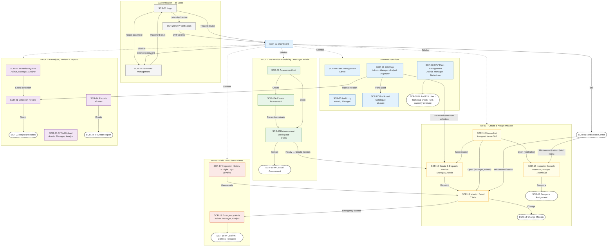
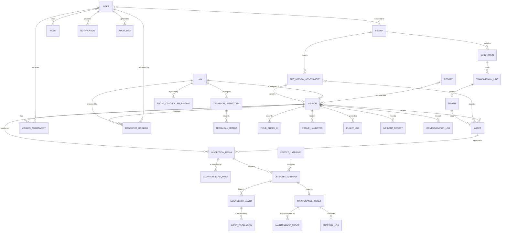

![][image1]

**CAPSTONE PROJECT REPORT**

**Report 3 – Software Requirements Specification**

Project: Integrated UAV-AI Inspection and Maintenance Management System for Electrical Infrastructure (UAV-PMS)

Group: GFA26SE66

– Ho Chi Minh City, October 2026 –

**Table of Contents**

- [I. Record of Changes](#record-of-changes)
- [II. Software Requirements Specification](#srs)
  - [1. Product Overview](#product-overview)
  - [2. User Requirements](#user-requirements)
    - [2.1 Actors](#actors)
    - [2.2 Use Cases](#use-cases)
  - [3. Functional Requirements](#functional-requirements)
    - [3.1 System Functional Overview](#system-functional-overview)
    - [3.2 MF01 – Pre-Mission Feasibility and Resource Readiness](#mf01)
    - [3.3 MF02 – Create and Assign Inspection Mission](#mf02)
    - [3.4 MF03 – Mission Execution and Field Inspection](#mf03)
    - [3.5 MF04 – AI Inspection and Defect Detection](#mf04)
    - [3.6 Common Functions](#cf)
  - [4. Non-Functional Requirements](#non-functional-requirements)
    - [4.1 External Interfaces](#external-interfaces)
    - [4.2 Quality Attributes](#quality-attributes)
  - [5. Requirement Appendix](#requirement-appendix)
    - [5.1 Business Rules](#business-rules)
    - [5.2 Common Requirements](#common-requirements)
    - [5.3 Application Messages List](#application-messages)
    - [5.4 Other Requirements](#other-requirements)
- [III. Literature Review](#iii.-literature-review)
- [IV. References](#iv.-references)

**ABBREVIATIONS**

| Acronym | Meaning |
| :------- | :------------------------------------ |
| AI | Artificial Intelligence |
| AMQP | Advanced Message Queuing Protocol (used by RabbitMQ) |
| API | Application Programming Interface |
| BR | Business Rule identifier (Section 5.1) |
| CF | Common Function identifier (Section 3.6) |
| CR | Common Requirement identifier (Section 5.2) |
| DETR | DEtection TRansformer |
| DLQ | Dead-Letter Queue |
| ERD | Entity Relationship Diagram |
| EVN | Vietnam Electricity |
| EXIF | Exchangeable Image File Format (image metadata) |
| FC | Flight Controller |
| GIS | Geographic Information System |
| gRPC | Google Remote Procedure Call (internal service call over HTTP/2) |
| JWT | JSON Web Token |
| mAP | mean Average Precision |
| MF | Main Flow identifier; MF01–MF04 name the four project main flows |
| MQTT | Message Queuing Telemetry Transport |
| MSG | Application message identifier (Section 5.3) |
| NFR | Non-Functional Requirement |
| NS | Non-Screen function identifier (Section 3.1.4) |
| OTP | One-Time Password |
| RPO / RTO | Recovery Point Objective / Recovery Time Objective |
| SCR | Screen identifier (Section 3.1.2) |
| SDI / SCI | The two YOLO11s-based improved detection models evaluated in the AI research |
| SRS | Software Requirements Specification |
| TLS | Transport Layer Security |
| UAV | Unmanned Aerial Vehicle |
| UAV-PMS | Integrated UAV-AI Inspection and Maintenance Management System for Electrical Infrastructure |
| UC | Use Case identifier |
| UID | Unique Identifier (flight-controller hardware ID) |
| UTC | Coordinated Universal Time |
| WBS | Work Breakdown Structure (Report 2, Table 1) |
| WKT | Well-Known Text (geometry format) |
| YOLO | You Only Look Once |

# I. Record of Changes {#record-of-changes}

| Date | A\*, M, D | In charge | Change Description |
| :---- | :---- | :---- | :---- |
| 24/09/2026 | A | Nguyễn Quốc Khánh | Created SRS draft v0.1 from Report 1, MF01–MF04, the supplied use-case diagrams and the verified backend behaviour. |
| 07/10/2026 | M | SE193338 – Nguyễn Nhật An | Unified actor names; redrew the context, use-case, screen-flow and ER diagrams; renumbered use cases and aligned them with the Report 2 WBS; added Common Functions. |
| 07/10/2026 | A | SE193338 – Nguyễn Nhật An | Added the screen list, screen authorization, non-screen functions, entity descriptions and detailed use-case specifications. |
| 07/10/2026 | M | SE193338 – Nguyễn Nhật An | Revised NFRs to measurable targets, aligned AI rules with the seven-class dataset and the YOLO11s/SDI/SCI/StructDETR models, reorganized business rules and messages, and added traceability and state tables. |
| 14/10/2026 | M | SE193338 – Nguyễn Nhật An | v0.3 – Aligned the SRS with the implemented backend (commit 124d764): microservices, six system roles, e-mail/OTP login, Region–Substation–Line–Tower–Asset hierarchy, UAV status model and flight-controller pairing, automatic assessment evaluation with GIS suitability, combined create-and-dispatch of missions, mission/assignment/booking states, MQTT topics, media ingestion with EXIF, Vision Bridge, RabbitMQ AI pipeline with gRPC severity evaluation, analyst review with automatic maintenance tickets, reports and system settings. |
| 14/10/2026 | D | SE193338 – Nguyễn Nhật An | v0.3 – Removed username login and account lockout, the Needs Review assessment result and override, automatic weather thresholds, flight altitude/speed parameters, the Field Completed state, the assignment Expired state, confidence-based auto-acceptance/discarding, Edge-Device metric import and the technical-inspection expiry job. |
| 24/10/2026 | D | SE193338 – Nguyễn Nhật An | v0.4 – Removed the Asset Health feature from the scope: asset health index, risk level, health history (CONDITION_HISTORY), health penalty on confirmed defects and health recovery on ticket closure. SCR-07 is now the Grid Asset Catalogue. |
| 24/10/2026 | A | SE193338 – Nguyễn Nhật An | v0.4 – Added the use-case specifications of MF02 (Section 3.3), MF03 (Section 3.4), MF04 (Section 3.5) and the Common Functions (Section 3.6). |
| 24/10/2026 | M | SE193338 – Nguyễn Nhật An | v0.4 – Reformatted the whole report (headings, tables, captions, numbering); re-aligned MF01, business rules, messages, configuration parameters and state tables with the backend (commit 7a90ab8); marked UC-CF-03 and UC-MF03-04 as deferred. |
| 24/10/2026 | M | SE193338 – Nguyễn Nhật An | v0.5 – Redrew the screens flow (Figure 8) and rewrote the screen descriptions and authorization matrix from the current web-client routes and role guards; replaced formula-level wording in BR-17, BR-21, BR-23, BR-53 and UC-MF01-02/05 with plain descriptions; aligned role, state and notification statements with the backend. |

\*A – Added, M – Modified, D – Deleted

# II. Software Requirements Specification {#srs}

## 1. Product Overview {#product-overview}

UAV-PMS is a web-based system that supports UAV-assisted inspection of electrical infrastructure for the EVN southern business unit described in Report 1. The system manages an inspection from the pre-mission readiness assessment, through mission assignment and field execution, to AI-based defect detection, analyst review and maintenance follow-up.

The product covers four main flows and a set of common functions:

- **MF01 – Pre-Mission Feasibility and Resource Readiness.** Defines the inspection scope (region, target assets and an optional boundary) and the planned window, then automatically evaluates site feasibility, personnel eligibility and UAV readiness (operational availability, technical health and GIS scope suitability). The result is Ready or Not Ready.
- **MF02 – Create and Assign Inspection Mission.** Creates a mission from a Ready assessment with priority and objective, assigns eligible personnel and a UAV, reserves them with resource bookings, dispatches the mission and tracks each assignee’s acceptance or postponement. Supports later changes: cancel, suspend, resume, postpone, reassign personnel, change the UAV and change the priority.
- **MF03 – Mission Execution and Field Inspection.** Supports field check-in, UAV handover and return, mission start and completion, live UAV status through MQTT, inspection media upload with EXIF metadata, flight logs, field incident reports and edge AI emergency alerts.
- **MF04 – AI Inspection and Defect Detection.** Sends every uploaded media file to the AI service through RabbitMQ, stores detections with category, bounding box and confidence, evaluates severity and priority through the internal Inspection Evaluation service, supports analyst review and reanalysis, creates maintenance tickets for confirmed defects and produces defect reports (PDF/Excel).
- **Common Functions (CF).** Login with OTP, user accounts and geographic scope, the infrastructure asset catalogue, the UAV inventory and flight-controller pairing, notifications, the audit log and system settings.

UAV-PMS uses two AI processing modes, consistent with Report 1 (FE-03) and Report 2 (MF03-06, MF04-04 to MF04-07):

- **Edge/Fast mode.** A YOLO-based model on the UAV’s onboard computer (Raspberry Pi) detects suspected anomalies during flight and sends them to the Vision Bridge API (UC-MF03-07). Analysis requests can also be routed to the edge model queue (preferred model `EDGE` or `YOLO11`).
- **Server/Deep mode.** After upload, the AI service analyses the full-resolution media with the model selected by the AI research (StructDETR candidate; if StructDETR is not stable by 15 November 2026, the best YOLO11s, SDI or SCI model is used) (UC-MF04-02). `SERVER` is the default preferred model.

The backend consists of ASP.NET Core 9 microservices behind an Ocelot API gateway:

| Service | Responsibility |
| :------- | :------------------------------------ |
| Identity Service | Authentication, OTP, trusted devices, refresh tokens, user accounts and roles. |
| Operations Service | Regions, substations, lines, towers, assets, UAVs, assessments, missions, field execution, media, alerts, maintenance, reports, audit log and system settings. |
| AI Inspection Service | AI analysis orchestration (RabbitMQ), result consumption and the Vision Bridge for edge detections. |
| Notification Service | In-app and e-mail notifications, the SignalR hub and the Hangfire background jobs. |
| Inspection Evaluation Service | Internal gRPC service that calculates severity, risk level, priority score and the immediate-alert decision of a detection. |

The services share one PostgreSQL/PostGIS database, use Redis for UAV live state and OTP data, and communicate asynchronously through RabbitMQ.

The system does **not** control the UAV in flight, generate flight waypoints, perform physical repair, certify UAV hardware, calculate long-term asset health or replace aviation licensing and safety procedures. Flight control and flight-condition decisions remain with the flight controller and the pilot.

Figure 1 shows the system boundary, the external entities and the data exchanged with them. Each external entity is described as an actor in Table 1.

![][image2]

**Figure 1.** *UAV-PMS system context.*

## 2. User Requirements {#user-requirements}

### 2.1 Actors {#actors}

UAV-PMS has five human actors and four system actors. All human actors specialize the generic User actor (Figure 2), so they share the functions Log In (UC-CF-01) and View Notifications (UC-CF-06). A user account may hold more than one role; the actor is determined by the role used for the action.

![][image3]

**Figure 2.** *Generalization of human actors.*

**Table 1.** *UAV-PMS actors.*

| # | Actor | System role | Type | Description |
| :---- | :---- | :---- | :---- | :---- |
| 1 | System Administrator | `SystemAdmin` | Human | Manages user accounts, roles, geographic scopes and system settings; has access to every function and region; reviews the audit log. |
| 2 | Mission Manager | `Manager` | Human | Maintains infrastructure assets and the UAV inventory, creates readiness assessments, creates and dispatches missions, changes missions, monitors field execution, requests reanalysis, manages maintenance tickets and approves reports. Limited to the regions in their geographic scope. |
| 3 | Inspector | `Inspector` | Human | Field operator who also acts as the UAV pilot. Responds to assignments, checks in, receives and returns the UAV, starts and completes the mission, uploads media and flight logs and reports field incidents. |
| 4 | Analyst | `Analyst` | Human | Reviews AI detections (confirm or reject), reviews and escalates emergency alerts, requests reanalysis and prepares reports. |
| 5 | UAV Technician | `Technician` (alias `MaintenanceTechnician`) | Human | Records UAV technical inspections, pairs flight controllers with UAVs, maintains UAV records and executes maintenance tickets (status, proof, materials). |
| 6 | Edge Device | – | System | The UAV’s onboard computer (Raspberry Pi with camera, GPS and flight-controller link). Publishes UAV status and telemetry through MQTT and sends edge AI detections with images to the Vision Bridge API. |
| 7 | Cloud AI Service | – | System | Server-side AI inference service (FastAPI). Consumes analysis requests from RabbitMQ and returns processing status and detections through the result queue. |
| 8 | Map Service | – | System | Leaflet with OpenStreetMap tiles; provides the base map for towers, assets, assessment boundaries, mission targets and live UAV positions. |
| 9 | Notification Provider | – | System | E-mail services: SendGrid for notification e-mails and Brevo for OTP and password-reset e-mails. In-app notifications are produced by UAV-PMS itself. |

### 2.2 Use Cases {#use-cases}

#### 2.2.1 Diagrams

The use cases are grouped into five diagrams: the common functions (Figure 3) and one diagram for each main flow (Figure 4 – Figure 7). Each use case is labelled with the identifier used in Table 2 and in Sections 3.2–3.6. A use case reused by another flow is shown in both diagrams with its original identifier; for example, UC-MF02-02 includes UC-MF01-03 in Figure 5.

![][image4]

**Figure 3.** *Use case diagram – Common Functions.*

![][image5]

**Figure 4.** *Use case diagram – MF01 Pre-Mission Feasibility and Resource Readiness.*

![][image6]

**Figure 5.** *Use case diagram – MF02 Create and Assign Inspection Mission.*

![][image7]

**Figure 6.** *Use case diagram – MF03 Mission Execution and Field Inspection.*

![][image8]

**Figure 7.** *Use case diagram – MF04 AI Inspection and Defect Detection.*

#### 2.2.2 Descriptions

Table 2 describes every use case in Figure 3 – Figure 7. The WBS column links each use case to the work item in Report 2, Table 1. The AI model training and evaluation items (MF04-04 to MF04-07) are research work and have no use case. Use cases marked *Deferred* appear in the diagrams but are not part of the current release.

**Table 2.** *Use case descriptions.*

| ID | Use Case | Primary Actor(s) | Secondary Actor(s) | Description | WBS |
| :---- | :---- | :---- | :---- | :---- | :---- |
| UC-CF-01 | Log In | User | Notification Provider | Authenticate with e-mail and password; on an untrusted device verify an e-mailed OTP; reset or change the password. | CF-01 |
| UC-CF-02 | Manage User Accounts | System Administrator | – | Create, update, suspend and delete accounts and assign one or more roles. | CF-02 |
| UC-CF-03 | Manage Personnel Qualifications | System Administrator | – | *Deferred.* Record each person’s qualifications with validity dates. | CF-02 |
| UC-CF-04 | Manage Infrastructure Assets | System Administrator, Mission Manager | Map Service | Maintain regions, substations, lines, towers and asset components with coordinates; import towers from Excel; browse the grid asset catalogue. | CF-03 |
| UC-CF-05 | Manage UAV Inventory | Mission Manager, UAV Technician, System Administrator | – | Maintain UAV records and operational status; pair a flight controller (Betaflight UID) with a UAV. | CF-04 |
| UC-CF-06 | View Notifications | User | – | Receive in-app notifications in real time, mark them as read and open the linked record. | CF-05 |
| UC-CF-07 | View Audit Log | System Administrator, Mission Manager | – | Search audit records of data changes and business actions. | CF-05 |
| UC-CF-08 | Manage System Settings | System Administrator | – | View and change the configurable thresholds (Table 57). | CF-05 |
| UC-MF01-01 | Create Readiness Assessment | Mission Manager | Map Service | Define the region, planned window, target assets and optional boundary; the assessment is evaluated immediately (includes UC-MF01-02). | MF01-01 |
| UC-MF01-02 | Evaluate Pre-Mission Readiness | Mission Manager | – | Run the site, personnel and UAV checks and obtain Ready or Not Ready; re-evaluate an assessment. | MF01-05, MF01-06 |
| UC-MF01-03 | Check Personnel Availability and Eligibility | – (included) | – | Included by UC-MF01-02 and UC-MF02-02. List field personnel who are active, in scope, hold a field role and are not booked in the window. | MF01-02 |
| UC-MF01-04 | Check UAV Availability and Technical Readiness | – (included) | – | Included by UC-MF01-02 and UC-MF02-03. List UAVs that are available, not booked, technically healthy and suitable for the scope. | MF01-03 |
| UC-MF01-05 | Record UAV Technical Inspection | UAV Technician | Edge Device | Record the checklist or metrics, verify the paired flight controller and obtain Passed or Failed with a technical health. | MF01-04 |
| UC-MF01-06 | View Readiness Assessment Result | Mission Manager | – | View the overall result and the reason of each component; cancel the assessment or hand it over to MF02. | MF01-06 |
| UC-MF02-01 | Create Inspection Mission | Mission Manager | – | Create a mission from a Ready assessment with title, priority, objective, personnel and UAV (includes UC-MF02-02, UC-MF02-03, UC-MF02-04). | MF02-01 – MF02-03 |
| UC-MF02-02 | Assign Personnel to Mission | Mission Manager | – | Assign eligible personnel with a mission role and required flag; add, remove or reassign later (includes UC-MF01-03). | MF02-04 |
| UC-MF02-03 | Assign UAV to Mission | Mission Manager | – | Assign an available, healthy and unbooked UAV; change it before the start (includes UC-MF01-04). | MF02-05 |
| UC-MF02-04 | Dispatch Mission | – (included) | Notification Provider | Reserve resources with bookings, set the mission to Pending Acceptance and notify the assignees. | MF02-06 |
| UC-MF02-05 | Preview Mission Targets on Map | Mission Manager, Inspector | Map Service | Display the mission targets in sequence, their towers and the scope boundary on the map. | MF02-07 |
| UC-MF02-06 | View Assigned Mission | Inspector | – | View the scope, schedule, instructions and assigned UAV of own missions. | MF02-08 |
| UC-MF02-07 | Respond to Mission Assignment | Inspector | – | Accept the assignment, or postpone it with a reason. | MF02-08 |
| UC-MF02-08 | Monitor Assignment Status | Mission Manager | Notification Provider | Track responses and the confirmation deadline, send reminders and messages. | MF02-06 |
| UC-MF02-09 | Change Dispatched Mission | Mission Manager | Notification Provider | Cancel, suspend, resume, postpone, reassign personnel, change the UAV or change the priority with re-validation. | MF02-09 |
| UC-MF03-01 | Check In at Mission Site | Inspector | – | Record arrival at the site after accepting the assignment. | MF03-01 |
| UC-MF03-02 | Confirm UAV Handover | Inspector | – | Receive custody of the assigned UAV with its condition, and return it after the flight. | MF03-02\* |
| UC-MF03-03 | Start Mission Execution | Inspector | – | Start a ready mission; the UAV becomes Flying and the mission In Progress. | MF03-02 |
| UC-MF03-04 | Record Asset Inspection Progress | Inspector | – | *Deferred.* Mark each mission target as Inspected or Skipped. | MF03-05 |
| UC-MF03-05 | Transmit Telemetry and Field Media | Edge Device, Inspector | – | Publish UAV status and telemetry through MQTT; upload inspection images and videos with EXIF/GPS metadata. | MF03-03, MF03-04 |
| UC-MF03-06 | Monitor Field Execution | Mission Manager | Map Service | View live UAV state, mission lifecycle events, communications and alerts. | MF03-03 |
| UC-MF03-07 | Report Critical Anomaly | Edge Device, Inspector | Notification Provider | Send an edge AI detection, trigger an emergency alert or file a field incident report. | MF03-06 |
| UC-MF03-08 | Handle Critical Alert | Analyst | Mission Manager | Review an emergency alert (confirm or dismiss) or escalate it to a responsible user. | MF03-06 |
| UC-MF03-09 | Finish Field Inspection | Inspector | – | Submit the flight log and complete the mission; the UAV becomes Idle and the bookings are released. | MF03-07 |
| UC-MF04-01 | Submit Inspection Data | Inspector | – | Upload media for a mission target; each valid file is queued for analysis automatically (includes UC-MF04-02). | MF04-01, MF04-02 |
| UC-MF04-02 | Process AI Analysis | – (included) | Cloud AI Service | Create an analysis request, publish it to the AI queue, receive the result, evaluate each detection and store it. | MF04-03 |
| UC-MF04-03 | Monitor AI Processing Status | Inspector, Analyst, Mission Manager | – | Track analysis requests in Pending, Processing, Completed or Failed state. | MF04-03 |
| UC-MF04-04 | View AI Analysis Results | Mission Manager, Inspector, Analyst | – | View detections with category, bounding box, confidence, severity and review status on the image. | MF04-08 |
| UC-MF04-05 | Review AI Detections | Analyst | – | Confirm or reject detections; a confirmed detection creates a maintenance ticket. | MF04-09, MF04-11 |
| UC-MF04-06 | Request Media Reanalysis | Analyst, Mission Manager | Cloud AI Service | Request a new analysis of existing media with a model and analysis type (includes UC-MF04-02). | MF04-10 |
| UC-MF04-07 | View Defect Report and Export | Mission Manager, Analyst, Inspector | – | Create, submit and approve defect reports, view statistics and export PDF or Excel. | MF04-12 |
| UC-MF04-08 | Manage Maintenance Ticket | Mission Manager, UAV Technician | – | Create, execute (status, proof, materials) and close maintenance tickets for confirmed defects. | MF04-11 |

\*UAV handover has no separate item in Report 2, Table 1; it is estimated inside MF03-02.

## 3. Functional Requirements {#functional-requirements}

### 3.1 System Functional Overview {#system-functional-overview}

#### 3.1.1 Screens Flow

Figure 8 shows the screens of the Angular web client and how users move between them. All users sign in on SCR-01; on an untrusted device they confirm an e-mailed OTP on SCR-28. Every user then lands on SCR-02 Dashboard. The sidebar of SCR-02 shows only the modules allowed for the user’s role (Table 4), so each role follows its own path:

- **System Administrator:** user accounts (SCR-04), audit log (SCR-25), and every operational screen of the Mission Manager.
- **Mission Manager:** readiness assessments (SCR-09, SCR-10) → mission creation and dispatch (SCR-12) → mission follow-up (SCR-13, SCR-14) → emergency alerts (SCR-19), AI review (SCR-21, SCR-22) and reports (SCR-24).
- **Inspector, Analyst and UAV Technician (field roles):** assigned missions (SCR-11, *Assigned to me* tab) → Inspector Console (SCR-15) to accept or postpone the assignment. The Inspector then executes the mission and uploads data on SCR-13. The Analyst reviews detections (SCR-22, SCR-21) and alerts (SCR-19). The Technician maintains the UAV fleet (SCR-08) and works on maintenance tickets (SCR-26).

Notation used in Figure 8:

- Rectangles are pages with their own route; a rectangle divided into rows is a page with tabs.
- Dashed ellipses are dialogs and pop-overs.
- Dashed frames group the screens by Common Functions and MF01–MF04. A dashed arrow from SCR-02 is a sidebar entry; the roles that see each page are written under its name.

**Figure 8.** *UAV-PMS screens flow. The draw.io version is `docs/diagrams/Screen_Flow_Diagram-Page-2.drawio.svg`.*

#### 3.1.2 Screen Descriptions

Table 3 describes each screen in Figure 8 and the use cases it serves. Live UAV monitoring (SCR-18) and maintenance tickets (SCR-26) are not separate pages; they are parts of SCR-13 Mission Detail.

**Table 3.** *Screen descriptions.*

| ID | Feature | Screen | Route | Description | Use Case(s) |
| :---- | :---- | :---- | :---- | :---- | :---- |
| SCR-01 | CF | Login | `/login` | E-mail and password entry. Opens SCR-28 when the device is not trusted, or the change-password page when the password must be changed. | UC-CF-01 |
| SCR-02 | CF | Dashboard | `/dashboard` | Home page of every role: active emergency alerts, mission status overview, defect statistics and recent defects. The sidebar shows only the modules of the user’s role. | UC-CF-01 |
| SCR-03 | CF | Notification Center | Header pop-over | Real-time notification list with unread count, filters, mark as read and a link to the related mission. | UC-CF-06 |
| SCR-04 | CF | User Management | `/admin/users` | User list with search and filters; dialogs to create and edit accounts, change the role, unlock and reset the password. | UC-CF-02 |
| SCR-06 | CF | GIS Map | `/gis` | Map of lines, towers, defects and alerts with layer toggles and filters. Selecting assets on the map can start a new mission (SCR-12); a detail drawer opens the asset (SCR-07) or the detection (SCR-21). | UC-CF-04, UC-MF02-05 |
| SCR-07 | CF | Grid Asset Catalogue | `/assets`, `/assets/:id` | List of grid assets with code, type, tower, line and operational status, and a detail drawer with technical data and linked defects. | UC-CF-04 |
| SCR-08 | CF / MF01 | UAV Fleet Management | `/drones` | UAV list with operational status and technical health. Dialogs to add, edit and delete a UAV, run the technical check (optionally reading the flight controller) and estimate the GIS coverage of a UAV. | UC-CF-05, UC-MF01-05 |
| SCR-09 | MF01 | Assessment List | `/pre-mission` | Assessments with code, region, planned window and status; filters; open, re-evaluate and cancel actions. | UC-MF01-01, UC-MF01-06 |
| SCR-10 | MF01 | Create Assessment / Assessment Workspace | `/pre-mission/new`, `/pre-mission/:id` | **Create:** one form with scope (region, line, towers on the map), time window, GIS boundary, required personnel and a summary. **Workspace:** 5 tabs – Overview & scope map, Line layout & weather, Personnel candidates, UAV candidates, Technical check – with readiness cards, a cancel dialog and the *Create mission* button when the result is Ready. | UC-MF01-01 – UC-MF01-06 |
| SCR-11 | MF02 | Mission List | `/missions` | Two tabs: *Assigned to me* and *All missions*; filters by status and priority. Managers open SCR-13; field roles open SCR-15. | UC-MF02-06, UC-MF02-08 |
| SCR-12 | MF02 | Create & Dispatch Mission | `/missions/new` | Mission form filled from a Ready assessment (or from a GIS selection): scope and readiness, resource assignment (Inspector, Analyst, Technician, UAV) with a conflict check and map preview, deadline and instructions; *Dispatch*. | UC-MF02-01 – UC-MF02-04 |
| SCR-13 | MF02 / MF03 / MF04 | Mission Detail | `/missions/:id` | 7 tabs: Overview (mission data, team, target map and live UAV telemetry), Upload data, AI processing, AI results, Target assets, Maintenance and Activity. Actions: start and complete the flight, send a reminder, and the change dialogs of SCR-14. | UC-MF02-05, UC-MF02-08, UC-MF03-03, UC-MF03-06, UC-MF03-09, UC-MF04-01, UC-MF04-03, UC-MF04-04 |
| SCR-14 | MF02 | Change Mission Dialogs | Dialogs in SCR-13 | Postpone, suspend, resume, cancel, reassign a role and change the priority, each with a reason. | UC-MF02-09 |
| SCR-15 | MF02 | Inspector Console | `/missions/:id/inspector` | Field view of an assigned mission: accept the assignment, UAV specification, pre-flight checklist, route map and tower list. | UC-MF02-06, UC-MF02-07 |
| SCR-16 | MF02 | Postpone Assignment Dialog | Dialog in SCR-15 | Reason for postponing or rescheduling an assignment. | UC-MF02-07 |
| SCR-17 | MF03 | Inspection History & Flight Logs | `/inspections` | Inspection records with result and filters; each row opens the AI results of the mission. | UC-MF03-05, UC-MF03-09 |
| SCR-18 | MF03 | Live Monitoring | Overview tab of SCR-13 | Telemetry panel and map with the latest UAV position, altitude, battery, speed and heading. | UC-MF03-06 |
| SCR-19 | MF03 | Emergency Alerts | `/emergency-alerts` | Two tabs: *Active alerts* and *Alert & review history*, with evidence image; dialogs to confirm, dismiss or escalate. | UC-MF03-07, UC-MF03-08 |
| SCR-20 | MF04 | AI Trial Upload | `/ai-analysis/upload` | Two tabs: image analysis and video analysis. Trial upload outside a mission; results are shown but not stored. | UC-MF04-03 |
| SCR-21 | MF04 | Detection Review | `/ai-review/:id` | Image with bounding box, category, confidence and severity; approve, or reject with a reason (SCR-23). | UC-MF04-04, UC-MF04-05 |
| SCR-22 | MF04 | AI Review Queue | `/ai-review` | Detections by review status (Pending, Confirmed, Rejected) in grid or table view. | UC-MF04-05 |
| SCR-23 | MF04 | Reject Detection Dialog | Dialog in SCR-21 | Reason for rejecting a detection. | UC-MF04-05 |
| SCR-24 | MF04 | Reports | `/reports` | Report list filtered by type and status; create report dialog; submit, approve and download. | UC-MF04-07 |
| SCR-25 | CF | Audit Log | `/system/audit-logs` | Audit records with filters, search and CSV export; detail dialog with the change comparison and raw data. | UC-CF-07 |
| SCR-26 | MF04 | Maintenance Tickets | Maintenance tab of SCR-13 | Tickets created from confirmed defects with status, technician, due date and proof. | UC-MF04-08 |
| SCR-27 | CF | Password Management | `/forgot-password`, `/reset-password`, `/change-password` | Request an OTP, reset a forgotten password, or change the password. | UC-CF-01 |
| SCR-28 | CF | OTP Verification | `/otp` | Six-digit OTP entry with resend for login and password reset. | UC-CF-01 |

*SCR-05 Personnel Qualifications is deferred together with UC-CF-03. UC-CF-08 Manage System Settings has no screen in the current release; it is performed through the System Settings API (Section 3.6.8).*

#### 3.1.3 Screen Authorization

Table 4 states which actor may open each screen. *X* = full access, *V* = view only, *own* = only missions the user is assigned to, blank = no access. Each user has one role. Access is checked by the web client (route guards) and again by the backend role and geographic-scope checks (BR-01, BR-02).

**Table 4.** *Screen authorization matrix.*

| Screen | System Administrator | Mission Manager | Inspector | Analyst | UAV Technician |
| :---- | :----: | :----: | :----: | :----: | :----: |
| SCR-01 – SCR-03, SCR-27, SCR-28 | X | X | X | X | X |
| SCR-04 User Management | X | | | | |
| SCR-06 GIS Map | X | X | V | V | |
| SCR-07 Grid Asset Catalogue | V | V | V | V | V |
| SCR-08 UAV Fleet Management | X | X | | | X |
| SCR-09, SCR-10 Assessment List / Workspace | X | X | | | |
| SCR-11 Mission List | X | X | V (own) | V (own) | V (own) |
| SCR-12 Create Mission, SCR-14 Change Mission | X | X | | | |
| SCR-13 Mission Detail (incl. SCR-18) | X | X | X (own: start, complete, upload) | V (own) | V (own) |
| SCR-15 Inspector Console, SCR-16 Postpone | | | X (own) | X (own) | X (own) |
| SCR-17 Inspection History | V | V | V | V | V |
| SCR-19 Emergency Alerts | X | X | | X | |
| SCR-20 AI Trial Upload | X | X | | X | |
| SCR-21 – SCR-23 AI Review | X | V | | X | |
| SCR-24 Reports | X (approve) | X (approve) | X (create, submit) | X (create, submit) | X (create, submit) |
| SCR-25 Audit Log | X | V | | | |
| SCR-26 Maintenance Tickets | X | X | V (own) | V (own) | X (own tickets) |

#### 3.1.4 Non-Screen Functions

Table 5 lists the functions that run without a user screen: background jobs, message consumers and integrations.

**Table 5.** *Non-screen functions.*

| ID | Feature | System Function | Description | Use Case |
| :---- | :---- | :---- | :---- | :---- |
| NS-01 | MF01 | Assessment Expiry Job | Operations Service background job, every 2 minutes: sets Ready assessments whose validity has passed to Expired. The same expiry rule is applied whenever an assessment is read, evaluated or used (BR-17). | UC-MF01-02 |
| NS-02 | MF02 | Mission Confirmation Overdue Job | Hangfire job, every minute: for a Pending Acceptance mission whose confirmation deadline has passed, notifies the manager (`MISSION_CONFIRMATION_OVERDUE`), writes an OVERDUE communication log and sends a real-time event, once per mission (BR-31). | UC-MF02-08 |
| NS-03 | CF | Notification Dispatcher | RabbitMQ consumers that turn integration events (mission created, mission dispatched, defect detected, maintenance ticket assigned, notification push, AI status changed) into in-app notifications, and the Hangfire job `push-notifications-sync` (every minute) that e-mails unsent notifications through SendGrid (BR-46). | UC-CF-06 |
| NS-04 | MF03 | MQTT Drone Consumer | Subscribes to `uav/+/status` and `uav/+/telemetry`, validates the UAV code and stores the latest UAV live state in Redis for 30 seconds (BR-39). | UC-MF03-05 |
| NS-05 | CF | Outbox Dispatcher | Publishes integration events stored in the outbox table (for example media uploaded, mission created from assessment, defect confirmed) to the RabbitMQ topic exchange. | UC-MF02-04, UC-MF04-01 |
| NS-06 | MF03 | Vision Bridge Ingestion | Receives edge AI detections (UAV, class, confidence, bounding box, GPS, image) for a UAV on an In Progress mission, stores the media and detection and notifies the mission manager and inspector (BR-42). | UC-MF03-07 |
| NS-07 | MF04 | AI Request Publisher | Consumes the media-uploaded event, creates an analysis request and publishes it to the server or edge, image or video request queue (BR-49). | UC-MF04-02 |
| NS-08 | MF04 | AI Result Consumer | Consumes AI results, validates them, evaluates each detection through NS-10, stores the detections, retries transient errors and moves failed messages to the dead-letter queue (BR-50 – BR-52). | UC-MF04-02 |
| NS-09 | CF | Audit Logger | Records inserts, updates and soft deletes of audited entities with user, table, record, old and new values, IP address and user agent, plus explicit business actions (BR-06). | UC-CF-07 |
| NS-10 | MF04 | Inspection Evaluation (gRPC) | Calculates severity, risk level, priority score and the immediate-alert decision of a detection (BR-53). | UC-MF04-02 |
| NS-11 | CF | Real-time Relay | Pushes assessment, mission-lifecycle and AI-status events to SignalR groups (user, mission, assessment). | UC-MF01-02, UC-MF03-06, UC-MF04-03 |
| NS-12 | CF | Housekeeping Jobs | `daily-summary-job` (daily summary to administrators and managers) and `auto-cleanup-job` (weekly removal of old temporary files and expired refresh tokens). | UC-CF-06 |

#### 3.1.5 Entity Relationship Diagram

Figure 9 is the conceptual ERD of UAV-PMS in crow’s-foot notation. It shows the business entities and their relationships and omits keys and technical tables (outbox, refresh tokens, trusted devices). Table 6 describes each entity.

**Figure 9.** *UAV-PMS conceptual entity relationship diagram.*

**Table 6.** *Conceptual entity descriptions.*

| # | Entity | Description |
| :---- | :---- | :---- |
| 1 | REGION | Management region that groups substations and defines the geographic scope of users, assessments and missions. |
| 2 | SUBSTATION | Substation in a region; the origin of transmission lines. |
| 3 | TRANSMISSION_LINE | Power line identified by code and voltage level. |
| 4 | TOWER | Tower on a line, identified by code and WGS 84 coordinates. |
| 5 | ASSET | Inspectable component on a tower (insulator string, conductor, surge arrester, cross-arm…) with type, code and operational status. |
| 6 | USER | Account with e-mail, password hash, status and profile. |
| 7 | ROLE | System role: SystemAdmin, Manager, Inspector, Analyst, Technician (MaintenanceTechnician). |
| 8 | PRE_MISSION_ASSESSMENT | Readiness assessment with region, planned window, target assets, boundary, component results, candidates, status and validity. |
| 9 | MISSION | Inspection mission with code, title, priority, objective, planned window, targets, UAV, status and the link to its assessment. |
| 10 | MISSION_ASSIGNMENT | Assignment of a user to a mission with mission role, required flag and response (Pending, Accepted, Postponed). |
| 11 | RESOURCE_BOOKING | Reservation of a user or UAV for a time window (Active, Released, Cancelled), used for conflict detection. |
| 12 | UAV | Drone with code, model, serial number, operational status, flight status, technical health, battery and endurance. |
| 13 | TECHNICAL_INSPECTION | Technical inspection of a UAV with result (Passed/Failed), technical health and validity. |
| 14 | TECHNICAL_METRIC | Checklist item or measured metric of an inspection with subsystem, value, critical flag and result. |
| 15 | FLIGHT_CONTROLLER_BINDING | Pairing between a flight-controller hardware UID and a UAV, with active flag and last-seen time. |
| 16 | FIELD_CHECK_IN | Check-in of an assigned user at the mission site. |
| 17 | DRONE_HANDOVER | Custody of the UAV given to a mission member (Accepted/Rejected) and its return with condition. |
| 18 | FLIGHT_LOG | GPS track, flight duration, maximum altitude, minimum battery and connection status of a flight. |
| 19 | INCIDENT_REPORT | Field incident with type, severity, description and optional evidence file. |
| 20 | COMMUNICATION_LOG | Messages and system events (dispatch, reminder, overdue, emergency) exchanged on a mission. |
| 21 | INSPECTION_MEDIA | Uploaded image or video with capture time, GPS position, target asset and review status. |
| 22 | AI_ANALYSIS_REQUEST | Analysis job for one media file with model, analysis type, status and result summary. |
| 23 | DETECTED_ANOMALY | Detection with category, bounding box, confidence, source, validation status and analyst notes. |
| 24 | DEFECT_CATEGORY | Canonical defect class with code, name and emergency-class flag. |
| 25 | EMERGENCY_ALERT | Emergency alert raised from a critical detection with priority, status, reviewer and notes. |
| 26 | ALERT_ESCALATION | Escalation of an alert to a responsible user with reason. |
| 27 | MAINTENANCE_TICKET | Work order for a confirmed defect with code, priority, technician, due date and status. |
| 28 | MAINTENANCE_PROOF | Repair evidence photo with technician notes. |
| 29 | MATERIAL_LOG | Material or component consumed by a ticket with quantity and unit. |
| 30 | REPORT | Defect or inspection report with type, scope, period, status and generated files. |
| 31 | NOTIFICATION | In-app notification with type, title, body, reference and read/pushed state. |
| 32 | AUDIT_LOG | Record of a data change or business action with user, time, old and new values and network origin. |

### Use case specification template

Sections 3.2–3.6 specify each use case in Table 2 with the same structure:

- **Specification table** – actors, trigger, preconditions, postconditions, priority, screens, business rules (Section 5.1), messages (Section 5.3) and backend API.
- **Normal flow**, **alternative flows** (A*n*) and **exceptions** (E*n*).
- **Screen layout** – the screenshot of the related screen.

Priority **High** marks the use cases required for the MF01–MF04 end-to-end demonstration. All API paths are relative to the gateway and start with `/api/v1` unless `/api/v2` is shown.

### 3.2 MF01 – Pre-Mission Feasibility and Resource Readiness {#mf01}

MF01 is the prerequisite of every inspection mission. It checks that the planned scope is valid, that eligible and unbooked field personnel exist, and that at least one technically ready UAV can cover the scope in the planned window. A mission can only be created from an assessment whose result is Ready (MF02).

#### 3.2.1 Create Readiness Assessment (UC-MF01-01)

**Table 7.** *UC-MF01-01 specification.*

| Item | Description |
| :------- | :------------------------------------ |
| Primary actor | Mission Manager (also System Administrator) |
| Secondary actor | Map Service |
| Trigger | The manager selects **“+ Tạo thẩm định mới”** on SCR-09, or opens `/pre-mission/new`. |
| Description | Create an assessment with region, planned window, target assets and an optional boundary; the system evaluates it immediately (includes UC-MF01-02). |
| Preconditions | The user is logged in as Mission Manager or System Administrator, is Active and has the region in their geographic scope. |
| Postconditions | An assessment is stored with policy version v2.0, evaluated, and its result is Ready or Not Ready. The audit log records `ASSESSMENT_CREATED`. |
| Priority | High |
| Screens | SCR-09, SCR-10 |
| Business rules | BR-01, BR-02, BR-14, BR-15, BR-16 |
| Messages | MSG-002, MSG-006, MSG-013, MSG-103, MSG-104, MSG-105 |
| API | `POST /api/v2/pre-mission-assessments` |

**Normal flow**

1. The manager opens SCR-10 (create form).
2. The manager selects the region; the map shows the towers and assets of that region.
3. The manager enters the planned start and end date-time.
4. The manager selects the target assets from the list or by clicking map markers.
5. Optionally, the manager draws the boundary polygon of the flight area.
6. The manager selects **“Khởi tạo & Đánh giá”**.
7. The system validates the input (BR-14, BR-15), stores the assessment with status Evaluating and runs UC-MF01-02 in the same request.
8. The system opens the assessment workspace (`/pre-mission/:id`) with the result.

**Alternative flows**

- **A1 – Repeated submission.** If the request carries an idempotency key that already exists, the system returns the existing assessment instead of creating a new one.

**Exceptions**

- **E1 – Invalid window.** The end is not after the start or is in the past: the system rejects the request (`INVALID_PLANNED_TIME`, MSG-002).
- **E2 – Empty or duplicate scope.** No asset or a repeated asset is selected (`INVALID_PROPOSED_SCOPE`, MSG-105).
- **E3 – Out of scope.** The region is not in the user’s scope (`REGION_MANAGEMENT_SCOPE_REQUIRED`, MSG-006) or an asset is not in the region (`ASSET_OUTSIDE_MANAGEMENT_SCOPE`, MSG-103).
- **E4 – Invalid asset.** An asset is inactive, has no coordinates or is outside the boundary (`ASSETS_INACTIVE`, `ASSET_MISSING_GEOLOCATION`, `ASSET_OUTSIDE_BOUNDARY`, MSG-104).
- **E5 – Invalid boundary.** The boundary is not a valid polygon or exceeds the size limits (`INVALID_GEOMETRY`, MSG-013).

**Screen layout**

> *[Screenshot: SCR-10 Create Assessment – `/pre-mission/new` – region selector, planned start/end, map with tower markers and boundary drawing, target asset checklist, button “Khởi tạo & Đánh giá”.]*

**Figure 10.** *Screen layout – Create Readiness Assessment.*

#### 3.2.2 Evaluate Pre-Mission Readiness (UC-MF01-02)

**Table 8.** *UC-MF01-02 specification.*

| Item | Description |
| :------- | :------------------------------------ |
| Primary actor | Mission Manager (also System Administrator) |
| Trigger | Automatically after UC-MF01-01; manually with **“Đánh giá lại”** on SCR-10. |
| Description | Evaluate the site, personnel and UAV components and set the overall result Ready or Not Ready with the reason of each failed component. |
| Preconditions | The assessment exists and is not Completed, Cancelled or Expired. |
| Postconditions | Personnel and UAV candidates are rebuilt; component results, overall status and validity (`ValidUntil`) are stored; the version is incremented; the audit log records `ASSESSMENT_EVALUATED`; a real-time `AssessmentStatusChanged` event is sent. |
| Priority | High |
| Screens | SCR-10 |
| Business rules | BR-15 – BR-21 |
| Messages | MSG-101, MSG-102, MSG-106, MSG-107 |
| API | `POST /api/v2/pre-mission-assessments/{id}/evaluate` (alias `/re-evaluate`) |

**Evaluation components**

| Component | Passes when |
| :------- | :------------------------------------ |
| Site | Every target asset is active, belongs to the region, has coordinates and lies inside the boundary (if any) (BR-15). |
| Personnel | At least one eligible Inspector, one eligible Analyst and one eligible Technician exist (BR-18, UC-MF01-03). |
| UAV | At least one UAV is eligible: available, unbooked, technically healthy and suitable for the scope (BR-20, BR-21, UC-MF01-04). |

Weather is not evaluated automatically; flight-condition decisions remain with the pilot.

**Normal flow**

1. The system checks that the assessment can be evaluated; if its validity or planned end has passed, it is set to Expired.
2. The system evaluates the site component.
3. The system rebuilds the personnel candidates (UC-MF01-03).
4. The system rebuilds the UAV candidates (UC-MF01-04).
5. The system sets the overall status: Ready if all components pass, otherwise Not Ready (BR-16).
6. The system sets how long the result stays valid (BR-17).
7. The system saves the result, writes the audit record and pushes the real-time event.
8. SCR-10 shows the overall badge, the component cards and enables **“Tạo nhiệm vụ bay”** when the result is Ready (MSG-101); otherwise it lists the reasons (MSG-102).

**Alternative flows**

- **A1 – Re-evaluation after a change.** After a technician records an inspection or personnel availability changes, the manager selects **“Đánh giá lại”** and the flow restarts at step 1.

**Exceptions**

- **E1 – Already used.** The assessment is Completed (`ASSESSMENT_ALREADY_COMPLETED`, MSG-107).
- **E2 – Cancelled.** The assessment is Cancelled (`ASSESSMENT_CANCELLED`, MSG-107).
- **E3 – Expired.** The validity or planned end has passed; the status becomes Expired (`ASSESSMENT_EXPIRED`, MSG-106).

**Screen layout**

> *[Screenshot: SCR-10 Assessment Workspace, Overview tab – overall status badge (Ready / Not Ready), validity countdown, component cards (Site, Personnel, UAV), button “Đánh giá lại”.]*

**Figure 11.** *Screen layout – Readiness evaluation (Overview tab).*

#### 3.2.3 Check Personnel Availability and Eligibility (UC-MF01-03)

**Table 9.** *UC-MF01-03 specification.*

| Item | Description |
| :------- | :------------------------------------ |
| Primary actor | – (included by UC-MF01-02 and UC-MF02-02); viewed by the Mission Manager |
| Trigger | Readiness evaluation; the manager opens the **“Ứng viên Nhân sự”** tab of SCR-10. |
| Description | List the field personnel and decide for each person whether they are eligible for the planned window and region. |
| Preconditions | The assessment has been evaluated. |
| Postconditions | Each candidate is stored with role, availability, eligibility and reason. |
| Priority | High |
| Screens | SCR-10 (Personnel Candidates tab) |
| Business rules | BR-02, BR-18, BR-19 |
| Messages | MSG-102 |
| API | Part of `GET /api/v2/pre-mission-assessments/{id}` |

**Eligibility criteria (BR-18)**

| Criterion | Rule | Reason code when failed |
| :---- | :---- | :---- |
| Account | Active and e-mail verified | `USER_INACTIVE` |
| Role | Inspector (Pilot), Analyst or Technician (MaintenanceTechnician); accounts with SystemAdmin or Manager role are excluded | `INVALID_ROLE` |
| Scope | Has a scope for the region or a global scope | `OUTSIDE_MANAGEMENT_SCOPE` |
| Schedule | No active booking overlapping the planned window (BR-19) | `SCHEDULE_CONFLICT` |

**Normal flow**

1. The manager opens the Personnel Candidates tab.
2. The system shows the role summary (eligible Inspectors, Analysts, Technicians) and the candidate table with name, role, scope, booking status and eligibility badge.
3. The manager checks that each required role has at least one eligible person.

**Alternative flows**

- **A1 – Filter by role.** The manager selects a role tab to show only that role.

**Exceptions**

- **E1 – Missing role.** No eligible person exists for a required role; the personnel component fails and the reason is shown (MSG-102).

**Screen layout**

> *[Screenshot: SCR-10, Personnel Candidates tab – role summary bar, role filter, candidate table with eligibility badge “Đủ điều kiện / Không đủ điều kiện”.]*

**Figure 12.** *Screen layout – Personnel candidates.*

#### 3.2.4 Check UAV Availability and Technical Readiness (UC-MF01-04)

**Table 10.** *UC-MF01-04 specification.*

| Item | Description |
| :------- | :------------------------------------ |
| Primary actor | – (included by UC-MF01-02 and UC-MF02-03); viewed by the Mission Manager and UAV Technician |
| Trigger | Readiness evaluation; the user opens the **“Ứng viên Thiết bị UAV”** tab of SCR-10. |
| Description | List the UAVs and decide for each one whether it is available, technically ready and able to cover the scope. |
| Preconditions | The assessment has been evaluated. |
| Postconditions | Each UAV candidate is stored with availability, technical health, suitability, estimated flights and reason. |
| Priority | High |
| Screens | SCR-10 (UAV Candidates tab), SCR-08 |
| Business rules | BR-12, BR-19, BR-20, BR-21, BR-22 |
| Messages | MSG-102 |
| API | Part of `GET /api/v2/pre-mission-assessments/{id}`; `GET /drones/eligible?assessmentId=`; `POST /drones/estimate-gis-scope` |

**Evaluation criteria**

| Criterion | Rule | Reason code when failed |
| :---- | :---- | :---- |
| Operational availability | Operational status Available and no overlapping active booking | `DRONE_NOT_AVAILABLE`, `SCHEDULE_CONFLICT` |
| Technical health | Health of the latest Passed inspection valid at the planned start (or the UAV’s stored health) is Healthy or Warning | `TECHNICAL_HEALTH_CRITICAL`, `TECHNICAL_HEALTH_DEGRADED`, `NO_VALID_TECHNICAL_INSPECTION` |
| Scope suitability | Suitable (one flight within range) or SuitableWithSplit (2–4 flights); otherwise Unsuitable (BR-21) | `SCOPE_EXCEEDS_CAPABILITY` |

**Normal flow**

1. The user opens the UAV Candidates tab.
2. The system shows the fleet summary and the candidate table: UAV code, model, operational status, technical health badge (Healthy, Warning, Critical), battery, suitability badge (“Phù hợp”, “Phù hợp (chia chuyến)”, “Không phù hợp”) and the estimated number of flights.
3. The manager identifies the UAVs that can be used for the mission.
4. If a UAV needs a new inspection, the technician selects **“Kiểm định”** to open UC-MF01-05.

**Alternative flows**

- **A1 – Split recommendation.** When the scope needs 2–4 flights, the system shows SuitableWithSplit with the estimated number of flights.

**Exceptions**

- **E1 – No eligible UAV.** The UAV component fails and the reasons are shown (MSG-102).

**Screen layout**

> *[Screenshot: SCR-10, UAV Candidates tab – fleet summary cards, candidate table with health and suitability badges, button “Kiểm định”.]*

**Figure 13.** *Screen layout – UAV candidates.*

#### 3.2.5 Record UAV Technical Inspection and Flight-Controller Binding (UC-MF01-05)

**Table 11.** *UC-MF01-05 specification.*

| Item | Description |
| :------- | :------------------------------------ |
| Primary actor | UAV Technician (also Mission Manager, System Administrator) |
| Secondary actor | Edge Device (flight controller read over USB / Web Serial) |
| Trigger | The technician opens the **“Kiểm định Kỹ thuật”** tab of SCR-10, or the technical-check dialog of a UAV on SCR-08. |
| Description | Read the flight-controller UID, verify that it is bound to the UAV, record the checklist or metrics and obtain the inspection result and technical health. |
| Preconditions | The UAV exists and the user has access to it (BR-02). |
| Postconditions | An inspection with result Passed or Failed, technical health and validity (7 days) is stored; the UAV’s technical health and last inspection are updated; the audit log records `INSPECTION_SUBMITTED`; a real-time `DroneInspectionCompleted` event is sent to the assessment. |
| Priority | High |
| Screens | SCR-10 (Technical Inspection tab), SCR-08 |
| Business rules | BR-13, BR-22, BR-23, BR-24 |
| Messages | MSG-108 – MSG-112 |
| API | `POST /drone-technical-inspections`; `POST /drones/{id}/basic-technical-check`; `GET /flight-controllers/{uid}/drone`; `POST`/`DELETE /drones/{id}/flight-controller` |

**Checklist used by the basic technical check**

| Item | Subsystem | Critical |
| :---- | :---- | :----: |
| Frame and body | Airframe | Yes |
| Propeller integrity | Propulsion | Yes |
| Motors | Propulsion | Yes |
| Battery level (low battery gives a warning, very low battery fails – BR-23) | Power | Yes |
| GPS / RTK fix | Avionics | Yes |
| RF link and telemetry (signal quality above the minimum – BR-23) | Communication | Yes |
| Flight controller | Avionics | Yes |
| Camera payload | Payload | No |

**Normal flow**

1. The technician connects the flight controller to the workstation by USB.
2. The technician selects the UAV; the browser reads the hardware UID through Web Serial (MSP).
3. The system resolves the UID; if it is bound to the selected UAV, the inspection controls are enabled.
4. The technician fills in the checklist or reads the metrics and selects **“Chạy kiểm định kỹ thuật”**.
5. The system evaluates each item (BR-22, BR-23) and shows pass/fail per item.
6. The technician submits; the system stores the inspection, updates the UAV health and shows the result (MSG-108).

**Alternative flows**

- **A1 – New flight controller.** The UID is not registered; the technician pairs it with the UAV (`POST /drones/{id}/flight-controller`). Any earlier active binding of the UAV or of the UID is deactivated (BR-13); the audit log records `FLIGHT_CONTROLLER_PAIRED` (MSG-112).
- **A2 – Unpair.** The technician removes the binding; the audit log records `FLIGHT_CONTROLLER_UNPAIRED`.

**Exceptions**

- **E1 – Controller belongs to another UAV.** Submission is blocked (`FC_DRONE_MISMATCH`, MSG-110).
- **E2 – Controller not registered.** Submission is blocked until pairing (`FC_NOT_REGISTERED`, MSG-109).
- **E3 – Critical failure.** A critical item fails; the result is Failed with health Critical and the UAV cannot be assigned (BR-20).
- **E4 – Invalid metrics.** No metric or a duplicate metric is sent (`METRICS_REQUIRED`, `DUPLICATE_METRIC`, MSG-111).
- **E5 – UAV not in assessment.** The assessment given does not contain the UAV as a candidate (`ASSESSMENT_DRONE_MISMATCH`).

**Screen layout**

> *[Screenshot: SCR-10, Technical Inspection tab – flight-controller UID card with connection state, validation banner, subsystem grid, metric table, button “Chạy kiểm định kỹ thuật”.]*

**Figure 14.** *Screen layout – Technical inspection and flight-controller binding.*

#### 3.2.6 View Readiness Assessment Result (UC-MF01-06)

**Table 12.** *UC-MF01-06 specification.*

| Item | Description |
| :------- | :------------------------------------ |
| Primary actor | Mission Manager (also System Administrator); Inspector view only |
| Trigger | The user opens an assessment from SCR-09 or the **“Kết quả Thẩm định”** tab of SCR-10. |
| Description | Show the overall result and the reason of each component; cancel the assessment or hand a Ready assessment over to mission creation (MF02). |
| Preconditions | The assessment exists and the user may access it (BR-02). |
| Postconditions | No change (view); or the assessment is Cancelled; or SCR-12 is opened with the assessment. |
| Priority | High |
| Screens | SCR-09, SCR-10 (Result tab), SCR-12 |
| Business rules | BR-16, BR-17, BR-25 |
| Messages | MSG-011, MSG-101, MSG-102, MSG-106, MSG-107 |
| API | `GET /api/v2/pre-mission-assessments`, `GET /api/v2/pre-mission-assessments/{id}`, `POST /api/v2/pre-mission-assessments/{id}/cancel` |

**Normal flow**

1. The manager opens the Result tab.
2. The system shows the overall badge (“READY – SẴN SÀNG BAY” or “NOT READY – CHƯA ĐỦ ĐIỀU KIỆN”), the validity countdown, the component results and the list of reasons.
3. If the result is Ready, the manager selects **“Tạo nhiệm vụ bay”**.
4. The system opens SCR-12 (`/missions/new?assessmentId={id}`) with the region, planned window, target assets and the eligible personnel and UAV candidates (UC-MF02-01).

**Alternative flows**

- **A1 – Cancel.** The manager selects **“Hủy đánh giá”**, enters an optional reason and confirms (MSG-011). The status becomes Cancelled, the audit log records `ASSESSMENT_CANCELLED` and a real-time `AssessmentCancelled` event is sent.

**Exceptions**

- **E1 – Not Ready.** **“Tạo nhiệm vụ bay”** is disabled and the reasons are highlighted (MSG-102).
- **E2 – Expired or used.** The assessment is Expired or Completed; the hand-over is blocked (MSG-106, MSG-107).

**Screen layout**

> *[Screenshot: SCR-10, Result tab – result banner, validity countdown, component outcome blocks, reason list, buttons “Hủy đánh giá” and “Tạo nhiệm vụ bay”.]*

**Figure 15.** *Screen layout – Assessment result and hand-over.*

#### 3.2.7 Assessment Expiry Job (NS-01)

**Table 13.** *NS-01 specification.*

| Item | Description |
| :------- | :------------------------------------ |
| Actor | Operations Service background worker |
| Trigger | Every 2 minutes; the same rule is applied when an assessment is read, evaluated or used. |
| Description | Prevent an outdated assessment from being used to create a mission. |
| Processing | The job selects assessments that are not deleted, have status Ready and whose `ValidUntil` has passed, and sets them to Expired. When an assessment in Draft, Evaluating, Ready or Not Ready is read or used after its `ValidUntil` or planned end, it is set to Expired at that moment. |
| Output | Updated status shown on SCR-09 and SCR-10. |
| Business rules | BR-05, BR-17 |
| Implementation | `PreMissionAssessmentExpiryJob`, `AssessmentExpiryPolicy` (Operations Service) |

### 3.3 MF02 – Create and Assign Inspection Mission {#mf02}

MF02 turns a Ready assessment into a dispatched mission. Creation, assignment, resource booking and dispatch are performed in one transaction, so a mission is never left half-booked. After dispatch, the assignees respond and the manager can change the mission until it starts.

#### 3.3.1 Create Inspection Mission (UC-MF02-01)

**Table 14.** *UC-MF02-01 specification.*

| Item | Description |
| :------- | :------------------------------------ |
| Primary actor | Mission Manager (also System Administrator) |
| Trigger | The manager selects **“Tạo nhiệm vụ bay”** on a Ready assessment (UC-MF01-06). |
| Description | Create a mission from a Ready assessment with title, description, priority, objective, priority defect categories, personnel and UAV, then dispatch it (includes UC-MF02-02, UC-MF02-03, UC-MF02-04). |
| Preconditions | The assessment is Ready, not expired and not used (BR-25). The manager may access it (BR-02). |
| Postconditions | A mission with code `MS-yyyyMMddHHmmssfff-nnn` and status Pending Acceptance exists; targets are copied from the assessment in order; assignments and bookings are created; the assessment becomes Completed and is linked to the mission; the audit log records `MISSION_CREATED_FROM_ASSESSMENT`. |
| Priority | High |
| Screens | SCR-12, SCR-13 |
| Business rules | BR-25 – BR-29 |
| Messages | MSG-201 – MSG-207 |
| API | `POST /api/v2/pre-mission-assessments/{id}/create-mission`; `POST /missions/check-resource-conflicts` |

**Input data**

| Field | Rule |
| :------- | :------------------------------------ |
| Title, description | Title required. |
| Priority | Normal, High or Emergency. Emergency requires an emergency reason of at least 10 characters (BR-27). |
| Objective | Periodic Inspection, Targeted Re-inspection, Incident Follow-up or Emergency Inspection. |
| Priority defects | Optional focus categories: Insulator, Conductor, Surge Arrester, Foreign Object, Tower Corrosion, Other. |
| Personnel | At least one person; each with mission role and required flag; all must be eligible candidates of the assessment (BR-26). |
| UAV | At least one UAV from the eligible candidates; the first one is the mission UAV and must be Available and not Critical (BR-26). |
| Idempotency key | Optional; a repeated key returns the mission already created. |

**Normal flow**

1. The system opens SCR-12 with the scope and window of the assessment and the eligible candidates.
2. The manager enters title, priority, objective and optional priority defects.
3. The manager selects personnel with mission role and required flag (UC-MF02-02) and the UAV (UC-MF02-03).
4. Optionally, the manager runs the conflict check.
5. The manager selects **Dispatch**.
6. The system validates the request (BR-25 – BR-27), creates the mission, targets and assignments, creates the bookings (BR-28) and dispatches the mission (UC-MF02-04).
7. The system marks the assessment Completed and opens SCR-13 (MSG-203).

**Alternative flows**

- **A1 – Repeated submission.** The same idempotency key returns the existing mission.

**Exceptions**

- **E1 – Assessment not usable.** It is not Ready, has expired or was already used (`ASSESSMENT_EXPIRED_OR_NOT_READY`, `ASSESSMENT_EXPIRED`, `ASSESSMENT_ALREADY_COMPLETED`, MSG-201).
- **E2 – Missing resources.** No personnel or no UAV (`PERSONNEL_ASSIGNMENT_REQUIRED`, `DRONE_ASSIGNMENT_REQUIRED`, MSG-204).
- **E3 – Not a candidate.** A person or UAV is not an eligible candidate (`RESOURCE_NOT_IN_ASSESSMENT`, MSG-205).
- **E4 – Emergency without reason** (`EMERGENCY_REASON_REQUIRED`, MSG-206).
- **E5 – Conflict or UAV not usable.** A resource is already booked, or the UAV is not Available or is Critical (`RESOURCE_BOOKING_CONFLICT`, `DRONE_NOT_AVAILABLE`, `DRONE_CRITICAL_HEALTH`, MSG-202, MSG-207).

**Screen layout**

> *[Screenshot: SCR-12 Create & Dispatch Mission – assessment summary, title, priority, objective, priority defects, personnel table with role and required flag, UAV selector, conflict check result, Dispatch button.]*

**Figure 16.** *Screen layout – Create and dispatch mission.*

#### 3.3.2 Assign Personnel to Mission (UC-MF02-02)

**Table 15.** *UC-MF02-02 specification.*

| Item | Description |
| :------- | :------------------------------------ |
| Primary actor | Mission Manager (also System Administrator) |
| Trigger | The manager selects personnel on SCR-12, or adds, removes or reassigns a member on SCR-13/SCR-14. |
| Description | Assign eligible personnel with a mission role (for example INSPECTOR, PILOT, ANALYST, TECHNICIAN) and a required flag; change the team before the mission starts (includes UC-MF01-03). |
| Preconditions | The mission has not started (BR-32). The new person is Active and not booked in the window. |
| Postconditions | Assignment and booking created, revoked or moved; the affected users are notified (`MISSION_ASSIGNED`, `MISSION_ASSIGNMENT_REMOVED`); a reassignment is audited (`ASSIGNMENT_REASSIGNED`). |
| Priority | High |
| Screens | SCR-12, SCR-13, SCR-14 |
| Business rules | BR-18, BR-19, BR-32 |
| Messages | MSG-202, MSG-211, MSG-212 |
| API | `POST /missions/{id}/assignments`; `DELETE /missions/{id}/assignments/{assignmentId}`; `POST /missions/{id}/assignments/{assignmentId}/reassign`; `GET /missions/{id}/assignments`; `GET /users/assignable` |

**Normal flow (reassign)**

1. On SCR-13 the manager selects **Reassign** for a member.
2. The system lists the assignable users.
3. The manager selects the new user and enters an optional reason.
4. The system checks the new user (Active, no conflict), releases the old booking, creates a new booking and resets the assignment to Pending.
5. If the role is INSPECTOR or PILOT, the new user becomes the mission inspector.
6. If the mission was ready, it returns to Pending Acceptance (BR-32); a real-time `REASSIGNED` event is sent.

**Alternative flows**

- **A1 – Add member.** The manager adds a person; the system checks the person, creates the assignment and booking and notifies the person.
- **A2 – Remove member.** The manager removes a person; the assignment is revoked and the booking cancelled.

**Exceptions**

- **E1 – Inactive user** (`ASSIGNEE_INACTIVE`, MSG-212).
- **E2 – Booking conflict** (`RESOURCE_BOOKING_CONFLICT`, MSG-202).
- **E3 – Mission started** (`MISSION_IMMUTABLE_AFTER_START`, MSG-211).

**Screen layout**

> *[Screenshot: SCR-13 Overview tab – team panel with role, required flag, response status and Reassign / Remove actions; reassign dialog.]*

**Figure 17.** *Screen layout – Mission team management.*

#### 3.3.3 Assign UAV to Mission (UC-MF02-03)

**Table 16.** *UC-MF02-03 specification.*

| Item | Description |
| :------- | :------------------------------------ |
| Primary actor | Mission Manager (also System Administrator) |
| Trigger | The manager selects the UAV on SCR-12 or **Change UAV** on SCR-14. |
| Description | Assign an available, healthy and unbooked UAV to the mission, or replace it before the start (includes UC-MF01-04). |
| Preconditions | The mission has not started (BR-32). |
| Postconditions | The mission UAV is set; the old UAV booking is cancelled and a new booking created; the audit log records `DRONE_ASSIGNED` or `DRONE_REPLACED`. |
| Priority | High |
| Screens | SCR-12, SCR-14 |
| Business rules | BR-12, BR-19, BR-20, BR-32 |
| Messages | MSG-202, MSG-207, MSG-211 |
| API | `PUT /missions/{id}/drone` |

**Normal flow**

1. The manager opens **Change UAV**.
2. The system lists the UAVs with status, health and conflicts.
3. The manager selects a UAV and confirms.
4. The system checks the UAV (flight status Idle, operational status Available, health not Critical, no booking conflict), replaces the booking and updates the mission.

**Exceptions**

- **E1 – UAV not usable** (`DRONE_UNAVAILABLE`, `DRONE_NOT_AVAILABLE`, `DRONE_CRITICAL_HEALTH`, `DRONE_ALREADY_RESERVED`, MSG-207).
- **E2 – Booking conflict** (`RESOURCE_BOOKING_CONFLICT`, MSG-202).
- **E3 – Mission started** (`MISSION_IMMUTABLE_AFTER_START`, MSG-211).

**Screen layout**

> *[Screenshot: SCR-14 Change UAV dialog – UAV list with operational status, technical health and conflict indicator.]*

**Figure 18.** *Screen layout – Change UAV.*

#### 3.3.4 Dispatch Mission (UC-MF02-04)

**Table 17.** *UC-MF02-04 specification.*

| Item | Description |
| :------- | :------------------------------------ |
| Primary actor | – (included by UC-MF02-01) |
| Secondary actor | Notification Provider |
| Trigger | Mission creation (UC-MF02-01). |
| Description | Reserve the resources, set the mission to Pending Acceptance and notify every assignee. |
| Preconditions | The mission, targets and assignments are valid. |
| Postconditions | One Active booking per person and UAV over the planned window; mission status Pending Acceptance; each assignee receives a `MISSION_DISPATCH` notification (in-app, real-time and e-mail); an outbox event `MissionCreatedFromAssessment` and a real-time `AssessmentCompleted` event are published. |
| Priority | High |
| Business rules | BR-28, BR-29, BR-46 |
| Messages | MSG-203 |
| API | Part of `POST /api/v2/pre-mission-assessments/{id}/create-mission` |

**Normal flow**

1. The system creates the bookings in the same transaction as the mission (BR-28).
2. The system sets the mission to Pending Acceptance.
3. The system stores a `MISSION_DISPATCH` notification for each assignee and publishes the outbox event.
4. The Notification Service pushes the notification in real time and e-mails it (NS-03).

**Exceptions**

- **E1 – Conflict at commit.** A booking conflict is detected; the whole transaction is rolled back (MSG-202).

#### 3.3.5 Preview Mission Targets on Map (UC-MF02-05)

**Table 18.** *UC-MF02-05 specification.*

| Item | Description |
| :------- | :------------------------------------ |
| Primary actor | Mission Manager, Inspector |
| Secondary actor | Map Service |
| Trigger | The user opens the Overview or Assets tab of SCR-13, or the map of SCR-15. |
| Description | Show the mission targets in sequence, their towers and the scope boundary on the map. |
| Preconditions | The user may access the mission (BR-02). |
| Postconditions | None (view only). |
| Priority | Medium |
| Screens | SCR-13, SCR-15, SCR-06 |
| Business rules | BR-02, BR-34 |
| Messages | MSG-003 |
| API | `GET /missions/{id}`; `GET /gis/infrastructure`; `PUT /missions/{id}/assets` (manager edits targets) |

**Normal flow**

1. The user opens the map of the mission.
2. The system draws the boundary and the target towers with their sequence numbers.
3. The user selects a marker to see the tower and asset details.

**Alternative flows**

- **A1 – Edit targets (manager).** Before the start, the manager changes the target assets. If no boundary is given, the system generates one around the assets. Assets outside the assessment scope require a new assessment (BR-34).

**Exceptions**

- **E1 – Invalid targets** (`MISSION_TARGET_REQUIRED`, `DUPLICATE_ASSET`, `ASSET_OUTSIDE_REGION_OR_SCOPE`, `SCOPE_REASSESSMENT_REQUIRED`, MSG-213).

**Screen layout**

> *[Screenshot: SCR-13 Overview tab – map with numbered target towers and boundary.]*

**Figure 19.** *Screen layout – Mission targets on the map.*

#### 3.3.6 View Assigned Mission (UC-MF02-06)

**Table 19.** *UC-MF02-06 specification.*

| Item | Description |
| :------- | :------------------------------------ |
| Primary actor | Inspector (also Analyst and UAV Technician for missions they are assigned to) |
| Trigger | The user opens a mission from the notification, SCR-11 or SCR-02. |
| Description | View the scope, planned window, priority, objective, instructions, team, UAV and own assignment status. |
| Preconditions | The user has an active assignment in the mission. |
| Postconditions | None (view only). |
| Priority | High |
| Screens | SCR-11, SCR-15 |
| Business rules | BR-01, BR-02 |
| Messages | MSG-003, MSG-006 |
| API | `GET /missions/my`; `GET /missions/{id}`; `GET /missions/{id}/assignments` |

**Normal flow**

1. The user opens the list of own missions.
2. The user selects a mission; the system opens SCR-15.
3. The system shows the acceptance banner, mission data, targets, UAV and team.

**Exceptions**

- **E1 – No access.** The user is not a member of the mission (`MISSION_ACCESS_DENIED`, MSG-006).

**Screen layout**

> *[Screenshot: SCR-15 Inspector Console – acceptance banner (Accept / Postpone), mission instructions, targets, UAV and team.]*

**Figure 20.** *Screen layout – Inspector Console.*

#### 3.3.7 Respond to Mission Assignment (UC-MF02-07)

**Table 20.** *UC-MF02-07 specification.*

| Item | Description |
| :------- | :------------------------------------ |
| Primary actor | Inspector (any assigned member) |
| Trigger | The member selects **Accept** or **Postpone** on SCR-15. |
| Description | Accept the assignment, or postpone it with a reason. |
| Preconditions | The member has an active assignment in the mission. |
| Postconditions | Accept: the response is Accepted; when every required member has accepted, the mission becomes Assigned (`MISSION_CONFIRMED`, real-time `CONFIRMED`). Postpone: the response is Postponed with reason and time; the manager is notified (`ASSIGNMENT_POSTPONED`); if the member is required, the mission becomes Postponed. |
| Priority | High |
| Screens | SCR-15, SCR-16 |
| Business rules | BR-30 |
| Messages | MSG-208, MSG-209 |
| API | `POST /missions/{id}/assignments/accept`; `POST /missions/{id}/assignments/postpone` |

**Normal flow**

1. The member reviews the mission (UC-MF02-06) and selects **Accept**.
2. The system records the response and time.
3. The system checks whether all required members have accepted (BR-30); if so, the mission becomes Assigned.
4. The system shows MSG-208.

**Alternative flows**

- **A1 – Postpone.** The member selects **Postpone**, enters the reason on SCR-16 and confirms. The system records the postponement and notifies the manager.
- **A2 – Accept again.** A second accept returns the existing result without change.

**Exceptions**

- **E1 – Reason missing** (`POSTPONE_REASON_REQUIRED`, MSG-209).
- **E2 – No assignment.** The user has no active assignment in the mission (MSG-006).

**Screen layout**

> *[Screenshot: SCR-16 Postpone dialog – reason field, Confirm / Cancel.]*

**Figure 21.** *Screen layout – Postpone assignment.*

#### 3.3.8 Monitor Assignment Status (UC-MF02-08)

**Table 21.** *UC-MF02-08 specification.*

| Item | Description |
| :------- | :------------------------------------ |
| Primary actor | Mission Manager |
| Secondary actor | Notification Provider |
| Trigger | The manager opens SCR-11 or SCR-13; the overdue job runs (NS-02). |
| Description | Track the responses of the team, send reminders and messages, and be warned when the confirmation deadline passes. |
| Preconditions | The mission is dispatched. |
| Postconditions | Reminder: a `MISSION_REMINDER` notification, a REMINDER communication log and a real-time event. Message: a communication log entry. |
| Priority | Medium |
| Screens | SCR-11, SCR-13 (Overview, Activity) |
| Business rules | BR-30, BR-31 |
| Messages | MSG-214 |
| API | `GET /missions`; `GET /missions/{id}/assignments`; `POST /missions/{id}/remind`; `GET`/`POST /missions/{id}/communications`; `GET /missions/{id}/activities` |

**Normal flow**

1. The manager opens SCR-13.
2. The system shows the assignment overview: required count, accepted count, all-confirmed flag, the confirmation deadline (if set) and each member’s response.
3. The manager selects **Remind**; the system notifies the inspector (or the first active member) and records the reminder (MSG-214).

**Alternative flows**

- **A1 – Send message.** The manager writes a message in the Activity tab; it is stored as a communication log entry.
- **A2 – Deadline passed.** NS-02 notifies the manager once with `MISSION_CONFIRMATION_OVERDUE` and records an OVERDUE log entry; the mission status does not change.

**Screen layout**

> *[Screenshot: SCR-13 Overview and Activity tabs – assignment overview, Remind button, communication timeline.]*

**Figure 22.** *Screen layout – Assignment monitoring.*

#### 3.3.9 Change Dispatched Mission (UC-MF02-09)

**Table 22.** *UC-MF02-09 specification.*

| Item | Description |
| :------- | :------------------------------------ |
| Primary actor | Mission Manager (also System Administrator) |
| Secondary actor | Notification Provider |
| Trigger | The manager selects a change action on SCR-13; the dialog SCR-14 opens. |
| Description | Cancel, suspend, resume or postpone the mission, reassign personnel (UC-MF02-02), change the UAV (UC-MF02-03) or change the priority. |
| Preconditions | The manager may manage the mission’s region (BR-02); the action is allowed in the current status (Table 59). |
| Postconditions | The mission status, bookings and related records are updated; affected users are notified; a communication log entry and a real-time event are recorded. |
| Priority | High |
| Screens | SCR-13, SCR-14 |
| Business rules | BR-05, BR-27, BR-32, BR-33 |
| Messages | MSG-011, MSG-012, MSG-206, MSG-209, MSG-210, MSG-211 |
| API | `POST /missions/{id}/cancel`, `/suspend`, `/resume`, `/postpone`; `PATCH /missions/{id}/priority` |

**Change actions**

| Action | Allowed from | Effect |
| :---- | :---- | :---- |
| Cancel | Draft, Pending Acceptance, Assigned, Preparing, Ready, Postponed, Suspended | Status Cancelled; active bookings cancelled; the assessment link is removed and the assessment returns to Ready if still valid, otherwise Expired; members notified (`MISSION_CANCELLED`). |
| Suspend | Assigned, Preparing, Ready, In Progress | Status Suspended; members notified (`MISSION_SUSPENDED`). |
| Resume | Suspended | In Progress if the mission had started, otherwise Ready or Assigned by readiness; members notified (`MISSION_RESUMED`). |
| Postpone | Pending Acceptance, Assigned, Preparing, Ready | Status Postponed with reason; manager notified (`MISSION_POSTPONED`). |
| Change priority | Any status before the start | Priority, objective and priority defects updated; Emergency requires a reason (BR-27); audited (`MISSION_PRIORITY_UPDATED`). |

**Normal flow**

1. The manager selects the action on SCR-13.
2. The system opens SCR-14 with the reason field and asks for confirmation (MSG-011).
3. The manager enters the reason and confirms.
4. The system checks the status transition (BR-05) and applies the effect.
5. The system notifies the affected users and shows MSG-210.

**Exceptions**

- **E1 – Transition not allowed** (`INVALID_MISSION_STATE`, MSG-012).
- **E2 – Change after start.** Personnel, UAV, targets or priority are changed after the start (`MISSION_IMMUTABLE_AFTER_START`, MSG-211).
- **E3 – Reason missing.** Postpone without reason (`POSTPONE_REASON_REQUIRED`, MSG-209); Emergency priority without reason (`EMERGENCY_REASON_REQUIRED`, MSG-206).
- **E4 – Out of scope** (`REGION_MANAGEMENT_SCOPE_REQUIRED`, MSG-006).

**Screen layout**

> *[Screenshot: SCR-14 Change Mission dialog – action, reason, confirmation.]*

**Figure 23.** *Screen layout – Change mission.*

### 3.4 MF03 – Mission Execution and Field Inspection {#mf03}

MF03 covers the work at the site: check-in, UAV custody, mission start, live telemetry, media upload, field incidents, edge AI alerts and completion. The system tracks the readiness of the mission from the members’ actions and moves it from Assigned to Preparing and Ready (BR-37).

#### 3.4.1 Check In at Mission Site (UC-MF03-01)

**Table 23.** *UC-MF03-01 specification.*

| Item | Description |
| :------- | :------------------------------------ |
| Primary actor | Inspector (any assigned member) |
| Trigger | The member selects **Check in** on SCR-15. |
| Description | Record the member’s arrival at the mission site. |
| Preconditions | The mission is Assigned or Preparing; the member has an active and Accepted assignment and has not checked in yet (BR-35). |
| Postconditions | A check-in record with server time is stored; the mission readiness is recalculated (BR-37); when it becomes Ready the audit log records `MISSION_READY`. |
| Priority | High |
| Screens | SCR-15 |
| Business rules | BR-35, BR-37 |
| Messages | MSG-301, MSG-302 |
| API | `POST /missions/{id}/check-in` |

**Normal flow**

1. The member arrives at the site and selects **Check in**.
2. The browser sends the current GPS position when available; the system validates its range.
3. The system records the check-in and recalculates the mission readiness.
4. SCR-15 shows the check-in time and the new mission status.

**Exceptions**

- **E1 – Not allowed.** The mission is not Assigned or Preparing, the assignment is not Accepted, or the user is not a member (`CHECK_IN_INVALID_STATE`, `ASSIGNMENT_NOT_ACCEPTED`, `USER_NOT_ASSIGNED`, MSG-301).
- **E2 – Duplicate** (`DUPLICATE_CHECK_IN`, MSG-302).

**Screen layout**

> *[Screenshot: SCR-15 – field checklist with Check in, UAV handover and Start steps.]*

**Figure 24.** *Screen layout – Field checklist (check-in).*

#### 3.4.2 Confirm UAV Handover (UC-MF03-02)

**Table 24.** *UC-MF03-02 specification.*

| Item | Description |
| :------- | :------------------------------------ |
| Primary actor | Inspector |
| Trigger | The inspector selects **Receive UAV** before the flight, or **Return UAV** after the flight, on SCR-15. |
| Description | Record the custody of the mission UAV with its condition, and its return. |
| Preconditions | Handover: the mission is Assigned or Preparing; the UAV is the mission UAV; the receiver is an active member; the UAV has no open handover. Return: the mission is In Progress, Completed or Cancelled and an accepted handover is open (BR-36). |
| Postconditions | Handover: a record Accepted or Rejected with condition; readiness recalculated. Return: return time and condition recorded; the UAV flight status becomes Idle. |
| Priority | High |
| Screens | SCR-15 |
| Business rules | BR-36, BR-37 |
| Messages | MSG-303, MSG-304, MSG-313 |
| API | `POST /missions/{id}/drone-handover`; `POST /missions/{id}/drone-handover/return` |

**Normal flow**

1. The inspector checks the UAV physically and selects **Receive UAV**.
2. The inspector enters the condition and accepts (or rejects) the UAV.
3. The system validates the handover (BR-36), stores it and recalculates readiness.

**Alternative flows**

- **A1 – Reject.** The inspector rejects the UAV because of its condition; the handover is stored as Rejected and the mission does not become Ready. The manager can change the UAV (UC-MF02-03).
- **A2 – Return.** After the flight, the inspector selects **Return UAV** and enters the return condition; the UAV becomes Idle.

**Exceptions**

- **E1 – Handover not allowed** (`HANDOVER_INVALID_STATE`, `DRONE_NOT_ASSIGNED`, `RECEIVER_NOT_ASSIGNED`, `DUPLICATE_HANDOVER`, MSG-303).
- **E2 – Condition missing** (`DRONE_CONDITION_REQUIRED`, MSG-304).
- **E3 – Return not allowed** (`RETURN_HANDOVER_INVALID_STATE`, MSG-313).

**Screen layout**

> *[Screenshot: SCR-15 – UAV handover dialog with UAV code, condition text and Accept / Reject.]*

**Figure 25.** *Screen layout – UAV handover.*

#### 3.4.3 Start Mission Execution (UC-MF03-03)

**Table 25.** *UC-MF03-03 specification.*

| Item | Description |
| :------- | :------------------------------------ |
| Primary actor | Inspector (also Mission Manager, System Administrator) |
| Trigger | The inspector selects **Start mission** on SCR-15. |
| Description | Start the field execution of the mission. |
| Preconditions | The mission is Ready, Assigned or Preparing; the user is the mission inspector, a member, or a manager of the region (BR-38). |
| Postconditions | The mission is In Progress; the UAV flight status is Flying; a real-time `IN_PROGRESS` event is sent. |
| Priority | High |
| Screens | SCR-15 |
| Business rules | BR-37, BR-38 |
| Messages | MSG-012, MSG-305 |
| API | `POST /missions/{id}/start` |

**Normal flow**

1. The inspector selects **Start mission**.
2. The system checks the status and the user (BR-38).
3. The system sets the mission In Progress and the UAV Flying and shows MSG-305.

**Alternative flows**

- **A1 – Start from Assigned or Preparing.** If the inspector has not checked in or received the UAV, the system records the check-in and an accepted handover for the inspector before starting.

**Exceptions**

- **E1 – Invalid status** (`INVALID_MISSION_STATE`, MSG-012).
- **E2 – Not a member** (`USER_NOT_ASSIGNED_TO_MISSION`, MSG-006).

#### 3.4.4 Record Asset Inspection Progress (UC-MF03-04) – Deferred

Marking each target as Inspected or Skipped is deferred to a later release. The mission target keeps the status Pending; progress is followed through the uploaded media of each target (UC-MF03-05).

#### 3.4.5 Transmit Telemetry and Field Media (UC-MF03-05)

**Table 26.** *UC-MF03-05 specification.*

| Item | Description |
| :------- | :------------------------------------ |
| Primary actors | Edge Device (telemetry), Inspector (media) |
| Trigger | The edge device publishes MQTT messages during the flight; the inspector uploads files on SCR-15 or SCR-13 (Upload tab). |
| Description | Publish UAV status and telemetry through MQTT; upload inspection images and videos with capture time and GPS position. |
| Preconditions | Telemetry: the UAV code is registered. Media: the mission is not Draft, Pending Acceptance or Cancelled; the uploader is a member (or a manager/admin); the asset is a mission target (BR-40). |
| Postconditions | Telemetry: the latest live state (position, altitude, battery, speed, heading, status) is stored in Redis for 30 seconds. Media: the file is stored, an inspection media record is created and a media-uploaded event starts AI analysis (UC-MF04-01). |
| Priority | High |
| Screens | SCR-15, SCR-13 (Upload tab), SCR-17, SCR-18 |
| Business rules | BR-39, BR-40 |
| Messages | MSG-306, MSG-307, MSG-308 |
| API | MQTT topics `uav/{code}/status`, `uav/{code}/telemetry`; `POST /missions/{id}/media` (multipart); `POST /inspections/upload`; `GET /drones/{id}/status` |

**Normal flow (media)**

1. The inspector selects the target asset and the files.
2. The system validates each file: type JPEG, PNG, WebP, TIFF or MP4, matching extension, at most 50 MB (BR-40).
3. If capture time or GPS position is missing, the system reads them from EXIF.
4. The system stores the file and the media record and publishes the media-uploaded event.
5. SCR-15 shows MSG-306 and the file appears in the Processing tab with status Pending (UC-MF04-03).

**Alternative flows**

- **A1 – Telemetry.** The edge device publishes status and telemetry; NS-04 validates the UAV code and updates the live state shown on SCR-18.
- **A2 – No asset selected.** On the mission upload route, the first target asset is used and the current time is used when no capture time is available.

**Exceptions**

- **E1 – Invalid file.** Unsupported type or extension, or larger than 50 MB (MSG-307).
- **E2 – Upload not allowed.** The mission has not been accepted or is cancelled, the user is not assigned, or the asset is not a target (`MISSION_NOT_EXECUTING_OR_COMPLETED`, `MISSION_CANCELLED`, MSG-308).
- **E3 – Storage failure** (`STORAGE_FAILURE`, MSG-007).
- **E4 – Unknown UAV code.** An MQTT message from an unregistered UAV is ignored and logged.

**Screen layout**

> *[Screenshot: SCR-13 Upload tab – target asset selector, drop zone, upload progress and file list.]*

**Figure 26.** *Screen layout – Media upload.*

#### 3.4.6 Monitor Field Execution (UC-MF03-06)

**Table 27.** *UC-MF03-06 specification.*

| Item | Description |
| :------- | :------------------------------------ |
| Primary actor | Mission Manager |
| Secondary actor | Map Service |
| Trigger | The manager opens SCR-02, SCR-13 or the live layer of SCR-06. |
| Description | Follow the live UAV state, the mission lifecycle events, communications, incidents and alerts. |
| Preconditions | The manager may access the mission. |
| Postconditions | None (view only). |
| Priority | Medium |
| Screens | SCR-02, SCR-13, SCR-18 |
| Business rules | BR-39 |
| Messages | MSG-003 |
| API | `GET /drones/{id}?live=true`; `GET /monitor/summary`, `/mission-status`, `/alerts`; `GET /missions/{id}/activities`, `/communications`, `/incidents`, `/flight-logs`; SignalR hub `/hubs/notifications` |

**Normal flow**

1. The manager opens the mission.
2. The system shows the live UAV position, altitude, battery and speed, refreshed from the live state.
3. Mission lifecycle events (accepted, ready, started, suspended, completed) arrive in real time and are added to the timeline.

**Alternative flows**

- **A1 – Link lost.** If no status is received for 30 seconds, the live state expires and the UAV is shown without live data.

**Screen layout**

> *[Screenshot: SCR-18 – map with live UAV marker and telemetry panel; mission timeline.]*

**Figure 27.** *Screen layout – Live monitoring.*

#### 3.4.7 Report Critical Anomaly (UC-MF03-07)

**Table 28.** *UC-MF03-07 specification.*

| Item | Description |
| :------- | :------------------------------------ |
| Primary actors | Edge Device, Inspector |
| Secondary actor | Notification Provider |
| Trigger | The edge model detects an anomaly in flight; the inspector reports a field incident on SCR-15; a client triggers an emergency alert. |
| Description | Bring critical field findings to the manager and analysts immediately. |
| Preconditions | Edge detection: the UAV is registered and assigned to an In Progress mission (BR-42). Incident: the user may execute the mission. |
| Postconditions | Edge detection: an image media and a Pending detection are stored and the mission manager, assignee and inspector are notified (`CriticalAlert` or `InfoAlert`). Emergency alert: an alert with status Active and priority Critical is stored, an `EMERGENCY_ALERT` communication log is written and Analysts, Managers and Administrators are notified. Incident: a report with status Reported is stored; a Critical incident notifies the manager (`CRITICAL_INCIDENT`). |
| Priority | High |
| Screens | SCR-15, SCR-19, SCR-03 |
| Business rules | BR-42, BR-43, BR-44, BR-46 |
| Messages | MSG-310, MSG-311 |
| API | `POST /vision/detections` (multipart), `POST /vision/detections/json`; `POST /alerts/trigger`; `POST /missions/{id}/incidents` |

**Normal flow (edge detection)**

1. The edge device sends the detection: UAV code, class, confidence, bounding box, track ID, time, GPS and image.
2. NS-06 finds the UAV and its In Progress mission, stores the image and the detection.
3. If the class is an emergency class (or its name contains Anomaly, Critical or Emergency), the system sends a critical notification; otherwise an informational one.
4. The manager sees the alert on SCR-03 and SCR-19 (MSG-311).

**Alternative flows**

- **A1 – Field incident.** The inspector enters type, severity (Low, Medium, High, Critical), description and an optional file; the system stores the incident and, if Critical, notifies the manager.
- **A2 – Trigger emergency alert.** An alert is created for the detection and the mission; its reviewers are notified.

**Exceptions**

- **E1 – UAV not registered or no active mission.** The edge detection is refused with a failure result.
- **E2 – Invalid incident** (`INCIDENT_TYPE_REQUIRED`, `SEVERITY_REQUIRED`, `INVALID_SEVERITY`, `DESCRIPTION_TOO_SHORT`, `ASSET_REQUIRED`, MSG-310).

**Screen layout**

> *[Screenshot: SCR-15 – incident report form (type, severity, description, evidence file).]*

**Figure 28.** *Screen layout – Field incident report.*

#### 3.4.8 Handle Critical Alert (UC-MF03-08)

**Table 29.** *UC-MF03-08 specification.*

| Item | Description |
| :------- | :------------------------------------ |
| Primary actor | Analyst (also Mission Manager, System Administrator) |
| Secondary actor | Mission Manager (escalation target) |
| Trigger | The analyst opens an alert on SCR-19. |
| Description | Review an emergency alert (confirm or dismiss) or escalate it to a responsible user. |
| Preconditions | The alert exists. |
| Postconditions | Review: status Confirmed or Dismissed, reviewer, notes and resolution time recorded. Escalation: status Escalated, an escalation record with target user and reason, and a notification to the target user. |
| Priority | High |
| Screens | SCR-19 |
| Business rules | BR-44 |
| Messages | MSG-011, MSG-004 |
| API | `GET /alerts/active`, `GET /alerts`, `GET /alerts/{id}`; `PUT /alerts/{id}/review`; `POST /alerts/{id}/escalate` |

**Normal flow**

1. The analyst opens the Active tab of SCR-19.
2. The system lists the active alerts with evidence image, category, confidence, mission and time.
3. The analyst selects an alert and chooses **Confirm** or **Dismiss** with notes.
4. The system records the decision and moves the alert to the History tab.

**Alternative flows**

- **A1 – Escalate.** The analyst selects **Escalate**, chooses the responsible user and enters the reason; the system records the escalation and notifies the user.

**Screen layout**

> *[Screenshot: SCR-19 – Active / History tabs, alert card with evidence image, Confirm / Dismiss / Escalate actions.]*

**Figure 29.** *Screen layout – Emergency alerts.*

#### 3.4.9 Finish Field Inspection (UC-MF03-09)

**Table 30.** *UC-MF03-09 specification.*

| Item | Description |
| :------- | :------------------------------------ |
| Primary actor | Inspector (also Mission Manager, System Administrator) |
| Trigger | The inspector submits the flight log and selects **Complete mission** on SCR-15. |
| Description | Submit the flight log, complete the mission and release the resources. |
| Preconditions | Flight log: the mission has been accepted (not Draft or Pending Acceptance). Complete: the mission is In Progress (BR-45). |
| Postconditions | A flight log is stored; the mission is Completed; the UAV flight status becomes Idle; all active bookings are Released; a real-time `COMPLETED` event is sent. |
| Priority | High |
| Screens | SCR-15, SCR-17 |
| Business rules | BR-41, BR-45 |
| Messages | MSG-309, MSG-312 |
| API | `POST /missions/{id}/flight-log`; `POST /missions/{id}/complete`; `GET /missions/{id}/flight-logs` |

**Normal flow**

1. The inspector enters the flight log: GPS track (JSON), flight duration, maximum altitude, minimum battery and connection status.
2. The system validates and stores the flight log (BR-41).
3. The inspector selects **Complete mission**.
4. The system completes the mission, sets the UAV Idle, releases the bookings and shows MSG-312.
5. The inspector returns the UAV (UC-MF03-02, A2).

**Exceptions**

- **E1 – Invalid flight log** (`FLIGHT_LOG_INVALID_STATE`, `GPS_TRACK_REQUIRED`, `INVALID_GPS_TRACK_JSON`, `INVALID_BATTERY_LEVEL`, `INVALID_ALTITUDE`, `INVALID_FLIGHT_DURATION`, MSG-309).
- **E2 – Not In Progress** (`INVALID_MISSION_STATE`, MSG-012).

**Screen layout**

> *[Screenshot: SCR-15 – flight log form and Complete mission button; SCR-17 inspection history.]*

**Figure 30.** *Screen layout – Flight log and completion.*

### 3.5 MF04 – AI Inspection and Defect Detection {#mf04}

MF04 analyses every uploaded media file asynchronously. The AI Inspection Service publishes an analysis request to RabbitMQ, the Cloud AI Service returns the detections, the Inspection Evaluation Service scores each detection, and an analyst confirms or rejects it. A confirmed detection becomes a maintenance ticket and can be included in a defect report.

#### 3.5.1 Submit Inspection Data (UC-MF04-01)

**Table 31.** *UC-MF04-01 specification.*

| Item | Description |
| :------- | :------------------------------------ |
| Primary actor | Inspector (also Mission Manager, System Administrator) |
| Trigger | The user uploads media for a mission target (UC-MF03-05). |
| Description | Store the media and queue it for AI analysis automatically (includes UC-MF04-02). |
| Preconditions | The media passed the upload checks (BR-40). |
| Postconditions | A media-uploaded event is in the outbox; NS-05 publishes it and NS-07 creates one analysis request with status Pending; a real-time `AiAnalysisStatusChanged` event is sent to the uploader. |
| Priority | High |
| Screens | SCR-13 (Upload, Processing tabs), SCR-15 |
| Business rules | BR-40, BR-47, BR-49 |
| Messages | MSG-306, MSG-401 |
| API | `POST /missions/{id}/media` |

**Normal flow**

1. The user uploads a file (UC-MF03-05).
2. The system stores the media and writes the media-uploaded event in the same transaction.
3. NS-05 publishes the event; NS-07 creates the analysis request and publishes it to the queue chosen by the preferred model and media type (BR-49).
4. The Processing tab shows the request as Pending (MSG-401).

**Exceptions**

- **E1 – Invalid event.** An event without media, mission, asset or uploader identifiers is moved to the dead-letter queue.

#### 3.5.2 Process AI Analysis (UC-MF04-02)

**Table 32.** *UC-MF04-02 specification.*

| Item | Description |
| :------- | :------------------------------------ |
| Primary actor | – (included by UC-MF04-01 and UC-MF04-06) |
| Secondary actor | Cloud AI Service |
| Trigger | An analysis request is published to an AI request queue. |
| Description | Analyse the media, receive the status and detections, evaluate each detection and store it. |
| Preconditions | The analysis request exists with status Pending. |
| Postconditions | The request is Completed (detections stored with validation status Pending, media set to Pending Review) or Failed (error code and message stored); a real-time `AiAnalysisStatusChanged` event is sent. |
| Priority | High |
| Business rules | BR-49 – BR-53 |
| Messages | MSG-402 – MSG-404 |
| Interfaces | Request queues `ai.analysis.{server\|edge}.{image\|video}.requested`; result queue `ai.analysis.result` with retry queue and dead-letter queue; gRPC `InspectionEvaluation/EvaluateDetection` |

**Normal flow**

1. The Cloud AI Service consumes the request and reports status Processing; the system sets the request to Processing (MSG-402).
2. The Cloud AI Service reports Completed with the model name and version and the list of detections (category code, confidence, bounding box, frame index and time for video, GPS, crop image).
3. NS-08 checks that the identifiers match the stored request and media (BR-50).
4. For each detection, the system maps the category code to a defect category (BR-51), stores the detection and calls NS-10, which returns severity, risk level, priority score and the immediate-alert decision (BR-53).
5. The system sets the request to Completed and the media to Pending Review and notifies the uploader (MSG-403).

**Alternative flows**

- **A1 – Video.** Detections carry frame index and time stamp; the video duration, frame rate and resolution are stored.
- **A2 – Duplicate result.** A result for a request already Completed or Failed is ignored.

**Exceptions**

- **E1 – AI failure.** The Cloud AI Service reports Failed; the request is Failed with the error code and message (MSG-404).
- **E2 – Transient error.** A time-out or database error is retried up to 3 times with a 15-second delay; then the message goes to the dead-letter queue (BR-52).
- **E3 – Unknown category or mismatched identifiers.** The result is rejected and moved to the dead-letter queue.

#### 3.5.3 Monitor AI Processing Status (UC-MF04-03)

**Table 33.** *UC-MF04-03 specification.*

| Item | Description |
| :------- | :------------------------------------ |
| Primary actors | Inspector, Analyst, Mission Manager |
| Trigger | The user opens the Processing tab of SCR-13. |
| Description | Track each analysis request in Pending, Processing, Completed or Failed status. |
| Preconditions | The user may access the mission. |
| Postconditions | None (view only). |
| Priority | Medium |
| Screens | SCR-13 (Processing tab), SCR-20 |
| Business rules | BR-50 |
| Messages | MSG-401 – MSG-404 |
| API | `GET /ai-analysis/{id}`; SignalR event `AiAnalysisStatusChanged` |

**Normal flow**

1. The user opens the Processing tab.
2. The system lists the requests with media, model, status, number of detections and time.
3. When a status changes, the list is refreshed from the real-time event; on Completed the Results tab is reloaded; on Failed the error message is shown.

**Alternative flows**

- **A1 – Trial upload.** On SCR-20, an Analyst or Manager uploads files outside a mission to try the AI. The results are shown but not stored.

**Screen layout**

> *[Screenshot: SCR-13 Processing tab – request list with status badges and detection counts.]*

**Figure 31.** *Screen layout – AI processing status.*

#### 3.5.4 View AI Analysis Results (UC-MF04-04)

**Table 34.** *UC-MF04-04 specification.*

| Item | Description |
| :------- | :------------------------------------ |
| Primary actors | Mission Manager, Inspector, Analyst |
| Trigger | The user opens the Results tab of SCR-13 or a detection on SCR-21. |
| Description | View the detections on the image (or video frame) with category, bounding box, confidence, severity, source and review status. |
| Preconditions | The user may access the mission. |
| Postconditions | None (view only). |
| Priority | High |
| Screens | SCR-13 (Results tab), SCR-21 |
| Business rules | BR-02, BR-53 |
| Messages | MSG-003 |
| API | `GET /missions/{id}/detections?status=&mediaType=&isEmergency=`; `GET /missions/{missionId}/ai-analysis/detections` |

**Normal flow**

1. The user opens the Results tab.
2. The system lists the detections with thumbnail, category, confidence and status, filtered by status, media type and emergency flag.
3. The user selects a detection; the system shows the image with the bounding box and the evaluation (severity, risk level, priority score).

**Screen layout**

> *[Screenshot: SCR-13 Results tab – detection list and image viewer with bounding boxes.]*

**Figure 32.** *Screen layout – AI analysis results.*

#### 3.5.5 Review AI Detections (UC-MF04-05)

**Table 35.** *UC-MF04-05 specification.*

| Item | Description |
| :------- | :------------------------------------ |
| Primary actor | Analyst (also Mission Manager, System Administrator) |
| Trigger | The analyst selects a detection on SCR-22 and opens SCR-21. |
| Description | Confirm or reject the detection. A confirmed detection creates a maintenance ticket. |
| Preconditions | The detection belongs to the mission; the analyst may access the mission. |
| Postconditions | The detection is Confirmed or Rejected with analyst, notes and time; the audit log records `DETECTION_APPROVED` or `DETECTION_REJECTED`. On confirmation: one maintenance ticket is created for the detection (BR-54, BR-55), a defect-confirmed notification is sent and real-time `DETECTION_REVIEWED` and `MAINTENANCE_TASK_CREATED` events are published. |
| Priority | High |
| Screens | SCR-22, SCR-21, SCR-23 |
| Business rules | BR-54, BR-55 |
| Messages | MSG-405, MSG-406 |
| API | `PUT /missions/{missionId}/detections/{detectionId}/review` (Operations Service) |

**Normal flow**

1. The analyst opens SCR-22 and filters the detections waiting for review.
2. The analyst opens a detection on SCR-21 and checks the image, category and confidence.
3. The analyst selects **Confirm**, optionally overrides the severity and enters notes.
4. The system records the decision and creates the maintenance ticket with priority and due date (BR-55), assigned to the mission technician.
5. The system shows MSG-405 with the ticket code.

**Alternative flows**

- **A1 – Reject.** The analyst selects **Reject**, enters the notes on SCR-23 and confirms; the detection is Rejected and no ticket is created.
- **A2 – Re-review.** The analyst changes an earlier decision; the new decision and notes replace the old ones. A ticket already created is kept.

**Exceptions**

- **E1 – Invalid decision or detection** (`INVALID_REVIEW_STATUS`, `ANOMALY_MISSION_MISMATCH`, MSG-406).

**Screen layout**

> *[Screenshot: SCR-21 Detection Review Workspace – image with bounding box, category, confidence, severity, notes, Confirm / Reject / Reanalyse.]*

**Figure 33.** *Screen layout – Detection review.*

#### 3.5.6 Request Media Reanalysis (UC-MF04-06)

**Table 36.** *UC-MF04-06 specification.*

| Item | Description |
| :------- | :------------------------------------ |
| Primary actors | Analyst, Mission Manager |
| Secondary actor | Cloud AI Service |
| Trigger | The user selects **Reanalyse** on SCR-21 (dialog SCR-23). |
| Description | Request a new analysis of existing media with an analysis type and a preferred model (includes UC-MF04-02). |
| Preconditions | The media belongs to the mission; a manager must manage the mission (BR-48). |
| Postconditions | A new analysis request with status Pending is created and queued; earlier requests and detections are kept. |
| Priority | Medium |
| Screens | SCR-21, SCR-23 |
| Business rules | BR-48, BR-49 |
| Messages | MSG-407 |
| API | `POST /missions/{missionId}/ai-analysis/from-media/{mediaId}?analysisType=&preferredModel=&notes=` |

**Normal flow**

1. The user selects **Reanalyse**.
2. The user chooses the analysis type (default General) and the preferred model (default SERVER; EDGE or YOLO11 for the edge model) and enters notes.
3. The system creates and queues the request (MSG-407); the flow continues in UC-MF04-02.

**Exceptions**

- **E1 – Media not in mission** (MSG-406).
- **E2 – No access** (MSG-006).

#### 3.5.7 View Defect Report and Export (UC-MF04-07)

**Table 37.** *UC-MF04-07 specification.*

| Item | Description |
| :------- | :------------------------------------ |
| Primary actors | Mission Manager, Analyst, Inspector (UAV Technician may create and submit) |
| Trigger | The user opens SCR-24. |
| Description | Create a report for a line, substation, missions and period; submit it for approval; approve or reject it; generate and download PDF or Excel; view defect statistics. |
| Preconditions | The user has a role allowed for the action (BR-59). |
| Postconditions | The report is stored with status Draft, Pending or Approved; generated files are stored and can be downloaded. |
| Priority | Medium |
| Screens | SCR-24 |
| Business rules | BR-59, BR-60 |
| Messages | MSG-411, MSG-412 |
| API | `GET`/`POST /reports`; `GET`/`PUT`/`DELETE /reports/{id}`; `PUT /reports/{id}/submit`, `/approve`, `/reject`; `POST /reports/{id}/generate?format=pdf\|excel`; `GET /reports/{id}/download`; `GET /reports/statistics` |

**Report content**

The generated file contains: general information (code, title, type, line, substation, creator, approver, period, number of defects), the missions table (code, title, status, date) and the defects table (category, mission, confidence, validation status, date; the Excel file also contains the analyst notes).

**Normal flow**

1. The user selects **Create report**, enters title, type (Defect, Periodic, Thermal, Corridor), scope, missions and period, and saves; the report is Draft.
2. The user submits the report; it becomes Pending.
3. The manager approves it; it becomes Approved (MSG-411).
4. The user selects **Export PDF** or **Export Excel**; the system generates the file and offers the download (MSG-412).

**Alternative flows**

- **A1 – Reject.** The manager rejects a Pending report with a reason; it returns to Draft.
- **A2 – Edit or delete.** A Draft report can be edited or deleted.

**Exceptions**

- **E1 – Not allowed.** Editing a non-Draft report or approving without the Manager role is refused (MSG-006, MSG-012).

**Screen layout**

> *[Screenshot: SCR-24 – report list with status, create dialog, statistics and export buttons.]*

**Figure 34.** *Screen layout – Reports.*

#### 3.5.8 Manage Maintenance Ticket (UC-MF04-08)

**Table 38.** *UC-MF04-08 specification.*

| Item | Description |
| :------- | :------------------------------------ |
| Primary actors | Mission Manager, UAV Technician |
| Trigger | A ticket is created by UC-MF04-05 or manually; the technician opens the Maintenance tab of SCR-13. |
| Description | Execute the repair of a confirmed defect: start the work, add proof photos and materials, request verification and close the ticket. |
| Preconditions | The ticket exists; the technician is assigned to it, or the user is a Manager or System Administrator. |
| Postconditions | The ticket status is updated; on closure the ticket is Closed, the resolution time is recorded and the detection becomes Resolved; a real-time `MAINTENANCE_TASK_STATUS_CHANGED` event is sent; actions are audited. |
| Priority | High |
| Screens | SCR-26 (Maintenance tab of SCR-13) |
| Business rules | BR-56, BR-57, BR-58 |
| Messages | MSG-408, MSG-409, MSG-410 |
| API | `GET /missions/{id}/maintenance-tasks`; `GET /maintenance/tickets`, `/maintenance/tickets/my`, `/maintenance/tickets/{id}`; `POST /maintenance/tickets`; `PUT /maintenance/tickets/{id}/status`; `POST /maintenance/tickets/{id}/proof`; `POST /maintenance/tickets/{id}/materials`; `PUT /maintenance/tickets/{id}/close` |

**Normal flow**

1. The technician opens an Open ticket and selects **Start**; the ticket becomes In Progress.
2. The technician uploads at least one proof photo with notes and records the materials used.
3. The technician selects **Request verification**; the ticket becomes Pending Verification.
4. The manager checks the proof and closes the ticket; the detection becomes Resolved (MSG-408).

**Alternative flows**

- **A1 – Manual ticket.** The manager creates a ticket for a detection with description, priority, due date and technician (BR-58).
- **A2 – Direct close.** The manager closes a ticket that has a proof photo with **Close** (`PUT /close`).

**Exceptions**

- **E1 – No proof.** Verification or closure without a proof photo is refused (MSG-409).
- **E2 – Ticket closed.** A Closed ticket cannot be changed (MSG-410).
- **E3 – Not assigned.** A technician who is not assigned to the ticket cannot change it (MSG-006).
- **E4 – Invalid status order.** For example Open → Pending Verification (MSG-012).

**Screen layout**

> *[Screenshot: SCR-26 – ticket list and detail with status steps, proof photos, material log, Start / Request verification / Close.]*

**Figure 35.** *Screen layout – Maintenance ticket.*

### 3.6 Common Functions {#cf}

#### 3.6.1 Log In (UC-CF-01)

**Table 39.** *UC-CF-01 specification.*

| Item | Description |
| :------- | :------------------------------------ |
| Primary actor | User (all human actors) |
| Secondary actor | Notification Provider (Brevo) |
| Trigger | The user opens `/login`, or selects **Forgot password** or **Change password**. |
| Description | Authenticate with e-mail and password; verify an e-mailed OTP on an untrusted device; reset a forgotten password or change the password. |
| Preconditions | The account exists, is Active and its e-mail is verified (BR-01). |
| Postconditions | The user receives an access token (60 minutes) and a refresh token (7 days) and lands on SCR-02; if “trust this device” was chosen, a device-trust token valid for 30 days is issued (BR-04). |
| Priority | High |
| Screens | SCR-01, SCR-28, SCR-27 |
| Business rules | BR-01, BR-04 |
| Messages | MSG-001, MSG-008, MSG-009, MSG-010 |
| API | `POST /auth/login`; `POST /auth/otp/send`; `POST /auth/otp/verify`; `POST /auth/refresh-token`; `POST /auth/reset-password`; `POST /users/change-password` |

**Normal flow**

1. The user enters e-mail and password and selects **Đăng nhập**.
2. The system checks the credentials and the account status.
3. If the device is trusted, the system issues the tokens and opens SCR-02.
4. Otherwise the system e-mails a six-digit OTP and opens SCR-28.
5. The user enters the OTP (and optionally ticks “trust this device”).
6. The system verifies the OTP (valid 15 minutes, at most 5 attempts), issues the tokens and opens SCR-02.

**Alternative flows**

- **A1 – Resend OTP.** The user can request a new OTP after the 30-second cooldown.
- **A2 – Forgot password.** The user enters the e-mail, verifies the OTP and receives a verification token (10 minutes) used to set a new password.
- **A3 – Change password.** A logged-in user verifies an OTP to obtain a step-up token (5 minutes) and sets a new password.
- **A4 – Token refresh.** When the access token expires, the client obtains a new one with the refresh token.

**Exceptions**

- **E1 – Wrong credentials** (MSG-008).
- **E2 – Inactive account or unverified e-mail** (MSG-009).
- **E3 – Wrong or expired OTP, or too many attempts** (MSG-010).

**Screen layout**

> *[Screenshot: SCR-01 Login and SCR-28 OTP Verification.]*

**Figure 36.** *Screen layout – Login and OTP.*

#### 3.6.2 Manage User Accounts (UC-CF-02)

**Table 40.** *UC-CF-02 specification.*

| Item | Description |
| :------- | :------------------------------------ |
| Primary actor | System Administrator |
| Trigger | The administrator opens SCR-04. |
| Description | Create, view, update, suspend, reactivate, reset the password of, and delete user accounts; assign one or more roles. |
| Preconditions | The user is a System Administrator. |
| Postconditions | The account is created or updated; changes are audited. |
| Priority | High |
| Screens | SCR-04 |
| Business rules | BR-01, BR-03, BR-06, BR-10 |
| Messages | MSG-001, MSG-004, MSG-011 |
| API | `GET`/`POST /users`; `GET`/`PUT`/`PATCH`/`DELETE /users/{id}`; `POST /users/{id}/suspend`; `POST /users/{id}/reset-password`; `GET /users/assignable` (Manager) |

**Normal flow**

1. The administrator opens SCR-04; the system lists the users with search and paging.
2. The administrator selects **Create user** and enters e-mail, full name, phone, initial password and roles.
3. The system validates and stores the account (MSG-004).

**Alternative flows**

- **A1 – Edit.** The administrator changes name, phone, status or the role list.
- **A2 – Suspend or reactivate.** The administrator suspends an account after confirmation (MSG-011); a suspended user cannot log in or be assigned (BR-18).
- **A3 – Reset password.** The administrator sets a new password for the user.

**Exceptions**

- **E1 – Duplicate e-mail or missing field** (MSG-001).

**Screen layout**

> *[Screenshot: SCR-04 User Management – user table, create/edit dialog with role selection.]*

**Figure 37.** *Screen layout – User management.*

#### 3.6.3 Manage Personnel Qualifications (UC-CF-03) – Deferred

Recording personnel qualifications (licences and certificates with validity dates) is deferred to a later release. In the current release, personnel eligibility is decided by role, account status, geographic scope and booking conflicts (BR-18).

#### 3.6.4 Manage Infrastructure Assets (UC-CF-04)

**Table 41.** *UC-CF-04 specification.*

| Item | Description |
| :------- | :------------------------------------ |
| Primary actors | System Administrator, Mission Manager (other roles view only) |
| Secondary actor | Map Service |
| Trigger | The user opens SCR-07 or SCR-06. |
| Description | Maintain the infrastructure hierarchy (region, substation, line, tower, asset) with coordinates; import towers from Excel; browse the grid asset catalogue and its linked defects and tickets. |
| Preconditions | Changes require the System Administrator or Mission Manager role. |
| Postconditions | Records are created, updated or soft-deleted; changes are audited. |
| Priority | High |
| Screens | SCR-07, SCR-06 |
| Business rules | BR-06, BR-10, BR-11 |
| Messages | MSG-001, MSG-003, MSG-004, MSG-013 |
| API | `/regions`, `/substations`, `/lines`, `/towers` (incl. `POST /towers/import`), `/assets` (incl. `POST /assets/spatial-query`); `GET /gis/infrastructure` |

**Normal flow**

1. The user opens SCR-07.
2. The system lists the assets with code, type, tower, line, region, operational status, last inspection date and number of open defects; filters by region, line, tower, type and status.
3. The user opens an asset; the system shows its technical data, location on the map and the linked detections and maintenance tickets.

**Alternative flows**

- **A1 – Create or edit.** The manager adds or edits a region, substation, line, tower or asset with its coordinates.
- **A2 – Import towers.** The manager uploads an Excel file of towers for a line; the system validates and imports the rows.
- **A3 – Spatial search.** The user draws a polygon on SCR-06; the system returns the assets inside it.

**Exceptions**

- **E1 – Invalid coordinates or geometry** (MSG-013).
- **E2 – Not authorised** (MSG-006).

**Screen layout**

> *[Screenshot: SCR-07 Grid Asset Catalogue – asset table with filters; asset detail with map and linked defects.]*

**Figure 38.** *Screen layout – Grid asset catalogue.*

#### 3.6.5 Manage UAV Inventory (UC-CF-05)

**Table 42.** *UC-CF-05 specification.*

| Item | Description |
| :------- | :------------------------------------ |
| Primary actors | Mission Manager, UAV Technician, System Administrator |
| Trigger | The user opens SCR-08. |
| Description | Maintain UAV records (code, model, serial number, region, operational status, battery, endurance, range) and the flight-controller pairing. |
| Preconditions | Create and update: Manager, Technician or Administrator. Delete: Manager or Administrator. |
| Postconditions | The UAV record is created, updated or soft-deleted; deleting a UAV deactivates its flight-controller bindings; changes are audited. |
| Priority | High |
| Screens | SCR-08 |
| Business rules | BR-10, BR-12, BR-13 |
| Messages | MSG-001, MSG-004, MSG-011, MSG-112 |
| API | `GET`/`POST /drones`; `GET`/`PUT`/`DELETE /drones/{id}`; `GET /drones/available`; `GET /drones/{id}/technical-inspections`; `GET /drones/{id}/flight-controller`, `/flight-controller/history` |

**Normal flow**

1. The user opens SCR-08; the system lists the UAVs with operational status, flight status, technical health, battery and last inspection.
2. The user selects **Add UAV** and enters the data.
3. The system validates and stores the UAV (MSG-004).

**Alternative flows**

- **A1 – Edit or change status.** The user changes the data or the operational status (for example Maintenance).
- **A2 – Pair flight controller.** See UC-MF01-05, A1.
- **A3 – Technical check.** See UC-MF01-05.

**Screen layout**

> *[Screenshot: SCR-08 UAV Fleet Management – UAV table, add/edit dialog, technical check and pairing dialog.]*

**Figure 39.** *Screen layout – UAV fleet management.*

#### 3.6.6 View Notifications (UC-CF-06)

**Table 43.** *UC-CF-06 specification.*

| Item | Description |
| :------- | :------------------------------------ |
| Primary actor | User |
| Trigger | A notification arrives in real time, or the user opens SCR-03. |
| Description | Receive in-app notifications, mark them as read, delete them and open the linked record. |
| Preconditions | The user is logged in and connected to the SignalR hub. |
| Postconditions | The notification is marked as read or deleted. |
| Priority | Medium |
| Screens | SCR-03 |
| Business rules | BR-46 |
| Messages | MSG-003 |
| API | `GET /notifications/history`; `GET /notifications/{id}`; `PUT /notifications/{id}/read`; `DELETE /notifications/{id}`; SignalR hub `/hubs/notifications` (event `NotificationReceived`) |

**Normal flow**

1. The system pushes a `NotificationReceived` event to all connections of the user; the bell shows the unread count.
2. The user opens SCR-03; the system lists the notifications by time.
3. The user selects a notification; the system marks it as read and opens the linked record (mission, assessment, detection, alert or ticket).

**Alternative flows**

- **A1 – Offline user.** Notifications are stored first (BR-46); the user sees them in the history after logging in, and NS-03 sends them by e-mail.

#### 3.6.7 View Audit Log (UC-CF-07)

**Table 44.** *UC-CF-07 specification.*

| Item | Description |
| :------- | :------------------------------------ |
| Primary actors | System Administrator, Mission Manager |
| Trigger | The user opens SCR-25. |
| Description | Search the audit records of data changes and business actions. |
| Preconditions | The user is a System Administrator or Mission Manager. |
| Postconditions | None (view only). |
| Priority | Medium |
| Screens | SCR-25 |
| Business rules | BR-06 |
| Messages | MSG-003 |
| API | `GET /audit-logs?tableName=&actionType=&search=&page=&pageSize=` |

**Normal flow**

1. The user opens SCR-25.
2. The system lists the audit records with time, user, table, record, action (Added, Modified, Deleted or a business action), old and new values and IP address.
3. The user filters by table, action and keyword and opens a record to compare old and new values.

**Screen layout**

> *[Screenshot: SCR-25 Audit Log Viewer – filters, record table and old/new value comparison.]*

**Figure 40.** *Screen layout – Audit log.*

#### 3.6.8 Manage System Settings (UC-CF-08)

**Table 45.** *UC-CF-08 specification.*

| Item | Description |
| :------- | :------------------------------------ |
| Primary actor | System Administrator (Mission Manager may view) |
| Trigger | The administrator calls the System Settings API (no web screen in the current release). |
| Description | View and change the configurable thresholds in Table 57 without changing the code. |
| Preconditions | Change: System Administrator. View and reload: System Administrator or Mission Manager. |
| Postconditions | The new value is stored and used by all services within 60 seconds (cache), or immediately after a reload. |
| Priority | Low |
| Business rules | BR-09 |
| Messages | MSG-001, MSG-004 |
| API | `GET /system-settings`; `GET /system-settings/{key}`; `PUT /system-settings/{key}`; `POST /system-settings/reload` |

**Normal flow**

1. The administrator lists the settings.
2. The administrator updates the value of a key.
3. The system validates that the value is not empty, stores it and clears the cache.

**Exceptions**

- **E1 – Empty value** (`INVALID_VALUE`, MSG-001).

## 4. Non-Functional Requirements {#non-functional-requirements}

### 4.1 External Interfaces {#external-interfaces}

Table 46 lists the software interfaces between UAV-PMS and the actors in Figure 1, and the internal infrastructure the system depends on. Table 47 lists the hardware of the team-built UAV that UAV-PMS communicates with.

**Table 46.** *Software interfaces.*

| ID | Interface | Protocol | Requirement |
| :---- | :---- | :---- | :---- |
| UI-01 | Web client (Angular) | HTTPS, JSON REST through the gateway; SignalR (WebSocket) for real-time events | Used by all human actors for every screen in Table 3. |
| EXT-01 | Edge Device | MQTT (Mosquitto) topics `uav/{code}/status` and `uav/{code}/telemetry`; HTTPS for the Vision Bridge (`/vision/detections`) | The UAV code in the payload must match a registered UAV; Vision Bridge calls carry a valid access token. |
| EXT-02 | Cloud AI Service | RabbitMQ (AMQP): request queues `ai.analysis.{server\|edge}.{image\|video}.requested`, result queue `ai.analysis.result` | Asynchronous; every request and result carries the analysis request ID and event ID. |
| EXT-03 | Map Service | Leaflet with OpenStreetMap tiles (HTTPS) | Base map only; UAV-PMS is the source of truth for tower and asset coordinates (WGS 84). |
| EXT-04 | Notification Provider | HTTPS APIs of SendGrid (notification e-mails) and Brevo (OTP and password e-mails) | The in-app notification is stored even if e-mail delivery fails. |
| INT-01 | API Gateway | Ocelot, HTTPS | Single public entry point; routes `/api/v{n}/…` to the owning service; exposes `/health` per service. |
| INT-02 | Message broker | RabbitMQ topic exchange with dead-letter exchanges | Durable queues for integration events and AI jobs; consumers are idempotent. |
| INT-03 | Cache | Redis | Stores UAV live state (30 s TTL) and OTP data; a cache failure must not change stored data. |
| INT-04 | Database | PostgreSQL with PostGIS | Stores all business and geospatial data; schema managed by EF Core migrations. |
| INT-05 | Inspection Evaluation | gRPC over HTTP/2 (internal only) | Called by the AI Inspection Service for every stored detection. |

**Table 47.** *Hardware interfaces of the team-built UAV.*

| ID | Component | Connection to UAV-PMS | Requirement |
| :---- | :---- | :---- | :---- |
| HW-01 | Onboard computer (Raspberry Pi) | Wi-Fi or 4G; MQTT and HTTPS | Runs the edge client and the YOLO edge model; buffers telemetry and detections when the link is lost. |
| HW-02 | Flight controller (Betaflight) | Serial link to the Raspberry Pi; USB/Web Serial to the technician’s browser | Provides position, attitude and battery data; its hardware UID identifies the UAV (UC-MF01-05). Flight control stays with the flight controller and the pilot’s radio. |
| HW-03 | Camera | CSI or USB to the Raspberry Pi | Captures images with time and GPS position (UC-MF03-05). |
| HW-04 | GPS module | Connected to the flight controller | Supplies the position used in telemetry, media metadata and alerts. |

*Note for the UAV team: add the exact model and main specifications of HW-01 to HW-04 (and the airframe, motors and battery) as agreed in Report 2.*

### 4.2 Quality Attributes {#quality-attributes}

#### 4.2.1 Usability

**Table 48.** *Usability requirements.*

| ID | Requirement |
| :------- | :------------------------------------ |
| NFR-USA-01 | A trained user reaches any MF01–MF04 primary screen from SCR-02 in at most three clicks. |
| NFR-USA-02 | Validation errors name the field and the corrective action (Section 5.3); stack traces are never shown to users. |
| NFR-USA-03 | Uploads and AI jobs show their status (Pending, Processing, Completed, Failed); reloading the page does not lose the status. |
| NFR-USA-04 | Cancel, suspend, reject and delete actions ask for confirmation (MSG-011) and offer a reason field. |
| NFR-USA-05 | The web client works on the current stable Chrome and Edge; SCR-15 is usable on a 360-pixel-wide mobile screen for field use. Web Serial pairing requires a Chromium-based desktop browser. |
| NFR-USA-06 | The user interface is in Vietnamese; codes and identifiers follow this specification. |

#### 4.2.2 Reliability

**Table 49.** *Reliability requirements.*

| ID | Requirement |
| :------- | :------------------------------------ |
| NFR-REL-01 | Mission creation, assignment and booking changes are transactional; a failed operation leaves no partial booking (BR-28). |
| NFR-REL-02 | Integration events are written to an outbox in the same transaction as the business data and published afterwards. |
| NFR-REL-03 | Message consumers are idempotent: processing the same AI result or event twice gives the same result (BR-50). |
| NFR-REL-04 | Transient AI-result failures are retried at most 3 times with a 15-second delay; failed messages are moved to a dead-letter queue (BR-52). |
| NFR-REL-05 | Concurrent updates of assessments and missions are detected by a version number and rejected (BR-07). |
| NFR-REL-06 | The Edge Device buffers telemetry and detections for at least 30 minutes without link and resends them in order. |
| NFR-REL-07 | The system is available 99% of the time during scheduled test and demonstration windows. |
| NFR-REL-08 | The database is backed up daily; restore is tested once before the release freeze (RPO 24 hours, RTO 4 hours). |

#### 4.2.3 Performance

**Table 50.** *Performance requirements.*

| ID | Requirement |
| :------- | :------------------------------------ |
| NFR-PER-01 | With 50 concurrent users, 95% of read requests complete within 2 seconds and 95% of write requests within 3 seconds (excluding file transfer). |
| NFR-PER-02 | An upload is acknowledged within 5 seconds after the file transfer ends. |
| NFR-PER-03 | A new analysis request is visible as Pending within 3 seconds; a received AI result is visible on SCR-13 within 5 seconds. |
| NFR-PER-04 | Telemetry is shown on SCR-18 within 2 seconds after the server receives it. |
| NFR-PER-05 | An edge critical detection is stored and notified to the manager within 5 seconds after the server receives it; e-mail delivery time is measured separately. |
| NFR-PER-06 | Lists are paginated (default 10–20 rows, at most 100 rows per page). |

#### 4.2.4 Security and Privacy

**Table 51.** *Security and privacy requirements.*

| ID | Requirement |
| :------- | :------------------------------------ |
| NFR-SEC-01 | All external traffic uses TLS. Credentials, API keys and signing keys are not stored in source control. |
| NFR-SEC-02 | Passwords are stored with a one-way password-hashing algorithm; access tokens expire after 60 minutes and refresh tokens after 7 days. |
| NFR-SEC-03 | Every protected API checks the user’s role and geographic scope on the server (BR-01, BR-02); path IDs are GUIDs. |
| NFR-SEC-04 | Uploaded files are checked for type, extension and size before storage; user-supplied file names are never used as storage paths. |
| NFR-SEC-05 | OTPs expire after 15 minutes, allow at most 5 attempts and can be resent after 30 seconds. The OTP bypass code (`Otp:BypassCode`) is used only in development and test and is disabled in production. |
| NFR-SEC-06 | Passwords, tokens and keys are never written to logs; administrative and security actions are audited (BR-06). |
| NFR-SEC-07 | The SignalR hub accepts only authenticated connections; a user receives only the events of their own user group and of missions they may access. |

#### 4.2.5 Maintainability, Observability and Compatibility

**Table 52.** *Maintainability, observability and compatibility requirements.*

| ID | Requirement |
| :------- | :------------------------------------ |
| NFR-MNT-01 | Each service writes structured logs with timestamp, level, service name, correlation ID and message. |
| NFR-MNT-02 | Each service exposes a `/health` endpoint that returns HTTP 200 when it is running; the gateway exposes `/health/{service}`. |
| NFR-MNT-03 | API changes stay backward compatible or are released as a new API version (`/api/v1`, `/api/v2`); deprecated endpoints return a `Warning: 299` header. |
| NFR-MNT-04 | Database schema changes are made only through version-controlled EF Core migrations. |
| NFR-MNT-05 | Each service follows the CQRS folder and naming conventions of the codebase and returns the common `ApiResponse` envelope. |
| NFR-MNT-06 | A release is accepted only if the solution builds without errors and all P0/P1 test cases pass. |
| NFR-MNT-07 | Business thresholds in Table 57 are configuration values and can be changed without code changes (BR-09). |

#### 4.2.6 AI Model Quality

**Table 53.** *AI model quality requirements.*

| ID | Requirement |
| :------- | :------------------------------------ |
| NFR-AI-01 | Every deployed model is evaluated on the fixed, versioned test split of the seven-class dataset and reported with precision, recall, mAP50, mAP50-95 and per-class results (Report 2, Table 2). |
| NFR-AI-02 | Each analysis request stores the model name and version that produced its detections, so results can be traced to an evaluation report. |
| NFR-AI-03 | The Server/Deep analysis of one image completes within 60 seconds under normal load (`Ai:TimeoutSeconds`), excluding queue waiting time. |
| NFR-AI-04 | The final accuracy targets of the Edge/Fast and Server/Deep models are set from the AI evaluation results and recorded in Part III before the release freeze. |

## 5. Requirement Appendix {#requirement-appendix}

### 5.1 Business Rules {#business-rules}

Business rules are grouped by function area. Default values of configurable rules are in Table 57.

**Table 54.** *Business rules.*

| ID | Rule Definition |
| :------- | :------------------------------------ |
| | **General** |
| BR-01 | Only an authenticated user with an Active account and a verified e-mail may use protected functions. Each API checks the user’s role (Table 4). |
| BR-02 | A Mission Manager acts only on regions in their geographic scope (a scope row for the region, or a global scope). A System Administrator has every region. A mission member may access the missions they are assigned to. |
| BR-03 | Each account has one system role. `Technician` and `MaintenanceTechnician` are equivalent. `Pilot` is used only as a mission-assignment role equivalent to Inspector; it is not a system role. |
| BR-04 | Login from an untrusted device requires an e-mailed OTP. A trusted device stays trusted for 30 days after its last use. |
| BR-05 | Status changes follow the state tables in Section 5.4.2; other transitions are rejected. |
| BR-06 | Data changes and business actions are audited with user, time, table, record, old and new values, IP address and user agent. |
| BR-07 | Assessments and missions carry a version number; an update based on an older version is rejected. |
| BR-08 | Times are stored in UTC and displayed in the Asia/Ho_Chi_Minh time zone. |
| BR-09 | Business thresholds are system settings (Table 57), cached for 60 seconds, not hard-coded. |
| BR-10 | Regions, substations, lines, towers, assets, UAVs, users and missions are soft-deleted; their history is kept. |
| | **Assets and UAVs** |
| BR-11 | Coordinates use WGS 84 (EPSG:4326). The hierarchy is Region → Substation → Line → Tower → Asset; each asset belongs to one tower. |
| BR-12 | A UAV has an operational status (Available, Reserved, In Use, Maintenance, Unavailable, Lost) and a flight status (Idle, Online, Flying, Maintenance, Offline). Only an Available UAV can be assigned. |
| BR-13 | A flight-controller UID is bound to at most one UAV and a UAV to at most one active UID; pairing deactivates the previous bindings of both. |
| | **MF01 – Readiness** |
| BR-14 | Only a Mission Manager or System Administrator may create, evaluate or cancel an assessment. The region must be active and in scope; at least one asset is selected, without duplicates; the planned end is after the planned start and in the future. |
| BR-15 | Every target asset is Active/Operational, belongs to the region and has coordinates. A boundary, if given, is a valid Polygon or MultiPolygon of at most 1,000 vertices and 65,536 characters and contains every target asset. |
| BR-16 | The result is Ready only when the site component passes and at least one eligible Inspector, one eligible Analyst, one eligible Technician and one eligible UAV exist; otherwise Not Ready with the reason of each failed component. |
| BR-17 | An evaluated assessment stays valid for a limited time (default 4 hours) and never beyond its planned end. After that it becomes Expired. Expired, Completed and Cancelled assessments cannot be evaluated. |
| BR-18 | A person is eligible when the account is Active and verified, holds a field role (Inspector, Analyst or Technician) and no SystemAdmin or Manager role, is in scope for the region and has no booking conflict. |
| BR-19 | A resource has a booking conflict when an Active booking overlaps the requested interval [start, end). |
| BR-20 | A UAV is eligible when it is Available, has no booking conflict, its technical health is Healthy or Warning, and its scope suitability is not Unsuitable. |
| BR-21 | Scope suitability: the system estimates the flight distance and time needed to inspect the target assets and compares them with the UAV’s endurance and operational range. The result is *Suitable* when one flight is enough, *Suitable with split* when a few flights (2–4) are needed, and *Unsuitable* otherwise. |
| BR-22 | A technical inspection is Failed if any critical item fails. Health is Critical if a critical item fails, Warning if a non-critical item fails, otherwise Healthy. The inspection is valid for 7 days. |
| BR-23 | A battery level below the critical threshold fails the check; a level below the warning threshold passes with a warning. An RF link quality below the minimum fails the check. The thresholds are system settings (Table 57). |
| BR-24 | If a flight-controller UID is supplied with an inspection, it must be registered and bound to the inspected UAV. |
| | **MF02 – Mission and assignment** |
| BR-25 | Only a Ready, unexpired and unused assessment can create a mission. One assessment creates at most one mission; the assessment then becomes Completed and keeps the link. |
| BR-26 | A mission has at least one person and one UAV, all chosen from the eligible candidates of the assessment. The mission UAV must be Available and not Critical. |
| BR-27 | Emergency priority requires an emergency reason of at least 10 characters. |
| BR-28 | The mission, its targets, assignments and one Active booking per person and UAV over the planned window are created in one transaction. |
| BR-29 | On dispatch, the mission becomes Pending Acceptance and every assignee receives a `MISSION_DISPATCH` notification. |
| BR-30 | Only the assignee responds to their assignment. The mission becomes Assigned when every active required assignment is Accepted. A postponement requires a reason; a postponement by a required member sets the mission to Postponed. |
| BR-31 | When the confirmation deadline of a Pending Acceptance mission has passed, the manager is notified once (`MISSION_CONFIRMATION_OVERDUE`). |
| BR-32 | Personnel, UAV, targets and priority cannot be changed after the mission has started. A reassignment checks that the new user is Active and unbooked, releases the old booking, resets the assignment to Pending and returns a ready mission to Pending Acceptance. |
| BR-33 | Cancelling a mission cancels its bookings and releases its assessment (Ready if still valid, otherwise Expired). In Progress and Completed missions cannot be cancelled; an In Progress mission can only be suspended. |
| BR-34 | Mission targets must be inside the assessment scope; targets outside it require a new assessment. |
| | **MF03 – Field execution** |
| BR-35 | Only an active member with an Accepted assignment can check in, once, while the mission is Assigned or Preparing. |
| BR-36 | A UAV handover is allowed while the mission is Assigned or Preparing, only for the mission UAV, to an active member, with a condition, and only one open handover per UAV. The return is allowed when the mission is In Progress, Completed or Cancelled and sets the UAV to Idle. |
| BR-37 | A mission is Ready when all required members have accepted, all active members have checked in, the UAV is set, at least one target exists and the UAV has an accepted, unreturned handover. With assignments and a UAV and at least one check-in or handover it is Preparing; otherwise Assigned. |
| BR-38 | A mission can be started from Ready, Assigned or Preparing by the mission inspector, a member or a manager of the region; the UAV becomes Flying. |
| BR-39 | Telemetry is accepted only from a registered UAV code that matches the topic; the live state expires after 30 seconds without a message. |
| BR-40 | Accepted media: JPEG, PNG, WebP, TIFF and MP4 with a matching extension, at most 50 MB per file. Upload is refused for Draft, Pending Acceptance and Cancelled missions, for non-members and for assets that are not mission targets. Missing capture time and GPS position are taken from EXIF. |
| BR-41 | A flight log is accepted only after the mission has been accepted; the GPS track is valid JSON; battery is 0–100%; altitude and duration are not negative. |
| BR-42 | An edge detection is accepted only for a registered UAV assigned to an In Progress mission. It is critical when its category is an emergency class or its class name contains “Anomaly”, “Critical” or “Emergency”. |
| BR-43 | A field incident has a type, a severity (Low, Medium, High, Critical) and a description of at least 10 characters; a Critical incident notifies the manager. |
| BR-44 | An emergency alert starts Active; a review sets it to Confirmed or Dismissed; an escalation requires a target user and a reason. Analysts, Managers and Administrators are notified when an alert is created. |
| BR-45 | A mission can be completed only from In Progress; completion sets the UAV to Idle and releases all Active bookings. |
| BR-46 | A notification is stored before it is pushed in real time or e-mailed; a delivery failure does not lose it. |
| | **MF04 – AI analysis, review and maintenance** |
| BR-47 | Each uploaded media file creates one analysis request; repeated media-uploaded events do not create duplicates. |
| BR-48 | Reanalysis may be requested by an Analyst or by a Manager of the mission; it creates a new request and keeps earlier requests and detections. |
| BR-49 | Preferred model `EDGE` or `YOLO11` routes the request to the edge queue, any other value (default `SERVER`) to the server queue; images and videos use separate queues. |
| BR-50 | An analysis request moves Pending → Processing → Completed or Failed. A result must match the stored request and media; results for a finished request are ignored. |
| BR-51 | Every detection must map to an existing defect category code; it is stored with validation status Pending. |
| BR-52 | A transient error while processing a result is retried at most 3 times with a 15-second delay; other errors move the message to the dead-letter queue. |
| BR-53 | Each detection receives a priority score from 0 to 100 that grows with its confidence and is higher for emergency defect classes. The score sets the severity: Critical, High, Medium or Low. An emergency-class detection with high confidence also raises an immediate alert. The thresholds are system settings (Table 57). |
| BR-54 | A review decision is Confirmed or Rejected with optional notes; the reviewer and time are recorded. A confirmed detection creates exactly one maintenance ticket, and the ticket is pushed to the mission page in real time. |
| BR-55 | An automatic ticket has priority Emergency if the category is an emergency class or the analyst overrides the severity to Critical/Urgent, Low if overridden to Low, otherwise High. Due date: 1 day for Emergency, otherwise 7 days. It is assigned to the mission’s technician. |
| BR-56 | Ticket status moves Open → In Progress → Pending Verification → Closed. Only the assigned technician, a Manager or an Administrator changes it. Pending Verification and Closed require at least one proof photo. A Closed ticket cannot be changed; closing sets the detection to Resolved. |
| BR-57 | A proof is a JPEG, PNG, WebP or TIFF image of at most 50 MB. A material record has a name, a unit and a quantity greater than 0. |
| BR-58 | A manual ticket has a description of at most 1,000 characters, a priority (Low, Medium, High, Emergency), a due date not in the past, a technician with the Technician role and an existing detection. |
| BR-59 | A report is edited or deleted only in Draft. Submit: Draft → Pending. Approve: Pending → Approved, by a Manager or Administrator. Reject (with reason): Pending → Draft. |
| BR-60 | Reports and exports apply the same role and scope permissions as the screens. |

### 5.2 Common Requirements {#common-requirements}

**Table 55.** *Common requirements.*

| ID | Requirement |
| :------- | :------------------------------------ |
| CR-01 | Mandatory fields are marked with an asterisk and validated on both client and server. |
| CR-02 | List screens provide search, sorting, filters and pagination (NFR-PER-06). |
| CR-03 | An empty result shows an empty-state message (MSG-003), not an error. |
| CR-04 | Dates are shown as dd/MM/yyyy HH:mm in the Asia/Ho_Chi_Minh time zone (BR-08). |
| CR-05 | Every API response uses the envelope `{ success, message, data, errors }`; paginated data contains `items` and pagination information. |
| CR-06 | A version conflict shows MSG-005 and reloads the record. |
| CR-07 | User-visible errors show a message and the backend error code; technical details are written only to logs. |
| CR-08 | Notifications link only to records the recipient may open and contain no password or token. |
| CR-09 | An external-service failure (storage, database, e-mail, AI) is shown as MSG-007, not as a user input error. |
| CR-10 | Status is never shown by colour alone; badges also carry text. Controls are keyboard-operable and labelled. |

### 5.3 Application Messages List {#application-messages}

Messages are numbered by area: MSG-0xx common, MSG-1xx MF01, MSG-2xx MF02, MSG-3xx MF03 and MSG-4xx MF04. Text in braces is replaced at run time. The last column gives the backend error code(s) that produce the message.

**Table 56.** *Application messages.*

| Code | Type | Context | Content | Backend code |
| :---- | :---- | :---- | :---- | :---- |
| MSG-001 | Inline | Required or invalid input | {Field} is required. | Validation error, `INVALID_VALUE` |
| MSG-002 | Inline | Invalid time range | The end time must be later than the start time and in the future. | `INVALID_PLANNED_TIME`, `INVALID_TIME_RANGE` |
| MSG-003 | Empty state | No result | No records match the selected filters. | – |
| MSG-004 | Toast | Save succeeded | Changes saved successfully. | – |
| MSG-005 | Error banner | Version conflict | This record was changed by another user. Refresh and try again. | `ASSESSMENT_CONCURRENCY_CONFLICT`, `MISSION_CONCURRENCY_CONFLICT` |
| MSG-006 | Error banner | Not authorised | You do not have permission to perform this action. | HTTP 403, `REGION_MANAGEMENT_SCOPE_REQUIRED`, `MISSION_ACCESS_DENIED`, `ASSESSMENT_ACCESS_DENIED`, `USER_NOT_ASSIGNED_TO_MISSION` |
| MSG-007 | Error banner | External service failure | {Service} is temporarily unavailable. Try again later. | `STORAGE_FAILURE`, `DATABASE_FAILURE` |
| MSG-008 | Error banner | Wrong credentials | E-mail or password is incorrect. | HTTP 401 |
| MSG-009 | Error banner | Account not usable | Your account is inactive or its e-mail is not verified. Contact the administrator. | HTTP 401, `ACTIVE_USER_REQUIRED` |
| MSG-010 | Inline | Invalid OTP | The OTP is incorrect or has expired. Request a new code. | OTP verification failure |
| MSG-011 | Confirm dialog | Confirm critical action | Are you sure you want to {action} {record}? | – |
| MSG-012 | Error banner | Invalid status | This action is not allowed while the {record} is {status}. | `INVALID_MISSION_STATE`, `INVALID_ASSESSMENT_STATUS` |
| MSG-013 | Inline | Invalid geometry | The boundary or coordinates are invalid. | `INVALID_GEOMETRY` |
| MSG-101 | Status | Assessment Ready | The assessment is Ready until {validUntil}. You can create a mission. | – |
| MSG-102 | Status | Assessment Not Ready | The assessment is Not Ready: {reasons}. | Reason codes of Table 9 and Table 10 |
| MSG-103 | Inline | Asset outside region | Asset {code} does not belong to region {region}. | `ASSET_OUTSIDE_MANAGEMENT_SCOPE`, `ASSETS_NOT_FOUND_OR_OUTSIDE_SCOPE` |
| MSG-104 | Inline | Invalid asset | Asset {code} is inactive, has no coordinates or is outside the boundary. | `ASSETS_INACTIVE`, `ASSET_MISSING_GEOLOCATION`, `ASSET_OUTSIDE_BOUNDARY` |
| MSG-105 | Inline | Invalid scope | Select at least one asset and do not repeat assets. | `INVALID_PROPOSED_SCOPE` |
| MSG-106 | Error banner | Assessment expired | The assessment has expired. Create or re-evaluate a new assessment. | `ASSESSMENT_EXPIRED` |
| MSG-107 | Error banner | Assessment closed | The assessment has already been used or cancelled. | `ASSESSMENT_ALREADY_COMPLETED`, `ASSESSMENT_CANCELLED` |
| MSG-108 | Toast | Technical inspection saved | Technical inspection saved: {Passed/Failed}, health {health}. | – |
| MSG-109 | Error banner | Controller not registered | The connected flight controller is not registered. Pair it with the UAV first. | `FC_NOT_REGISTERED` |
| MSG-110 | Error banner | Controller mismatch | The connected flight controller belongs to {uav}, not to {expectedUav}. | `FC_DRONE_MISMATCH` |
| MSG-111 | Inline | Invalid metrics | Enter at least one metric and do not repeat a metric. | `METRICS_REQUIRED`, `DUPLICATE_METRIC` |
| MSG-112 | Toast | Controller paired | Flight controller {uid} is paired with {uav}. | – |
| MSG-201 | Error banner | Cannot create mission | Only a Ready assessment that has not been used or expired can create a mission. | `ASSESSMENT_EXPIRED_OR_NOT_READY` |
| MSG-202 | Inline | Resource conflict | {Resource} is already booked from {start} to {end}. | `RESOURCE_BOOKING_CONFLICT` |
| MSG-203 | Toast | Mission dispatched | Mission {code} dispatched. Assignment notifications have been sent. | – |
| MSG-204 | Inline | Resources missing | Select at least one person and one UAV. | `PERSONNEL_ASSIGNMENT_REQUIRED`, `DRONE_ASSIGNMENT_REQUIRED` |
| MSG-205 | Inline | Not a candidate | {Resource} is not an eligible candidate of the assessment. | `RESOURCE_NOT_IN_ASSESSMENT` |
| MSG-206 | Inline | Emergency reason | Enter an emergency reason of at least 10 characters. | `EMERGENCY_REASON_REQUIRED` |
| MSG-207 | Inline | UAV not usable | UAV {code} is not available or its technical health is Critical. | `DRONE_NOT_AVAILABLE`, `DRONE_UNAVAILABLE`, `DRONE_CRITICAL_HEALTH`, `DRONE_ALREADY_RESERVED` |
| MSG-208 | Toast | Assignment accepted | Mission assignment accepted. | – |
| MSG-209 | Inline | Postpone reason | Enter a reason for the postponement. | `POSTPONE_REASON_REQUIRED` |
| MSG-210 | Toast | Mission changed | Mission {action} completed. Affected users have been notified. | – |
| MSG-211 | Error banner | Mission started | The mission has started; its team, UAV, targets and priority can no longer be changed. | `MISSION_IMMUTABLE_AFTER_START` |
| MSG-212 | Inline | Inactive assignee | {User} is not active and cannot be assigned. | `ASSIGNEE_INACTIVE` |
| MSG-213 | Inline | Invalid targets | The targets are empty, repeated or outside the assessment scope. | `MISSION_TARGET_REQUIRED`, `DUPLICATE_ASSET`, `ASSET_OUTSIDE_REGION_OR_SCOPE`, `SCOPE_REASSESSMENT_REQUIRED` |
| MSG-214 | Toast | Reminder sent | A reminder has been sent to {user}. | – |
| MSG-301 | Error banner | Check-in blocked | You cannot check in: {reason}. | `CHECK_IN_INVALID_STATE`, `ASSIGNMENT_NOT_ACCEPTED`, `USER_NOT_ASSIGNED` |
| MSG-302 | Info | Already checked in | You have already checked in for this mission. | `DUPLICATE_CHECK_IN` |
| MSG-303 | Error banner | Handover blocked | The UAV handover is not allowed: {reason}. | `HANDOVER_INVALID_STATE`, `DRONE_NOT_ASSIGNED`, `RECEIVER_NOT_ASSIGNED`, `DUPLICATE_HANDOVER` |
| MSG-304 | Inline | Condition missing | Describe the condition of the UAV. | `DRONE_CONDITION_REQUIRED` |
| MSG-305 | Toast | Mission started | Mission started. Telemetry recording is on. | – |
| MSG-306 | Toast | Media received | {n} file(s) uploaded and queued for AI analysis. | – |
| MSG-307 | Inline | Unsupported file | {File}: only JPEG, PNG, WebP, TIFF or MP4 up to 50 MB are accepted. | Validation error |
| MSG-308 | Error banner | Upload not allowed | Media cannot be uploaded for this mission or asset now. | `MISSION_NOT_EXECUTING_OR_COMPLETED`, `MISSION_CANCELLED` |
| MSG-309 | Inline | Invalid flight log | The flight log is incomplete or invalid: {field}. | `FLIGHT_LOG_INVALID_STATE`, `GPS_TRACK_REQUIRED`, `INVALID_GPS_TRACK_JSON`, `INVALID_BATTERY_LEVEL`, `INVALID_ALTITUDE`, `INVALID_FLIGHT_DURATION` |
| MSG-310 | Inline | Invalid incident | Enter the incident type, severity and a description of at least 10 characters. | `INCIDENT_TYPE_REQUIRED`, `SEVERITY_REQUIRED`, `INVALID_SEVERITY`, `DESCRIPTION_TOO_SHORT`, `ASSET_REQUIRED` |
| MSG-311 | Critical alert | Critical anomaly | Emergency: {class} detected on mission {code} at {location}. | – |
| MSG-312 | Toast | Mission completed | Mission completed. Return the UAV and review the AI results. | – |
| MSG-313 | Error banner | Return blocked | The UAV can be returned only after the mission has started and an accepted handover exists. | `RETURN_HANDOVER_INVALID_STATE` |
| MSG-401 | Status | AI pending | The media is queued for AI analysis. | – |
| MSG-402 | Status | AI processing | AI analysis is in progress. | – |
| MSG-403 | Status | AI completed | AI analysis completed: {n} detection(s) need review. | – |
| MSG-404 | Error banner | AI failed | AI analysis failed: {error}. Request a reanalysis or contact the administrator. | AI `ErrorCode` |
| MSG-405 | Toast | Review saved | Detection {decision}. Maintenance ticket {code} has been created. | – |
| MSG-406 | Error banner | Invalid review | The detection or decision is invalid for this mission. | `INVALID_REVIEW_STATUS`, `ANOMALY_MISSION_MISMATCH` |
| MSG-407 | Toast | Reanalysis queued | Reanalysis requested with model {model}. | – |
| MSG-408 | Toast | Ticket updated | Ticket {code} is now {status}. | – |
| MSG-409 | Error banner | Proof required | Upload at least one repair proof photo first. | Business rule error |
| MSG-410 | Error banner | Ticket closed | This ticket is closed and cannot be changed. | Business rule error |
| MSG-411 | Toast | Report status | Report {code} {submitted / approved / returned to draft}. | – |
| MSG-412 | Toast | Export ready | The report has been exported as {format}. | – |

### 5.4 Other Requirements {#other-requirements}

#### 5.4.1 Configuration Parameters

Table 57 lists the system settings (UC-CF-08, BR-09) with their default values, followed by fixed parameters defined in configuration files. Values must be confirmed with the stakeholder before the release.

**Table 57.** *Configuration parameters and default values.*

| Key | Default | Meaning | Rule |
| :---- | :---- | :---- | :---- |
| `Otp:ExpiryMinutes` | 15 | OTP lifetime (minutes) | BR-04 |
| `Otp:CooldownSeconds` | 30 | Minimum time between OTP sends | BR-04 |
| `Otp:MaxAttempts` | 5 | Maximum OTP attempts | BR-04 |
| `Otp:BypassCode` | 123456 | Development/test bypass code; disabled in production | NFR-SEC-05 |
| `Auth:AccessTokenExpiryMinutes` | 60 | Access token lifetime | NFR-SEC-02 |
| `Auth:RefreshTokenExpiryDays` | 7 | Refresh token lifetime | NFR-SEC-02 |
| `Auth:DeviceTrustDays` | 30 | Trusted device lifetime | BR-04 |
| `Auth:StepUpTokenExpiryMinutes` | 5 | Step-up token for password change | UC-CF-01 |
| `Auth:VerificationTokenExpiryMinutes` | 10 | Verification token for password reset | UC-CF-01 |
| `Ai:EmergencyConfidenceThreshold` | 0.80 | Minimum confidence for an immediate alert | BR-53 |
| `Ai:CriticalScoreThreshold` | 90 | Priority score for Critical | BR-53 |
| `Ai:HighScoreThreshold` | 75 | Priority score for High | BR-53 |
| `Ai:MediumScoreThreshold` | 50 | Priority score for Medium | BR-53 |
| `Ai:DefaultPreferredModel` | SERVER | Default AI model route | BR-49 |
| `Ai:TimeoutSeconds` | 60 | AI processing time-out | NFR-AI-03 |
| `Drone:CriticalBatteryThreshold` | 30 % | Battery below which the check fails | BR-23 |
| `Drone:WarningBatteryThreshold` | 50 % | Battery below which a warning is given | BR-23 |
| `Drone:MinRfLinkThreshold` | 50 | Minimum RF link quality | BR-23 |
| `Drone:InspectionValidityDays` | 7 | Technical inspection validity | BR-22 |
| *Fixed:* assessment validity | 4 hours (or planned end) | – | BR-17 |
| *Fixed:* assessment expiry job | every 2 minutes | – | NS-01 |
| *Fixed:* emergency reason length | ≥ 10 characters | – | BR-27 |
| *Fixed:* `InspectionMedia:MaxFileSizeBytes` | 50 MB | Maximum media file size | BR-40 |
| *Fixed:* `Mqtt:LiveStateTtlSeconds` | 30 seconds | UAV live-state expiry | BR-39 |
| *Fixed:* AI result retry | 3 attempts, 15 seconds apart | – | BR-52 |
| *Fixed:* overdue and e-mail jobs | every minute | – | NS-02, NS-03 |
| *Fixed:* display time zone | Asia/Ho_Chi_Minh | – | BR-08 |

#### 5.4.2 State Tables

The tables below define the allowed statuses and transitions referenced by BR-05, fully synchronized with the domain state machines and database schema.

**Table 58.** *Readiness assessment states (`PreMissionAssessmentStatus`).*

| State | Meaning | Next states (trigger) |
| :---- | :---- | :---- |
| Evaluating | Created; evaluation pipeline is running against GIS, weather, personnel, and drone readiness | Ready, NotReady (automatic evaluation engine) |
| Ready | All readiness criteria pass (feasibility score meets threshold) | Completed (mission created), Expired (validity window passed), Cancelled (cancelled by manager), Evaluating (re-evaluation triggered) |
| NotReady | At least one feasibility check fails (e.g. weather risk, resource conflict) | Evaluating (re-evaluation triggered), Expired, Cancelled |
| Completed | An inspection mission was successfully created and dispatched from this assessment | Cancelled or Expired if mission is revoked (BR-33) |
| Expired | Assessment validity window or planned mission schedule has elapsed | – (final) |
| Cancelled | Assessment manually cancelled by the mission manager | – (final) |

**Table 59.** *Mission states (`MissionStatus`).*

| State | Meaning | Next states (trigger) |
| :---- | :---- | :---- |
| Draft | Initial mission draft created by manager | Pending, Cancelled |
| Pending | Dispatched; awaiting required team member responses/confirmations | Ready (all required accept), Postponed (postpone requested), Cancelled |
| Ready | All required members accepted and field preconditions met; ready for flight | InProgress (field execution started), Postponed, Cancelled |
| InProgress | Field inspection is actively running (drone in flight, telemetry streaming) | Completed (field inspection finished), Postponed, Cancelled |
| Postponed | Mission execution paused or delayed due to weather, technical issue, or unavailability | Ready (resumed after delay), Cancelled |
| Completed | Inspection mission completed; flight logs and media recorded | – (final) |
| Cancelled | Mission cancelled by manager; all associated resource bookings released | – (final) |

*Note: In the web client UI workflow, intermediate sub-stages (such as Assigned and Preparing) reflect operational steps within the Pending and Ready lifecycles.*

**Table 60.** *Other state models.*

| Object | States and transitions |
| :------- | :------------------------------------ |
| Detected anomaly (`AnomalyReviewStatus`) | Pending → InReview → Confirmed (triggers maintenance ticket creation) or Rejected (dismissed defect). |
| Maintenance ticket (`MaintenanceTicketStatus`) | Open → Assigned → InProgress → PendingVerification → Closed. |
| Assignment response | Pending → Accepted or Postponed; reassignment resets to Pending; a replaced member becomes Replaced or Cancelled. |
| Resource booking | Active → Released (mission completed, member replaced) or Cancelled (mission cancelled, member or UAV removed). |
| Technical inspection | Pending → InProgress → Passed, Failed or Incomplete; technical health Unknown, Healthy, Warning or Critical. |
| UAV handover | Accepted or Rejected → Returned. |
| AI analysis request | Pending → Processing → Completed or Failed. |
| Emergency alert | Active → Confirmed, Dismissed or Escalated. |
| Report | Draft → Pending → Approved; Pending → Draft on rejection. |

#### 5.4.3 Defect Categories

**Table 61.** *Canonical defect categories.*

| Code | Category (dataset class, Report 1 LI-5) | Emergency class |
| :---- | :---- | :----: |
| DC-01 | Cracked insulator | No |
| DC-02 | Broken insulator | Yes |
| DC-03 | Flashover-damaged insulator | No |
| DC-04 | Surge-arrester insulation damage | No |
| DC-05 | Damaged conductor strands | Yes |
| DC-06 | Damaged conductor insulation sheath | No |
| DC-07 | Bird nest / foreign object | No |

*The emergency-class flag (`IsEmergencyClass`) drives the priority score and the immediate-alert decision (BR-53). The values are the team’s proposal and must be confirmed with the EVN stakeholder.*

#### 5.4.4 Requirement Traceability

Table 62 links each main flow to its use cases, screens, non-screen functions and main entities (Report 2, Table 2, *Requirements and traceability*).

**Table 62.** *Traceability from main flow to screens and data.*

| Flow | Use cases | Screens | Non-screen functions | Main entities |
| :---- | :---- | :---- | :---- | :---- |
| CF | UC-CF-01 – UC-CF-08 | SCR-01 – SCR-04, SCR-06 – SCR-08, SCR-25, SCR-27, SCR-28 | NS-03, NS-05, NS-09, NS-11, NS-12 | User, Role, Region, Substation, Transmission Line, Tower, Asset, UAV, Flight Controller Binding, Notification, Audit Log |
| MF01 | UC-MF01-01 – UC-MF01-06 | SCR-08 – SCR-10 | NS-01, NS-11 | Pre-Mission Assessment, Technical Inspection, Technical Metric, Resource Booking |
| MF02 | UC-MF02-01 – UC-MF02-09 | SCR-11 – SCR-16 | NS-02, NS-03, NS-05 | Mission, Mission Assignment, Resource Booking, Communication Log |
| MF03 | UC-MF03-01 – UC-MF03-09 | SCR-15, SCR-17 – SCR-19 | NS-04, NS-06 | Field Check-in, Drone Handover, Flight Log, Incident Report, Inspection Media, Emergency Alert |
| MF04 | UC-MF04-01 – UC-MF04-08 | SCR-13, SCR-20 – SCR-24, SCR-26 | NS-07, NS-08, NS-10 | AI Analysis Request, Detected Anomaly, Defect Category, Maintenance Ticket, Maintenance Proof, Material Log, Report |

# III. Literature Review {#iii.-literature-review}

## 1. Introduction {#1.-introduction}

Inspection of electrical transmission infrastructure is essential for maintaining power-system reliability, identifying deteriorated components at an early stage, and reducing the risk of unexpected failures. Conventional inspection methods commonly rely on ground patrols, manual visual observation, or direct physical access to transmission-line assets. Although these approaches remain widely used, they are often labor-intensive, time-consuming, and potentially hazardous when infrastructure is located in difficult or high-risk environments. Unmanned Aerial Vehicles (UAVs) have therefore become increasingly important for electrical-infrastructure inspection because they can collect high-resolution visual data from towers, conductors, insulators, and surrounding environments while reducing the need for direct human exposure to hazardous locations.    

The increasing availability of UAV imagery has also accelerated the application of computer vision and deep-learning techniques to automated infrastructure monitoring. Previous research has investigated convolutional neural networks, one-stage detectors from the YOLO family, transformer-based detectors such as RT-DETR, and multimodal inspection systems for tasks including asset localization, defect detection, foreign-object identification, and power-line monitoring. These approaches demonstrate the potential of artificial intelligence to support faster and more consistent inspection processes, particularly when large volumes of aerial imagery must be analyzed.    

However, UAV-based electrical-infrastructure inspection remains a challenging visual-recognition problem. Important defects may occupy only a small region of a high-resolution image, while the apparent size and orientation of components can vary significantly depending on flight altitude, camera angle, and viewing distance. In addition, vegetation, buildings, shadows, occlusion, motion blur, and changing illumination may interfere with object detection. Certain defect classes are also visually ambiguous. For example, an apparently discontinuous conductor may represent actual physical damage, but it may also result from temporary occlusion or an unfavorable viewpoint.

Another important issue is the reliability of the evaluation process itself. Model performance can be influenced by class imbalance, annotation quality, inconsistent bounding-box definitions, and differences in datasets, image resolution, or evaluation protocols. Consequently, comparing only headline accuracy values from different studies may lead to misleading conclusions about the relative effectiveness of detection architectures.

Accordingly, this literature review examines the main technical foundations and previous research relevant to UAV-based electrical-infrastructure inspection. Particular attention is given to object-detection architecture families, multi-scale and frequency-domain feature representation, structural context, temporal evidence, annotation quality, and evaluation methodology. The review also considers the trade-off between detection accuracy and computational efficiency, which is particularly important when models are intended for both embedded UAV hardware and server-side analysis.

The purpose of this review is therefore not only to identify high-performing detection models, but also to establish a foundation for a controlled comparative evaluation. Representative lightweight YOLO models are considered for edge-oriented deployment, while RT-DETR-R50 serves as the principal transformer-based reference for server-side experimentation. Frequency-domain enhancement, structural-context reasoning, and multi-frame verification are treated as targeted experimental extensions whose value must be demonstrated empirically rather than assumed in advance. This framing is consistent with the benchmark-oriented scope of the study.

## 2. Conceptual Foundations and Domain Challenges {#2.-conceptual-foundations-and-domain-challenges}

### 2.1 Conceptual Foundations and Core Theories {#2.1-conceptual-foundations-and-core-theories}

#### 2.1.1 UAV-Based Electrical-Infrastructure Inspection {#2.1.1-uav-based-electrical-infrastructure-inspection}

Unmanned Aerial Vehicles (UAVs) have become an important platform for electrical-infrastructure inspection because they can collect visual data from locations that are difficult, expensive, or unsafe for human inspectors to access directly. In transmission-line environments, UAVs can be equipped with RGB cameras, thermal sensors, LiDAR, positioning systems, and communication modules depending on the inspection objective.

Among these sensing modalities, RGB imagery is particularly suitable for visually observable defects and abnormalities, including damaged insulators, foreign objects, broken components, corrosion, and vegetation-related issues. Thermal imagery is more appropriate for detecting abnormal heat patterns, whereas LiDAR provides geometric information such as conductor sag, clearance, and three-dimensional structure.

The present study focuses primarily on RGB-based object detection from UAV imagery and video. Autonomous flight control, three-dimensional reconstruction, and thermal fault diagnosis are outside the core scope of the research. Limiting the study to a common visual input modality allows different detection architectures to be evaluated under a more consistent experimental setting.

#### 2.1.2 Object Detection Architecture Families {#2.1.2-object-detection-architecture-families}

Modern object-detection methods can be broadly grouped into several architectural families according to how candidate objects are represented, localized, and classified.

Two-stage detectors, such as Faster R-CNN, first generate candidate regions and then classify and refine those regions in a separate stage. This design has historically provided strong localization performance, but the additional processing stages generally increase computational cost and inference latency.

One-stage detectors, represented by the YOLO family, perform object localization and classification within a unified detection pipeline. Their relatively high inference speed, compact model variants, and efficient feature extraction make them attractive for real-time and edge-oriented applications. These characteristics are especially relevant to UAV inspection, where inference may need to operate under limited computing and power resources.

Transformer-based detectors adopt a different formulation. DETR and its derivatives use attention mechanisms and object queries to perform set-based prediction. RT-DETR extends this approach toward real-time detection, providing a transformer-based alternative to conventional one-stage detectors while retaining competitive computational efficiency. RT-DETR-based models have also been investigated for transmission-line and insulator-defect detection.

In this study, these architecture families are used primarily as representative benchmarks rather than as starting points for designing a completely new detector. Lightweight YOLO models represent the practical edge-deployment family, while RT-DETR-R50 is used as the principal transformer-based reference for controlled experiments.

#### 2.1.3 Multi-Scale Feature Representation {#2.1.3-multi-scale-feature-representation}

UAV imagery often contains objects with substantial variation in apparent size. Large electrical structures may occupy a significant portion of an image, whereas defects such as broken strands, damaged insulator elements, or small foreign objects may occupy only a limited number of pixels.    

This scale variation creates a fundamental challenge for object detection. High-resolution feature maps preserve local spatial details that are important for detecting small objects, while deeper and lower-resolution feature maps contain stronger semantic information. Effective detectors therefore commonly combine information from multiple feature levels.

Previous detection approaches have addressed this problem using strategies such as feature-pyramid networks, additional high-resolution detection layers, adaptive feature fusion, multi-scale neck structures, attention mechanisms, and higher input resolutions. 

For this study, multi-scale representation is important not only as a model-design consideration but also as an evaluation factor. A detector may achieve strong overall performance while continuing to perform poorly on small or fine-grained defect categories. Consequently, per-class and object-scale analysis is required in addition to global mAP.

#### 2.1.4 Frequency-Domain Feature Representation {#2.1.4-frequency-domain-feature-representation}

Most object detectors operate primarily in the spatial domain, where visual information is represented directly through image pixels and learned spatial feature maps. However, recent studies have investigated frequency-domain information as a complementary representation for object detection.

Frequency-domain representations can emphasize characteristics such as edges, repetitive patterns, high-frequency details, and texture transitions that may be difficult to preserve through conventional spatial feature extraction.

Recent works such as FES-DETR and DFIR-DETR have investigated the use of frequency-domain enhancement for UAV and small-object detection. These studies suggest that frequency information may provide complementary cues for fine-grained visual patterns and small targets.    

In the present study, frequency-domain enhancement is treated as a targeted modification to the RT-DETR baseline rather than as an assumed improvement. Its contribution must therefore be evaluated experimentally against the unchanged baseline under the same dataset and evaluation protocol.

The corresponding research question can be formulated as:

*Does frequency-domain feature enhancement provide measurable improvements for difficult or fine-grained electrical-infrastructure defect categories compared with the unchanged RT-DETR baseline?*

This formulation keeps the experiment focused on measurable improvement rather than architectural complexity itself.

#### 2.1.5 Structural Context and Component Relationships {#2.1.5-structural-context-and-component-relationships}

Electrical infrastructure has an important property that distinguishes it from many generic object-detection environments: its components are not positioned independently.

Conductors generally follow continuous paths, insulators occur in specific supporting configurations, and electrical components have relatively constrained spatial relationships with towers, cross-arms, fittings, and surrounding objects.    

These relationships provide information that may not be available from local visual appearance alone. Relevant structural relationships may include continuity, connectivity, support, expected component presence, relative geometry, and clearance.

For example, an apparent conductor discontinuity may be more suspicious if it violates an otherwise continuous conductor path. Similarly, the interpretation of a foreign object may depend not only on its appearance but also on its position relative to electrical components.

In this study, structural context is therefore considered as an additional source of evidence rather than as a replacement for conventional visual detection.

The proposed structural-context experiment is intended to evaluate whether learnable relationships between detected components can improve performance beyond appearance-based detection alone. Structural reasoning is consequently treated as a controlled extension of the RT-DETR baseline rather than as the basis of an entirely new architecture.    

This distinction is important because a negative result is still meaningful. If structural context improves only certain defect classes, or does not produce a statistically meaningful improvement, the experiment can still clarify where contextual reasoning is useful and where conventional visual features are sufficient.

#### 2.1.6 Temporal and Multi-Frame Evidence {#2.1.6-temporal-and-multi-frame-evidence}

UAV inspections frequently generate video sequences or multiple neighboring images rather than isolated single frames. As a result, the same electrical component may appear in several consecutive observations from slightly different viewpoints.

This temporal redundancy can provide additional evidence when a single frame is visually ambiguous. For example, a conductor may appear discontinuous in one frame because of vegetation, motion blur, or viewpoint occlusion. If the same conductor appears continuous in neighboring frames, the apparent defect may be more likely to represent a temporary visual artifact than a persistent structural failure.    

Previous work in related video-analysis domains has demonstrated that structural consistency and persistent object-state information can improve interpretation across frames. SSTM applies structural consistency and spatiotemporal matching to satellite-video detection, while StateTrace maintains object-level state and visibility information over extended video sequences.    

These methods do not directly solve electrical-infrastructure defect detection. Nevertheless, they support the broader principle that temporal observations can provide evidence unavailable from a single image.

Accordingly, the present study treats multi-frame information as a verification mechanism rather than as a complete video-understanding architecture. Its purpose is to determine whether neighboring frames can help distinguish persistent defects from temporary visual ambiguity while keeping the primary benchmark focused on object detection.

### 2.2 Problem Space and Domain Challenges {#2.2-problem-space-and-domain-challenges}

#### 2.2.1 Small and Fine-Grained Defects {#2.2.1-small-and-fine-grained-defects}

A major challenge in UAV-based electrical-infrastructure inspection is that many important defects occupy only a small portion of a high-resolution image. Examples include broken conductor strands, localized insulator damage, small foreign objects, missing fittings, and other fine-grained abnormalities.

When an object is represented by only a limited number of pixels, the detector has less visual information available for both classification and localization. Small defects can also disappear after repeated downsampling inside a deep neural network, particularly when the background contains strong textures such as vegetation, cables, or structural components.

This challenge is one reason why previous studies have explored high-resolution detection layers, multi-scale feature fusion, region-focused processing, and higher input resolutions. However, these strategies usually increase computational cost. Therefore, improving small-object sensitivity must be balanced against inference efficiency, especially for edge deployment.

#### 2.2.2 Viewpoint and Scale Variation {#2.2.2-viewpoint-and-scale-variation}

UAV imagery is captured under highly variable geometric conditions. The same electrical component may be observed from different altitudes, camera distances, angles, and flight trajectories. As a result, its apparent size, shape, orientation, and visible surface may change considerably across images.

This variation can make detection difficult even when the physical object itself does not change. For example, a defect that is clearly visible from a frontal view may become partially hidden or visually compressed when viewed from an oblique angle. Long and thin structures such as conductors are particularly sensitive to perspective distortion.

Viewpoint variation also complicates benchmarking. A model may perform well on images captured under a narrow set of conditions but generalize poorly when exposed to different flight paths or camera distances. Therefore, model performance should be interpreted in relation to the diversity of the evaluation data rather than as a purely architecture-dependent property.

#### 2.2.3 Complex Backgrounds and Environmental Interference {#2.2.3-complex-backgrounds-and-environmental-interference}

Electrical infrastructure is often surrounded by visually complex environments. UAV imagery may contain sky, trees, vegetation, roads, buildings, mountains, nearby towers, and other electrical structures within the same scene.

These backgrounds can introduce patterns that resemble target objects or partially obscure them. Vegetation is especially challenging because it can simultaneously act as background clutter, an occluding object, and an inspection concern when it approaches electrical assets.    

Environmental conditions further increase visual variability. Changes in brightness, shadow, haze, backlighting, motion blur, compression artifacts, and defocus can alter the appearance of the same component without any physical change in the infrastructure itself.

Consequently, a reliable inspection model must distinguish defect-related visual evidence from environmental variation. This motivates the use of representative data augmentation and robustness testing, but also highlights the need to evaluate models on realistic aerial imagery rather than on visually clean examples alone.

#### 2.2.4 Occlusion and Visual Ambiguity {#2.2.4-occlusion-and-visual-ambiguity}

Occlusion is a particularly important challenge in electrical-infrastructure inspection because many components are thin, elongated, or partially hidden by surrounding objects.

A conductor may temporarily disappear behind vegetation, another component, or a structural element. In a single frame, this missing visual segment may resemble a broken conductor even though the physical line remains intact. Motion blur, compression, and unfavorable viewpoints can produce similar visual ambiguity.

This creates an important limitation for purely appearance-based single-frame detection. The model must infer physical condition from incomplete visual evidence, even though multiple physical states may produce similar image patterns.

This challenge does not imply that conventional object detectors are unsuitable. Instead, it motivates more careful error analysis and provides a rationale for evaluating additional contextual or multi-frame evidence when single-frame predictions are uncertain.

#### 2.2.5 Intra-Class Variation and Inter-Class Similarity {#2.2.5-intra-class-variation-and-inter-class-similarity}

Objects belonging to the same electrical-infrastructure category may have substantially different visual appearances.

Insulators, for example, can vary in material, geometry, number of discs, installation configuration, surface condition, and viewing direction. Defects within the same category may also appear differently depending on their severity and location.

This phenomenon is known as intra-class variation. A detector must therefore learn a category that may contain many visually different examples.

At the same time, different categories may share similar visual features. This inter-class similarity can make it difficult to distinguish a defect from a normal structure or to separate visually related defect types.

The combination of high intra-class variation and inter-class similarity increases the risk of class confusion and makes per-class evaluation particularly important.

#### 2.2.6 Dataset Imbalance and Taxonomy Constraints {#2.2.6-dataset-imbalance-and-taxonomy-constraints}

Electrical defects do not occur with equal frequency in real inspection data. Common conditions are easier to collect, while severe or rare failures may appear only occasionally. This naturally produces imbalanced datasets in which some classes contain substantially more training examples than others.    

Class imbalance can cause a model to perform well on dominant categories while remaining weak on rare but operationally important defects. Aggregate mAP may therefore hide poor performance on individual classes.

A second issue concerns taxonomy consistency. For controlled benchmarking, the meaning of each class must remain stable across training and evaluation. The current project uses the following six-class taxonomy:  
1\. insulator  
2\. insulator\_broken  
3\. insulator\_flashover  
4\. bird\_nest  
5\. foreign\_object  
6\. broken\_strand

Maintaining a fixed taxonomy is necessary because changing class definitions between experiments would make direct comparison unreliable. A measured improvement could otherwise reflect a simpler or altered labeling scheme rather than a genuinely better detector.    

For this reason, class definitions, dataset versions, and train-validation-test splits should be documented and kept consistent during controlled comparisons.

#### 2.2.7 Annotation Quality and Bounding-Box Semantics {#2.2.7-annotation-quality-and-bounding-box-semantics}

Annotation quality is another major factor affecting both model training and evaluation.

In object detection, disagreement can arise not only from incorrect class labels or missing objects, but also from different interpretations of what a bounding box should represent. For the same defect, an annotation may enclose only the damaged region, the complete affected component, or the component together with surrounding contextual structure.    

This distinction becomes especially important for elongated or structurally ambiguous categories such as conductor damage. Two bounding boxes may refer to the same physical defect while having substantially different spatial extents.

Evaluation metrics based on Intersection over Union are sensitive to these differences. A detector may still obtain strong mAP@50 when its predicted box roughly overlaps the target, while stricter thresholds used in mAP@50:95 penalize inaccurate box extent much more heavily.    

Internal project benchmarks illustrate this issue. The V6.2E YOLO11n@640 baseline achieved an mAP@50 of 0.768 and an mAP@50:95 of 0.413, while YOLO11m@1024 achieved 0.815 and 0.457 respectively. Although the larger model and higher input resolution improved both metrics, the difference between loose and strict localization remained approximately 0.36.    

Further analysis indicated that object size alone did not fully explain this gap, suggesting that class-specific annotation semantics and bounding-box extent consistency also require attention.    

Therefore, evaluation in this study should not rely exclusively on a single aggregate mAP value. Per-class behavior, strict-IoU performance, annotation consistency, and qualitative error analysis are all necessary for distinguishing model limitations from dataset-quality limitations.

## 3. Existing Research Work {#3.-existing-research-work}

Research on UAV-based electrical-infrastructure inspection has developed across several major technological directions, ranging from conventional convolutional detectors to lightweight real-time models, transformer-based architectures, frequency-enhanced methods, and multimodal inspection systems.

### 3.1 Technology Landscape Review {#3.1-technology-landscape-review}

**3.1.1 Conventional CNN-Based Detection**

Earlier studies established the feasibility of using convolutional neural networks for visual inspection of electrical infrastructure. CNN-based approaches demonstrated that defects in power-line components could be detected directly from aerial imagery rather than relying entirely on manually designed image-processing rules.

For example, Tao et al. investigated power-line insulator defect detection from aerial images using convolutional neural networks. This line of work provided an important foundation for later object-detection systems by demonstrating that visual characteristics of damaged electrical components could be learned automatically from labeled data.    

However, conventional CNN-based architectures may become less effective when scenes contain large variations in object scale, complex backgrounds, or long-range relationships between components. These limitations motivated later work involving stronger multi-scale feature representation, attention mechanisms, and transformer-based detection.

**3.1.2 YOLO-Based Real-Time Detection**

The YOLO family has become widely adopted in UAV inspection because of its high inference speed and availability of compact model variants.

Previous transmission-line studies have adapted YOLO architectures for foreign-object detection and insulator-defect recognition. Gao et al. proposed a YOLOv11-based method for UAV foreign-object detection on power transmission lines. Their YOLOv11-SDI configuration focuses on small-object representation and improved feature fusion and reports strong performance on an expanded FOTL\_Drone dataset.    

Wang et al. proposed SCI-YOLO11 for transmission-line insulator defect detection, further demonstrating continued interest in adapting YOLO-family models to electrical-inspection tasks.    

The relevance of these works to the present study is primarily practical. Lightweight YOLO variants provide strong candidates for edge-oriented deployment because they offer a favorable trade-off between computational cost and detection performance.

Accordingly, YOLO models are used in the present study as practical baselines and edge-deployment references rather than as the main subject of architectural innovation.

**3.1.3 Transformer-Based Detection**

Transformer-based object detection has become another important research direction for electrical-infrastructure inspection.

RT-DETR provides a real-time end-to-end transformer detector and serves as a representative architecture for this family. Unlike conventional dense prediction pipelines, RT-DETR uses object queries and attention-based feature interaction while remaining suitable for real-time applications.    

Several studies have extended DETR-based models for transmission-line inspection.

Zhang and Zhao proposed TL-DETR, which incorporates multi-scale feature enhancement, sparse attention, and feature recalibration for transmission-line defect detection. Their reported results show an mAP@50 of 86.0%, compared with 83.1% for their RT-DETR baseline.    

Yao and Li also proposed an improved Detection Transformer for transmission-line insulator defects by incorporating window attention, an additional small-object detection layer, and improved feature aggregation.    

These studies support the use of RT-DETR as a strong transformer-based benchmark for the present research.

**3.1.4 Frequency-Enhanced Detection**

Frequency-domain enhancement has recently emerged as a complementary strategy for improving visual representation in UAV and small-object detection.

FES-DETR introduces frequency-domain enhancement into an efficient UAV object detector, while DFIR-DETR combines frequency-domain iterative refinement with dynamic feature aggregation for small-object detection.    

These approaches suggest that spatial-domain features may benefit from complementary frequency information, particularly for fine edges, repetitive patterns, and small targets.

For the present study, these works provide the motivation for evaluating frequency enhancement as a controlled modification to the RT-DETR baseline rather than assuming that the technique will automatically improve performance.

**3.1.5 State-Space and Sequence-Oriented Approaches**

Recent research has also explored architectures beyond conventional CNNs and transformers.

For example, Mamba-enhanced Detection Transformer models incorporate selective state-space mechanisms for transmission-line defect detection. Such approaches reflect broader interest in sequence-oriented modeling and efficient long-range dependency representation.    

Although these models are not used as the primary benchmark in this study, they demonstrate that the technology landscape continues to evolve and that no single architecture can be assumed to be universally optimal for all electrical-inspection tasks.

**3.1.6 Multimodal Inspection Systems**

Electrical-infrastructure inspection is not limited to RGB imagery.

Previous reviews describe UAV systems that combine RGB cameras with thermal sensors, LiDAR, positioning systems, GIS, wireless communication, and edge-computing components.    

Such multimodal systems can provide information that is unavailable from RGB imagery alone. Thermal sensing can reveal abnormal heat patterns, while LiDAR can provide geometric information such as conductor sag, spatial clearance, and three-dimensional structure.

However, multimodal systems also require additional hardware, calibration, synchronization, storage, and deployment complexity.    

Therefore, the present benchmark remains primarily focused on RGB-based object detection to ensure that model comparisons are performed under a consistent visual input modality.

### 3.2 Strategies Applied in Previous Research {#3.2-strategies-applied-in-previous-research}

Previous studies have proposed a wide range of techniques for improving detection performance in UAV and electrical-infrastructure imagery.

**3.2.1 Multi-Scale Feature Fusion**

Multi-scale feature fusion is one of the most common strategies used in previous object-detection research.

Feature maps at different network depths contain complementary information. High-resolution features preserve local spatial details, while deeper features provide stronger semantic representation.

Combining these representations can improve detection performance when scenes contain both large infrastructure components and small defects.    

This strategy is especially relevant to UAV inspection because object scale may vary substantially within the same image.

**3.2.2 High-Resolution Detection Layers**

Another common approach is to introduce additional high-resolution detection layers.

Small objects may lose important visual details as feature maps are repeatedly downsampled. Additional high-resolution layers preserve more local information and can therefore improve sensitivity to small targets.    

However, this improvement comes at the cost of increased memory consumption and computational complexity.

For edge-oriented systems, this creates a direct trade-off between small-object sensitivity and deployment efficiency.

**3.2.3 Attention Mechanisms**

Attention mechanisms are widely used to improve feature selection.

Common forms include spatial attention, channel attention, window attention, and cross-scale attention. These mechanisms are intended to emphasize informative features while reducing the influence of irrelevant background information.    

Attention is particularly relevant to electrical-infrastructure imagery because target defects often occupy only a small region within visually complex scenes.

**3.2.4 Adaptive Feature-Fusion Necks**

YOLO-based research frequently modifies the neck portion of the detection architecture.

Previous approaches include adaptive feature fusion, BiFPN-like structures, dynamic integration mechanisms, and local-global feature processing.    

These techniques aim to improve the flow of information between multiple feature scales.

However, increased architectural complexity does not guarantee improved performance. Therefore, such modifications should be evaluated experimentally rather than adopted solely because they are more sophisticated.

**3.2.5 Frequency-Domain Enhancement**

Frequency-domain enhancement represents another recent strategy.

FES-DETR and DFIR-DETR suggest that frequency features can provide complementary information for UAV and small-object detection.    

In the present study, frequency enhancement is therefore considered a candidate experiment whose value will be measured against the unchanged RT-DETR baseline.

The relevant question is not whether the model becomes more complex, but whether the modification produces a measurable and reproducible improvement.

**3.2.6 Region-of-Interest Hierarchical Detection**

Hierarchical or region-of-interest pipelines provide another method for dealing with small defects.

Rather than detecting a very small defect directly from a large UAV image, the system can first identify a relevant component or region and then analyze a higher-resolution crop.    

A simplified pipeline can be represented as:

UAV Image  
   ↓  
Component Detection  
   ↓  
Region-of-Interest Crop  
   ↓  
Defect Detection

This approach increases the effective visual resolution of the target and reduces irrelevant background information.

However, errors in the first detection stage can propagate through the pipeline. If the correct region is not identified initially, later defect detection cannot recover the missed object.    

**3.2.7 Data Augmentation and Environmental Perturbation**

Data augmentation is commonly used to improve robustness to UAV imaging conditions.

Frequently used transformations include brightness and contrast variation, rotation, scaling, motion blur, defocus blur, haze, compression artifacts, shadow, and backlighting.    

These transformations allow the training process to expose the detector to a wider range of visual conditions.

However, augmented samples are not equivalent to new independent real-world observations. Therefore, augmentation should improve robustness rather than be interpreted as a substitute for representative data collection.    

**3.2.8 Structural Consistency and Object-State Reasoning**

Research in related video-analysis domains has explored structural consistency and persistent object states across frames.

SSTM uses structural consistency and spatiotemporal matching, while StateTrace represents object trajectories, states, relationships, and visibility over time. These approaches provide conceptual evidence that information across frames can help distinguish persistent physical conditions from temporary visual ambiguity.

Although these methods were not designed specifically for electrical-infrastructure inspection, they motivate the controlled use of structural and temporal evidence in the present study.

**3.2.9 Controlled Model Adaptation**

A common pattern across previous research is that domain-specific detectors are usually created by adapting an existing architecture rather than designing a completely new model from first principles.

This observation aligns directly with the methodology of the present study.    

The research therefore follows a benchmark-first process:

1\. evaluate representative baseline models;  
2\. identify class-specific or localization-specific weaknesses;  
3\. introduce limited modifications related to those weaknesses;  
4\. measure whether the modifications produce reproducible improvements;  
5\. retain only changes supported by experimental evidence.

This strategy reduces the risk of adding architectural components without demonstrating that they solve an observed problem.

### 3.3 Evaluation Metrics Used in Previous Work {#3.3-evaluation-metrics-used-in-previous-work}

Reliable evaluation of object-detection systems requires more than a single accuracy value.

Different metrics capture different aspects of model behavior, including classification quality, missed detections, localization accuracy, class-specific performance, and computational efficiency.

**3.3.1 Precision, Recall, and F1-Score**

Precision measures the proportion of predicted detections that correspond to correct detections.

*$Precision=\frac{TP}{TP+FP}$*

*where $TP$ represents true positives and $FP$ represents false positives.*

High Precision indicates that the detector produces relatively few false alarms.

Recall measures the proportion of ground-truth objects that are successfully detected.

$Recall=\frac{TP}{TP+FN}$

where $FN$ represents false negatives.

High Recall indicates that relatively few true objects are missed.

The F1-score combines Precision and Recall using their harmonic mean:

$F1=2\times \frac{Precision\times Recall}{Precision+Recall}$

This metric is useful when both false positives and false negatives are important.

For infrastructure inspection, Recall may be particularly important when missing a genuine defect is more costly than sending an additional candidate for later verification.

**3.3.2 IoU and Mean Average Precision**

Intersection over Union (IoU) measures the spatial overlap between a predicted bounding box and its corresponding ground-truth box.

$IoU=\frac{AreaofIntersection}{AreaofUnion}$

A prediction is normally considered correct only if its IoU exceeds a specified threshold.

mAP@50 evaluates Average Precision using an IoU threshold of 0.50.

Because this threshold permits relatively loose spatial overlap, mAP@50 provides a useful measure of general detection capability.

mAP@50:95 evaluates performance over multiple IoU thresholds from 0.50 to 0.95.

This metric is considerably more sensitive to localization quality and bounding-box extent.

For this reason, both metrics should be reported. A model may achieve high mAP@50 while still producing imprecise bounding boxes, particularly when annotation boundaries are inconsistent. The current project specifically identifies strict bounding-box localization as an important evaluation concern.    

**3.3.3 Per-Class and Object-Scale Evaluation**

Overall mAP can hide substantial differences between classes.

A model may achieve strong aggregate performance while performing poorly on rare or difficult categories.

Therefore, evaluation should report per-class Precision, Recall, AP@50, and AP@50:95 where possible.

Object-scale analysis is also useful because UAV datasets often contain large differences in target size.

Performance on small, medium, and large objects can reveal whether a model improvement benefits the intended target categories or merely improves already-easy cases.

**3.3.4 Error Categorization**

Quantitative metrics do not explain why a detector fails.

Error analysis can distinguish between:

\- missed detections;  
\- incorrect class predictions;  
\- duplicate detections;  
\- inaccurate bounding-box extent;  
\- background false positives;  
\- occlusion-related errors;  
\- failures caused by blur or viewpoint variation.

This type of analysis is important before modifying a model because different errors require different solutions.

For example, increasing model capacity may help recover missed detections but may not correct inconsistent bounding-box semantics.    

**3.3.5 Edge-Deployment Metrics**

When a detector is intended for embedded deployment, model quality must be evaluated together with computational cost.

Relevant metrics include:

\- model parameters;  
\- model size;  
\- FLOPs;  
\- preprocessing time;  
\- inference latency;  
\- post-processing latency;  
\- end-to-end latency;  
\- RAM utilization;  
\- CPU or GPU utilization;  
\- FPS;  
\- device temperature;  
\- power consumption.

These metrics are particularly important for Raspberry Pi deployment because a model that performs well on a desktop GPU may not satisfy memory, thermal, or latency constraints on edge hardware.

**3.3.6 Video and System-Level Metrics**

If the final system processes UAV video rather than isolated images, frame-level mAP alone may not fully describe operational behavior.

Additional metrics may include:

\- false alarms per minute;  
\- missed events;  
\- event-level Recall;  
\- persistence of false detections;  
\- time from first observation to alert.

These metrics are especially relevant when the edge model is used for screening or urgent alert generation.

**3.3.7 Controlled Benchmark Protocol**

Meaningful model comparison requires consistent experimental conditions.

Important controls include:

\- fixed class taxonomy;  
\- fixed train, validation, and test splits;  
\- consistent evaluation metrics;  
\- documented image resolution;  
\- documented training schedule;  
\- reproducible random seeds;  
\- fixed evaluation thresholds where required.

Without these controls, an apparent model improvement may be caused by changes in data, preprocessing, resolution, or evaluation procedure rather than by the model architecture itself.

For this reason, the present study emphasizes reproducible dataset versions, controlled evaluation conditions, and a locked test set during model development.

## 4. Fit-Gap Analysis {#4.-fit-gap-analysis}

The reviewed literature demonstrates that UAV-based electrical-infrastructure inspection has been addressed using a wide range of object-detection architectures and enhancement strategies. These include conventional CNN-based detectors, lightweight YOLO models, transformer-based architectures such as RT-DETR, multi-scale feature fusion, attention mechanisms, frequency-domain enhancement, region-of-interest processing, and temporal or structural reasoning.

However, direct comparison among published methods remains difficult because different studies frequently use different datasets, defect taxonomies, image resolutions, training procedures, hardware platforms, and evaluation protocols. A model reporting higher mAP in one study cannot therefore be assumed to be universally superior to another model evaluated under different experimental conditions.    

Based on the reviewed literature, five main research gaps are identified.

**4.1 Lack of Controlled Comparability**

The first gap concerns comparability between model families.

Published studies often report strong detection results, but these results are commonly obtained under different datasets, class definitions, augmentation procedures, input resolutions, evaluation splits, and model scales.    

As a result, headline metrics alone do not provide sufficient evidence that one architecture is inherently more suitable than another.

The present study addresses this limitation through a controlled benchmarking methodology. Representative model families are evaluated using a consistent dataset taxonomy, fixed data splits, standardized evaluation metrics, and documented training conditions.

This design allows differences in model behavior to be interpreted more reliably and reduces the risk of attributing improvements to architecture when they may instead result from changes in data or evaluation settings.

**4.2 Accuracy–Efficiency Trade-Off for Edge Deployment**

The second gap concerns the relationship between detection accuracy and computational efficiency.

High-capacity models may provide stronger recognition performance but can be unsuitable for embedded hardware because of memory, latency, power, or thermal constraints. Conversely, lightweight models may satisfy real-time requirements while losing detection accuracy or Recall on difficult defect classes.    

This trade-off is particularly important in UAV inspection, where the computing resources available on the aircraft are substantially more limited than those available on a workstation or server.

The present research therefore separates the inspection system into two functional levels.

A lightweight YOLO-family model is investigated for on-board screening and rapid alert generation, while higher-capacity models are retained for server-side post-flight analysis.

This two-tier design avoids forcing a single model to simultaneously optimize for minimum latency and maximum analytical accuracy.

**4.3 Dataset Quality and Annotation Reliability**

The third gap concerns dataset quality and the reliability of evaluation labels.

Although previous work frequently focuses on improving model architecture, detection performance can also be strongly affected by missing labels, incorrect class assignments, inconsistent taxonomy, or inconsistent bounding-box definitions.

These problems are particularly important when strict localization metrics are used because different interpretations of the spatial extent of a defect may substantially affect IoU-based evaluation. The current literature review therefore identifies annotation quality and bounding-box semantics as important factors in benchmark reliability.    

Preliminary experiments in the present project further demonstrate that validation-label errors can substantially underestimate model performance. Correcting systematic annotation issues produced significant changes in class-level AP, particularly for bird\_nest and foreign\_object.

This finding indicates that improvements in model architecture should not be interpreted independently of dataset quality.

Accordingly, the proposed methodology includes model-assisted annotation auditing and dataset-version control as part of the benchmark process.

**4.4 Class-Specific and Localization-Specific Failure Analysis**

The fourth gap concerns the limited explanatory value of aggregate detection metrics.

A single overall mAP value may conceal substantial weaknesses in individual defect categories. Similarly, strong mAP@50 performance may coexist with poor performance under stricter IoU thresholds.

Existing project benchmarks show that increasing model size and input resolution improves overall performance but does not necessarily eliminate the difference between loose and strict localization metrics.    

This indicates that performance analysis should distinguish between several possible failure modes, including:

\- missed objects;  
\- incorrect classifications;  
\- inaccurate bounding-box extent;  
\- annotation inconsistency;  
\- small-object detection failure;  
\- occlusion-related ambiguity.

The present study therefore emphasizes per-class AP, mAP@50, mAP@50:95, Recall, localization quality, and qualitative error categorization instead of relying exclusively on a single aggregate score.

**4.5 Limited Validation of Targeted Architectural Enhancements**

The fifth gap concerns the way architectural improvements are evaluated.

Previous studies have proposed many potentially useful techniques, including attention mechanisms, feature-pyramid modifications, additional high-resolution layers, frequency-domain processing, adaptive feature fusion, region-focused analysis, and structural or temporal reasoning.    

However, multiple modifications are often introduced simultaneously.

When this occurs, it becomes difficult to determine which component is responsible for an observed performance improvement.

The present study addresses this problem through controlled ablation around a common RT-DETR-R50 baseline.

The planned experimental configurations are:

| Configuration | Description | Experimental Purpose |
| ----- | ----- | ----- |
| **B0** | RT-DETR-R50 baseline | Establish transformer reference performance |
| **B1** | RT-DETR-R50 \+ frequency-domain enhancement | Evaluate the contribution of frequency information |
| **B2** | RT-DETR-R50 \+ structural-context reasoning | Evaluate the contribution of component relationships |
| **B3** | Combined experimental configuration | Evaluate whether the selected enhancements provide complementary benefits |

**Table 6.** *Limited Validation of Targeted Architectural Enhancements.*
This structure follows the existing benchmark-first design of the project.    

The objective is not to present B3 as a completely new object-detection architecture. Instead, each modification is evaluated according to whether it provides measurable and reproducible improvement over B0.

**4.6 Visual Ambiguity and Limited Use of Multi-Frame Evidence**

The sixth gap concerns visual ambiguity in single-frame inspection.

A single UAV frame may contain incomplete or misleading evidence due to occlusion, motion blur, vegetation, or viewpoint changes. For example, a conductor that appears discontinuous in one image may be fully visible in neighboring frames.

Research such as SSTM and StateTrace demonstrates that temporal consistency and persistent object states can provide information that is unavailable from isolated frames. However, these methods were developed for satellite-video detection and general long-video reasoning rather than the specific electrical-infrastructure defect task considered in this research.    

Therefore, multi-frame information is treated as an optional verification mechanism rather than the central detection architecture.

The aim is to determine whether neighboring observations can reduce ambiguous false alarms or missed detections without significantly increasing system complexity.

**4.7 Fit-Gap Summary**

The relationship between previous work and the present study can be summarized as follows:

| Research Direction | Existing Strength | Remaining Limitation | Role in the Present Study |
| ----- | ----- | ----- | ----- |
| YOLO-based detection | High inference speed and practical deployment potential | Accuracy may decrease on difficult classes and constrained hardware introduces trade-offs | Edge-oriented baseline and on-board detector |
| RT-DETR-based detection | Strong transformer-based detection and global feature modeling | Additional computation and limited domain-specific contextual reasoning | Principal transformer benchmark |
| Multi-scale / attention methods | Improve representation of small and difficult objects | Often introduce several modifications simultaneously | Reference strategies for targeted experiments |
| Frequency-domain enhancement | May preserve fine-grained and high-frequency information | Benefit is not established for the target electrical dataset | Controlled B1 experiment |
| Structural reasoning | Can exploit relationships between components | Limited direct validation for electrical-infrastructure detection | Controlled B2 experiment |
| Temporal reasoning | Can reduce ambiguity across neighboring frames | Adds processing complexity and is not always required | Optional verification experiment |
| Annotation auditing | Can reveal hidden dataset-quality problems | Often treated as preprocessing rather than part of evaluation methodology | Integrated into benchmark reliability |
| Edge deployment | Enables real-time UAV-side inference | Accuracy, latency, memory, and thermal constraints must be balanced | Teacher–student and Raspberry Pi evaluation |

**Table 7.** *Fit-Gap Summary.*
Overall, the principal gap addressed by this study is not the absence of object-detection architectures. Numerous capable detectors already exist.

Instead, the main research need is a controlled and reproducible evaluation of model families, dataset quality, localization behavior, deployment constraints, and selected architectural extensions under a common UAV electrical-infrastructure inspection setting.

The expected contribution is therefore both comparative and experimental: first, to determine which model configurations are suitable for different operational roles, and second, to measure whether frequency-domain enhancement, structural context, and limited temporal verification provide meaningful improvements beyond established baselines.

## 5. Summary {#5.-summary}

This literature review examined the theoretical foundations, existing research, common improvement strategies, evaluation methods, and remaining challenges associated with UAV-based electrical-infrastructure inspection.

Previous research demonstrates that UAV platforms provide an effective means of acquiring visual data from electrical assets while reducing the need for direct human access to difficult or hazardous locations. RGB imagery is particularly suitable for visually observable defects, while thermal and LiDAR sensing provide complementary information for temperature-related and geometric inspection tasks.    Pasted markdown

Deep-learning-based object detection has become an important component of automated inspection. YOLO-family detectors are attractive for real-time and edge-oriented deployment because of their relatively high inference speed and availability of compact variants. Transformer-based detectors, particularly RT-DETR and its derivatives, provide another strong model family and have increasingly been adapted to transmission-line inspection tasks.    Pasted markdown

Previous studies have also investigated multi-scale feature fusion, attention mechanisms, high-resolution detection layers, region-of-interest processing, and frequency-domain enhancement. These methods aim to improve representation of small or visually difficult targets. Research in neighboring video-analysis domains further suggests that structural consistency and temporal evidence may help distinguish persistent physical conditions from temporary visual ambiguity.    Pasted markdown

At the same time, several persistent challenges remain. These include small and fine-grained defects, viewpoint and scale variation, complex backgrounds, occlusion, motion blur, intra-class variation, inter-class similarity, class imbalance, annotation inconsistency, and inaccurate bounding-box localization.    Pasted markdown

These challenges demonstrate that model evaluation should not rely exclusively on global mAP. A comprehensive benchmark should consider Precision, Recall, F1-score, mAP@50, mAP@50:95, per-class AP, localization quality, object-scale performance, false-positive and false-negative behavior, model size, inference latency, and computational requirements.    Pasted markdown

The literature also indicates that reported results from different studies cannot always be directly compared because datasets, class definitions, input resolutions, model scales, and evaluation protocols frequently differ.

For this reason, the present research adopts a benchmark-first methodology.

Lightweight YOLO models are investigated primarily for edge-oriented deployment and rapid UAV-side screening, while higher-capacity detectors support more detailed server-side analysis. RT-DETR-R50 serves as the principal transformer baseline for controlled architectural experiments.

Model customization remains secondary to this benchmark.

When a consistent weakness is identified, a limited modification is introduced and evaluated through controlled ablation. Frequency-domain enhancement, structural-context reasoning, and short-term multi-frame verification are therefore treated as targeted experimental extensions rather than assumptions about what must improve detection performance. This is consistent with the existing research scope, which explicitly prioritizes comparative evaluation over development of an entirely new detector.    Pasted markdown

In addition, the present study incorporates dataset-quality analysis as part of the experimental process. Preliminary findings indicate that annotation errors and taxonomy inconsistencies can substantially influence measured performance. Consequently, dataset provenance, annotation auditing, fixed evaluation splits, and reproducible benchmark conditions are considered essential to interpreting model improvements correctly.

Overall, the expected contribution of the study is a reproducible comparative assessment of detection accuracy, localization quality, class-specific behavior, computational efficiency, and deployment suitability, together with an evaluation of the incremental benefits of selected model enhancements.

Rather than seeking architectural complexity for its own sake, the research aims to determine which model, data, and reasoning strategies provide meaningful practical value for UAV-based electrical-infrastructure inspection under controlled experimental conditions.

# IV. References {#iv.-references}

\[1\] F. Ahmed, J. C. Mohanta, and A. Keshari, “Power transmission line inspections: Methods, challenges, current status and usage of unmanned aerial systems,” *Journal of Intelligent & Robotic Systems*, vol. 110, Art. no. 54, 2024\.

\[2\] A. L. B. Vieira e Silva, H. de Castro Felix, F. P. M. Simões, V. Teichrieb, M. dos Santos, H. Santiago, V. Sgotti, and H. Lott Neto, “InsPLAD: A dataset and benchmark for power line asset inspection in UAV images,” *International Journal of Remote Sensing*, vol. 44, no. 23, pp. 7294–7320, 2023, doi: 10.1080/01431161.2023.2283900.

\[3\] Y. Zhao, W. Lv, S. Xu, J. Wei, G. Wang, Q. Dang, Y. Liu, and J. Chen, “DETRs Beat YOLOs on Real-time Object Detection,” in *Proc. IEEE/CVF Conference on Computer Vision and Pattern Recognition (CVPR)*, 2024, pp. 16965–16974, doi: 10.1109/CVPR52733.2024.01605.

\[4\] X. Tao, D. Zhang, Z. Wang, X. Liu, H. Zhang, and D. Xu, “Detection of Power Line Insulator Defects Using Aerial Images Analyzed With Convolutional Neural Networks,” *IEEE Transactions on Systems, Man, and Cybernetics: Systems*, 2018\.

\[5\] R. Abdelfattah, X. Wang, and S. Wang, “TTPLA: An Aerial-Image Dataset for Detection and Segmentation of Transmission Towers and Power Lines,” in *Proc. Asian Conference on Computer Vision (ACCV)*, 2020\.

\[6\] Y. Zhang and R. Zhao, “TL-DETR: Efficient transmission line defect detection for edge deployment,” *PLOS ONE*, vol. 21, no. 6, Art. no. e0351470, 2026, doi: 10.1371/journal.pone.0351470.

\[7\] R. Qian and C. You, “FES-DETR: Efficient UAV Object Detector With Frequency-Domain Enhancement Across Spatial-Domain,” *Journal of Real-Time Image Processing*, vol. 23, Art. no. 51, 2026, doi: 10.1007/s11554-026-01854-8.

\[8\] B. Gao, J. Tong, X. Chen, H. Yu, and Z. Li, “DFIR-DETR: Frequency-domain iterative refinement and dynamic feature aggregation for small object detection,” *Neural Networks*, vol. 204, Art. no. 109256, 2026, doi: 10.1016/j.neunet.2026.109256.

\[9\] Y. Zhang, Y. Tang, F. Liu, Y. Chen, and T. Han, “Structural Consistency Based Multiobject Detection for Satellite Video and Benchmark With Real Scene Simulation Dataset,” *IEEE Journal of Selected Topics in Applied Earth Observations and Remote Sensing*, vol. 18, pp. 23728–23743, 2025, doi: 10.1109/JSTARS.2025.3603130.

\[10\] K. Li, G. Wan, G. Cheng, L. Meng, and J. Han, “Object detection in optical remote sensing images: A survey and a new benchmark,” *ISPRS Journal of Photogrammetry and Remote Sensing*, vol. 159, pp. 296–307, 2020, doi: 10.1016/j.isprsjprs.2019.11.023.

\[11\] D. Gao, Y. Yin, H. Zhang, and B. Wang, “YOLOv11-based UAV foreign object detection for power transmission lines,” *Electronics*, vol. 14, no. 18, Art. no. 3577, 2025, doi: 10.3390/electronics14183577.

\[12\] E. İnce, “Transmission line inspection with UAVs: A review of technologies, applications, and challenges,” *International Journal of Energy and Smart Grid*, vol. 9, no. 1, pp. 60–69, 2024, doi: 10.55088/ijesg.1596043.

\[13\] T. Santos, T. Cunha, A. Dias, A. P. Moreira, and J. Almeida, “UAV visual and thermographic power line detection using deep learning,” *Sensors*, vol. 24, no. 17, Art. no. 5678, 2024, doi: 10.3390/s24175678.

\[14\] S. Xiong, Y. Liu, Y. Yan, L. Pei, P. Xu, X. Fu, and X. Jiang, “Object recognition for power equipment via human-level concept learning,” *IET Generation, Transmission & Distribution*, vol. 15, no. 10, pp. 1578–1587, 2021\.

\[15\] P. Jia, “Mamba-enhanced detection transformer with selective state space models for multi-category defect detection in transmission lines,” *Discover Computing*, vol. 29, no. 1, Art. no. 489, 2026\.

\[16\] X. Yao and S. Li, “An object detection method based on improved detection transformer for insulator defect detection of electrical transmission lines,” *Electric Power Systems Research*, Art. no. 112929, 2026, doi: 10.1016/j.epsr.2026.112929.

\[17\] Y. Han, W. Li, Y. Cao, H. Xu, S. Yang, S. You, and X. Su, “StateTrace: An object-centric framework for hidden-state spatiotemporal reasoning in long videos,” *arXiv preprint*, arXiv:2608.18532, 2026\.

\[18\] J. Wang, Y. Wang, X. Li, B. Yuan, and M. Wang, “SCI-YOLO11: An improved defect detection algorithm for transmission line insulators based on YOLO11,” *PLOS ONE*, vol. 20, no. 10, Art. no. e0322561, 2025\.

[image1]: <>

[image2]: <>

[image3]: <>

[image4]: <>

[image5]: <>

[image6]: <>

[image7]: <>

[image8]: <>
